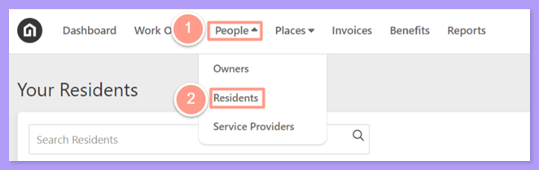
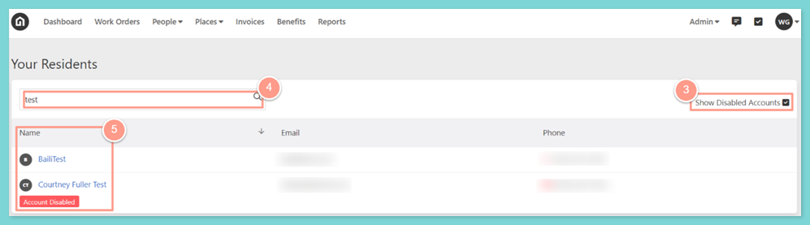
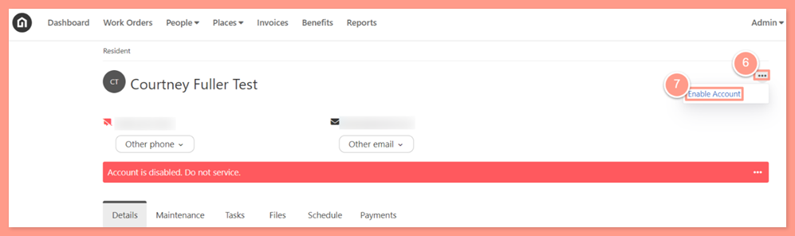
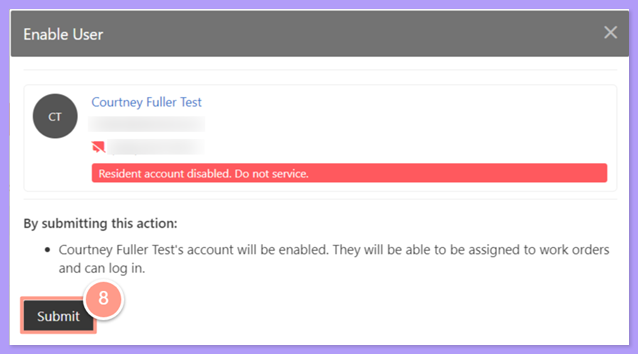
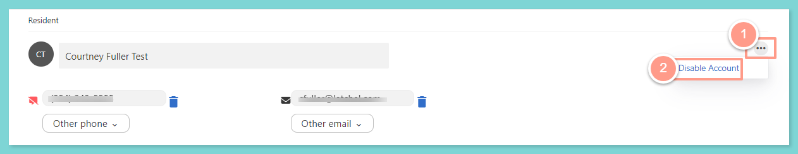
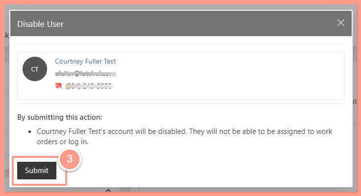

## **Searching and Enabling Residents**

<Steps>
  <Step title="**Go to People then Residents**" icon="1" iconType="sharp-solid" stepNumber={1} titleSize="p">
    From the top navigation menu click **People**, then on the dropdown select **Residents**.

    <Frame>
      
    </Frame>
  </Step>
  <Step title="**Show disabled accounts and search**" icon="2" iconType="sharp-solid" stepNumber={2} titleSize="p">
    On the residents page check the **Show Disabled Accounts** box to display all resident profiles. Now in the **Search Field**, you could use either the resident's name, email, or phone number to search for the resident's profile.
  </Step>
  <Step title="**Click the resident's name**" icon="3" iconType="sharp-solid" stepNumber={3} titleSize="p">
    Once searched, click on the **Name** of the resident.

    <Frame>
      
    </Frame>

    <Note>
      A disabled resident's account will have an **"Account Disabled"** tag displayed under their name.
    </Note>
  </Step>
  <Step title="**Select Enable Account**" icon="4" iconType="sharp-solid" stepNumber={4} titleSize="p">
    Now in the resident's profile, click on the **ellipsis icon** (three dots) across the resident's name then select **Enable Account**.

    <Frame>
      
    </Frame>
  </Step>
  <Step title="**Click Submit**" icon="5" iconType="sharp-solid" stepNumber={5} titleSize="p">
    And click **Submit**.

    <Frame>
      
    </Frame>
  </Step>
</Steps>

## **Disabling Residents**

<Steps>
  <Step title="**Select Disable Account**" icon="1" iconType="sharp-solid" stepNumber={1} titleSize="p">
    In the resident's profile, click on the **ellipsis icon** (three dots) across the resident's name then select **Disable Account**.

    <Frame>
      
    </Frame>
  </Step>
  <Step title="**Click Submit**" icon="2" iconType="sharp-solid" stepNumber={2} titleSize="p">
    And click **Submit**.

    <Frame>
      
    </Frame>

    <Note>
      This action is **only** applicable to accounts **without an integration** unless the Property Manager has provided a report with a list of residents that require a status change.
    </Note>
  </Step>
</Steps>