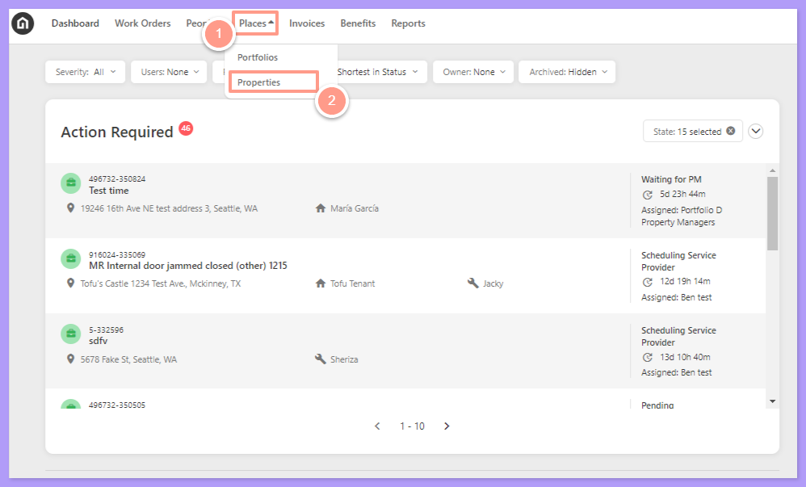
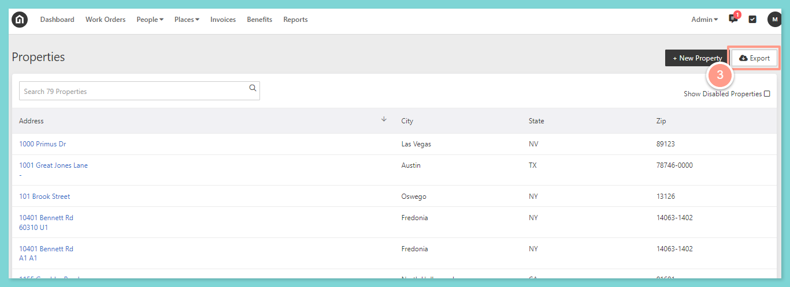
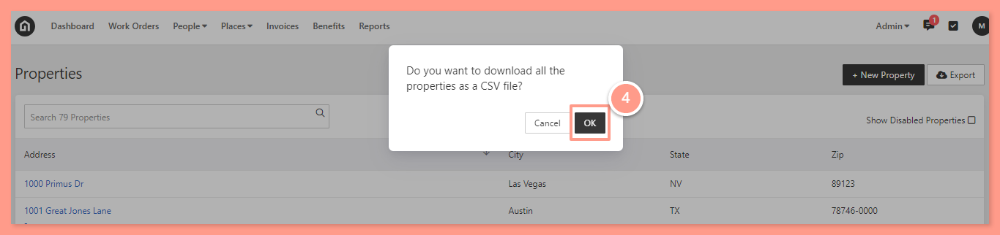

## **How to Export Properties**

<Frame>
  
</Frame>

<Steps>
  <Step title="**Click Export**" icon="1" iconType="sharp-solid" stepNumber={1} titleSize="p">
    Click **Export** in the top right corner.

    <Frame>
      
    </Frame>
  </Step>
  <Step title="**Select Ok to download the CSV**" icon="2" iconType="sharp-solid" stepNumber={2} titleSize="p">
    You'll then receive a pop-up asking if you want to download all the properties as a CSV file. Select **Ok**.

    <Frame>
      
    </Frame>

    Depending on your browser settings, either you will be asked to save the CSV file to download, or it will automatically save on your computer. Then, access the file from your computer downloads folder.
  </Step>
</Steps>
