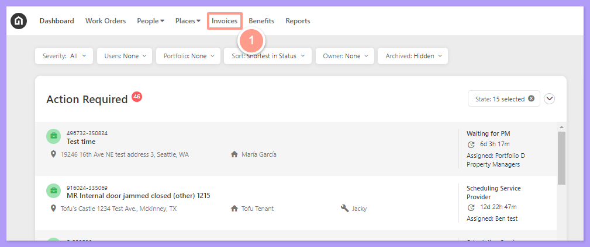
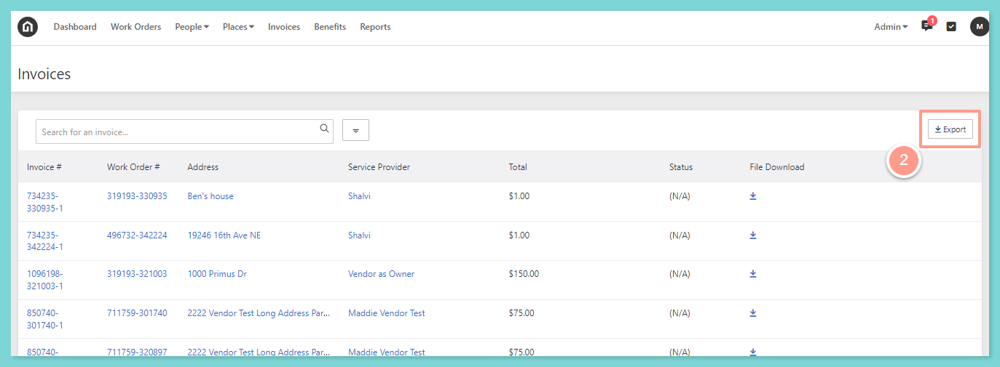
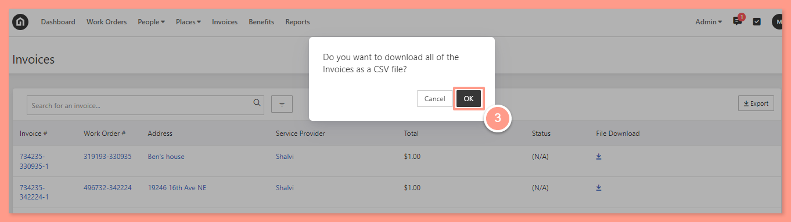

## **How to Export Your Invoice Data to a CSV**

<Steps>
  <Step title="**Click Invoices**" icon="1" iconType="sharp-solid" stepNumber={1} titleSize="p">
    From your dashboard, click on **Invoices** from the top.

    <Frame>
      
    </Frame>
  </Step>
  <Step title="**Click Export**" icon="2" iconType="sharp-solid" stepNumber={2} titleSize="p">
    Next, click **Export** in the top right corner.

    <Frame>
      
    </Frame>
  </Step>
  <Step title="**Click Ok to download the CSV**" icon="3" iconType="sharp-solid" stepNumber={3} titleSize="p">
    A pop-up will then appear asking if you want to download all of the invoices to a CSV file. Click **Ok**.

    <Frame>
      
    </Frame>
    Depending on your computer browser settings, you will be asked to save the CSV file or it will automatically download. Access the CSV file from your computer downloads folder once done downloading.
  </Step>
</Steps>
