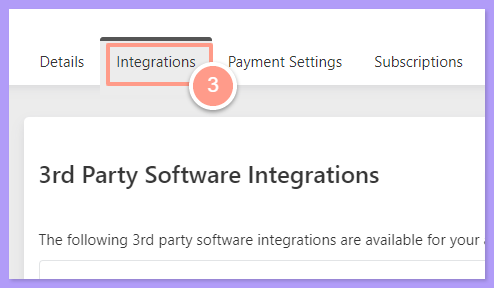
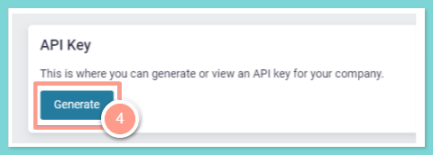
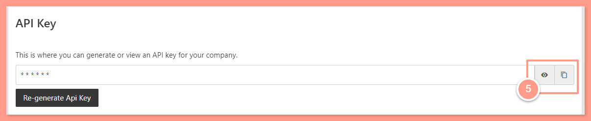
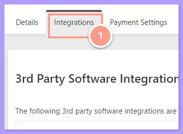
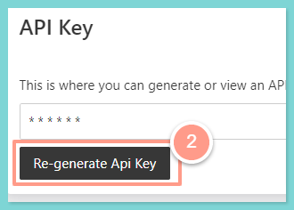
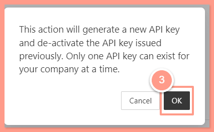

Latchel Property Managers can generate (for the first-time) or regenerate an API key right from the Latchel [console](http://app.latchel.com/)\! Keep reading to learn more.

## **How to generate an API Key for the first time?**

<Steps>
  <Step title="**Open Account Settings**" icon="1" iconType="sharp-solid" stepNumber={1} titleSize="p">
    On your Latchel dashboard click the initial icon and on the dropdown select **Account Settings.**

    <Frame>
      
    </Frame>
  </Step>
  <Step title="**Select the Integrations tab**" icon="2" iconType="sharp-solid" stepNumber={2} titleSize="p">
    Select the **Integrations** tab from the sub-navigation menu.

    <Frame>
      
    </Frame>
  </Step>
  <Step title="**Click Generate**" icon="3" iconType="sharp-solid" stepNumber={3} titleSize="p">
    Scroll down to the **API Key** panel, then select **Generate.**

    <Frame>
      
    </Frame>
  </Step>
  <Step title="**View and copy your key**" icon="4" iconType="sharp-solid" stepNumber={4} titleSize="p">
    Click on the eye symbol to view your key. You should copy your key and keep it secure.

    <Frame>
      
    </Frame>
  </Step>
</Steps>

## ****How to re-generate an API key?****

<Steps>
  <Step title="**Go to the Integrations tab**" icon="1" iconType="sharp-solid" stepNumber={1} titleSize="p">
    In the same **Integrations** tab.

    <Frame>
      
    </Frame>
  </Step>
  <Step title="**Click Re-Generate API Key**" icon="2" iconType="sharp-solid" stepNumber={2} titleSize="p">
    Scroll down to the **API Key** panel, and click **Re-Generate API Key.**

    <Frame>
      
    </Frame>
  </Step>
  <Step title="**Click OK**" icon="3" iconType="sharp-solid" stepNumber={3} titleSize="p">
    Then click **OK** to generate a new API key.

    <Frame>
      
    </Frame>
  </Step>
</Steps>