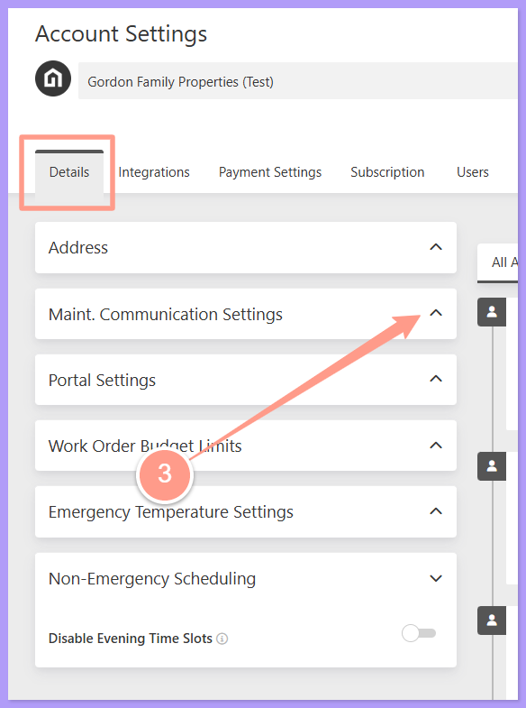
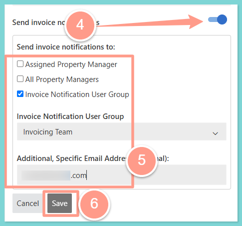

<Note>
  You can now choose which notifications you get, and whether they arrive by email, SMS, or in-app, from **Account Settings > Notifications > Notification Preferences**. Learn more in the guide below.
</Note>

<Card title="Notification Preferences" color="#ff9b8a" icon="bell-ring" iconType="duotone" href="/s/topic/0TO5e000000h9wqGAA/notification-preferences">
  Customize how and when you receive updates about work orders, residents, and team activity.
</Card>

## **How to Manage My Own Invoice Notification Settings**

<Steps>
  <Step title="**Open Account Settings**" icon="1" iconType="sharp-solid" stepNumber={1} titleSize="p">
    On the upper right corner of the Latchel dashboard, click your **user icon** and on the dropdown select **Account Settings**.

    <Frame>
      
    </Frame>
  </Step>
  <Step title="**Expand Maint. Communication Settings**" icon="2" iconType="sharp-solid" stepNumber={2} titleSize="p">
    Under the Details tab click the dropdown icon of **Maint. Communication Settings** to expand the options.

    <Frame>
      
    </Frame>
  </Step>
  <Step title="**Set invoice notifications and recipients**" icon="3" iconType="sharp-solid" stepNumber={3} titleSize="p">
    From there, you can manage the toggle option for **Send invoice notifications** and choose who should receive the notification by **checking the corresponding box** of one of the default options and/or **adding a specific email address**. Finally, click **Save**.

    <Frame>
      
    </Frame>
  </Step>
</Steps>