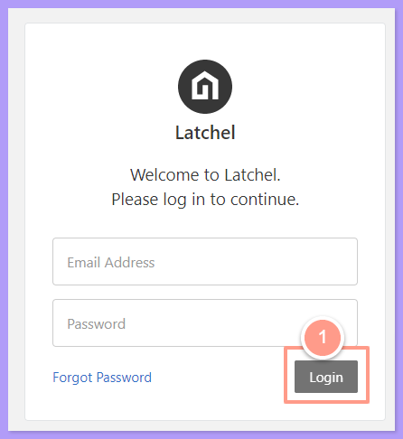
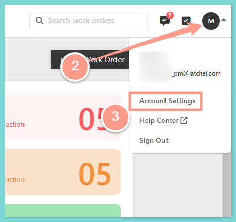
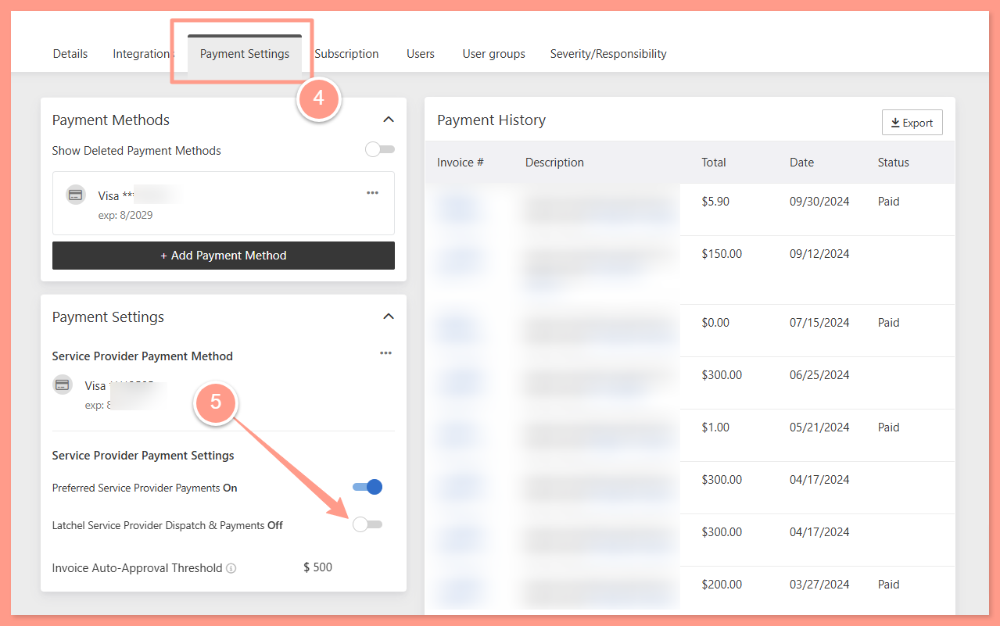
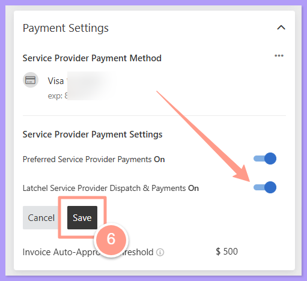

For any type of work, as a property manager you may opt-in to source new service providers if nobody from your preferred network is available to accept the job. For **emergency work orders**, the Latchel Team may source a new provider on the spot, or source someone that have previously worked within your area. For **non-emergency work orders**, the Latchel system source a new service providers, you will instantly gain access to a directory of service providers that Latchel has previously worked within your area.

If none of your preferred service providers are available for a non-emergency job, Latchel team will surface the work order for your team right away. From there, you’ll have direct access to Latchel’s list of service providers to move things along more quickly.

**_Remember to_**\_ **contact them before you officially hire them**\_. If you decide to select a service provider from Latchel’s list, make sure to set out a firm description of the scope of work to be done at the home.

Having access to Latchel’s list is a great tool to help you build up your preferred network! Let get into details on how you can opt-in to this service!

## **Licensing and Vetting of LCN Service Providers**

<Warning>
  **Latchel doesn't manage, require, or verify licensing information for Latchel Contractor Network (LCN) service providers.** The LCN works like a directory of local service providers that Latchel has found or worked with in your area. It isn't a vetted or licensed network.
</Warning>

If a job needs a licensed service provider, or your owners expect license details for the work done on their property:

- Confirm the service provider's license yourself before you hire them, or
- Assign the work to one of your preferred service providers. You can save a preferred service provider's license number and insurance details in their profile. See [**How to Add & Manage Service Providers**](/s/topic/0TO5e000000h9wqGAA/How-to-Add-Manage-Service-Providers).

To keep LCN service providers off certain types of work, limit the LCN to specific skills, as shown in the guide below.

<Card title="Setting Up Latchel Contracted Network (LCN) Preferences" color="#ff9b8a" icon="user-clock" iconType="duotone" href="/s/topic/0TO5e000000h9wqGAA/Setting-Up-Latchel-Contracted-Network-LCN-Preferences">
  Control when Latchel uses its service provider network for your work orders.
</Card>

## **How to Opt-In to the Latchel Contractor Network**

<Steps>
  <Step title="**Log into Latchel**" icon="1" iconType="sharp-solid" stepNumber={1} titleSize="p">
    Log into **[Latchel.](https://app.latchel.com/login)**

    <Frame>
      
    </Frame>
  </Step>
  <Step title="**Open Account Settings**" icon="2" iconType="sharp-solid" stepNumber={2} titleSize="p">
    Click on your initials or avatar in the upper right-hand corner of the dashboard, and click **Account Settings.**

    <Frame>
      
    </Frame>
  </Step>
  <Step title="**Turn on the dispatch toggle**" icon="3" iconType="sharp-solid" stepNumber={3} titleSize="p">
    Click the tab **Payment Settings.** In the **Payment Settings section**, click the toggle for **Latchel Service Provider Dispatch & Payments**. This will turn the toggle to blue.

    <Frame>
      
    </Frame>
  </Step>
  <Step title="**Click Save**" icon="4" iconType="sharp-solid" stepNumber={4} titleSize="p">
    Lastly, click **Save**.

    <Frame>
      
    </Frame>
  </Step>
</Steps>

Keep in mind that **a service provider payment method is needed to opt-in to Latchel Contracted Network service providers**. If there is no service provider payment method on file, you will be asked to set up a payment method. Follow the guide below to add or update your service provider payment method.

<Card title="How to Update the Service Provider Payment Method on File" color="#ff9b8a" icon="credit-card" iconType="duotone" href="/s/topic/0TO5e000000h9wqGAA/How-to-Update-the-Service-Provider-Payment-Method-on-File">
  Follow these steps to update or change the payment method saved for a service provider in your account.
</Card>
