<Steps>
  <Step title="**Open Account Settings**" icon="1" iconType="sharp-solid" stepNumber={1} titleSize="p">
    From your dashboard click your **initial icon** located at the upper right corner of the page, then select **Account Settings**.

    <Frame>
      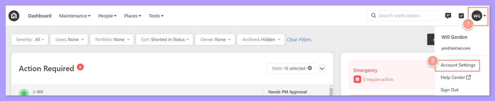
    </Frame>
  </Step>
  <Step title="**Go to Payment Settings**" icon="2" iconType="sharp-solid" stepNumber={2} titleSize="p">
    Go to the **Payment Settings** tab.

    <Frame>
      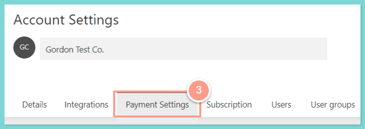
    </Frame>
  </Step>
  <Step title="**Toggle off dispatch and save**" icon="3" iconType="sharp-solid" stepNumber={3} titleSize="p">
    Then on the **Payment Settings** section under the **Service Provider Payment Settings**, toggle off the **Latchel Service Provider Dispatch & Payments** and hit **Save**.

    <Frame>
      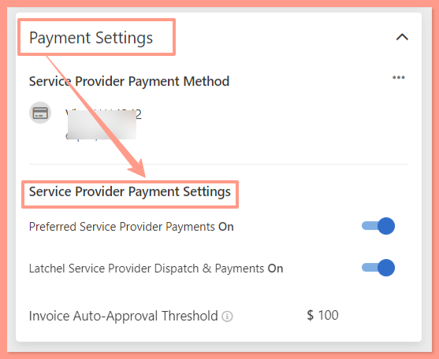
    </Frame>
     
    <Frame>
      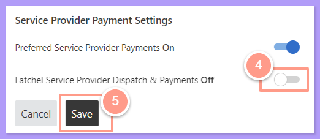
    </Frame>

    Please note that by making this change, Latchel Contracted Network service providers will no longer be assigned to work orders of any type. This may occasionally require your involvement to keep work orders moving forward smoothly. **_All work orders where the list of Preferred Service Providers has been exhausted, will be forwarded to the assigned property manager._**
  </Step>
</Steps>

In case you need to opt out from Latchel Contracted Network from specific portfolio or a property follow these steps below!

## **How to Opt-Out a Portfolio**

If you opt a portfolio out of the Latchel Contractor Network, this means that the properties added to the portfolio WILL NOT be serviced by the Latchel Contractor Network. To learn more about configuration inheritance and how a portfolio can override company-level configurations, read **[Configuration Inheritance (Property, Portfolio, & Company Level)](/s/topic/0TO5e000000h9wqGAA/Configuration-Inheritance-Property-Portfolio-Company-Level "Configuration Inheritance (Property, Portfolio, & Company Level)")**.

<Steps>
  <Step title="**Click Places then Portfolios**" icon="1" iconType="sharp-solid" stepNumber={1} titleSize="p">
    On your portal click **Places** and on the dropdown select **Portfolios**.

    <Frame>
      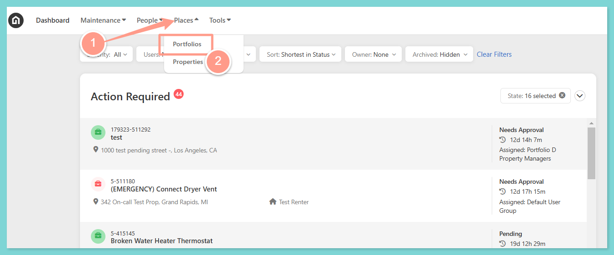
    </Frame>
  </Step>
  <Step title="**Open the portfolio**" icon="2" iconType="sharp-solid" stepNumber={2} titleSize="p">
    Search for the name of the portfolio, or scroll the portfolio list, then click the **hyperlinked portfolio name**.

    <Frame>
      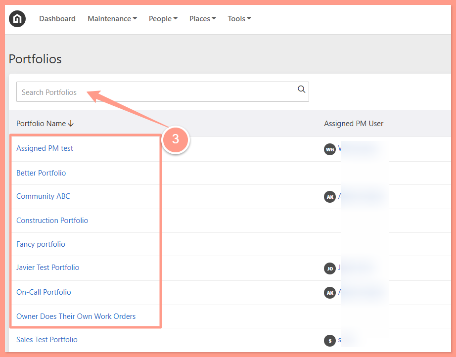
    </Frame>
  </Step>
  <Step title="**Click Override**" icon="3" iconType="sharp-solid" stepNumber={3} titleSize="p">
    From the **Payments** tab, locate the **Latchel Service Provider Dispatch & Payments** section and click **Override**. A blue toggle will appear after. 

    <Frame>
      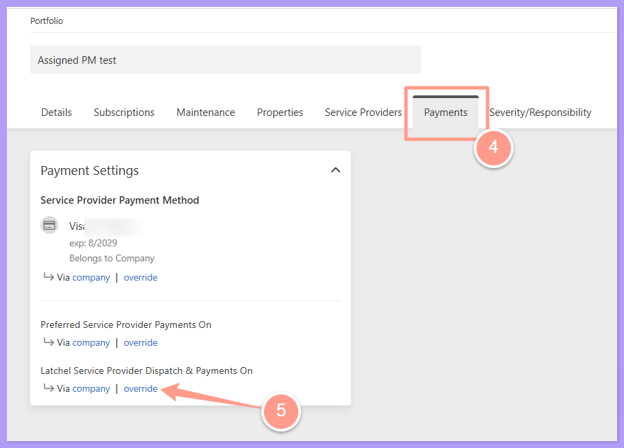
    </Frame>
  </Step>
  <Step title="**Turn off the toggle and save**" icon="4" iconType="sharp-solid" stepNumber={4} titleSize="p">
    Click the blue toggle to turn off Latchel Service Dispatch & Payments on. The blue toggle will turn to gray once turned off. Then click **Save**.

    <Frame>
      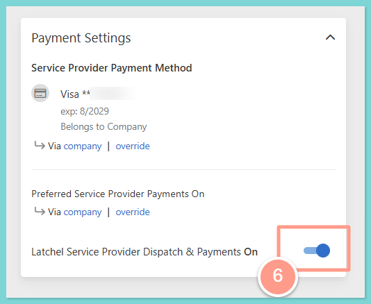
    </Frame>
    <Frame>
      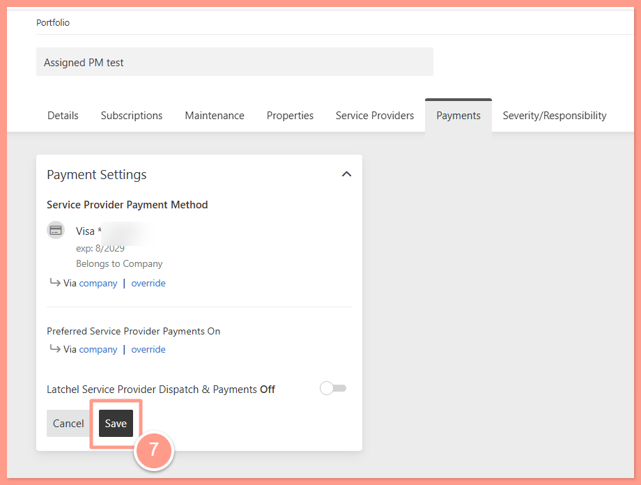
    </Frame>
  </Step>
</Steps>

## **How to Opt-Out a Property**

If only a particular property from your company or from a portfolio must be opted out from LCN, follow the steps below. Please take note that changing the settings within a property do not affect the settings of the portfolio (if the property is assigned to a portfolio) or the company. Check how this works from this help guide:

<Card title="Configuration Inheritance (Property, Portfolio, & Company Level)" color="#ff9b8a" icon="network-wired" iconType="duotone" href="/s/topic/0TO5e000000h9wqGAA/Configuration-Inheritance-Property-Portfolio-Company-Level">
  See how settings at the company, portfolio, and property levels pass down, and how to override them.
</Card>

<Steps>
  <Step title="**Go to Places then Properties**" icon="1" iconType="sharp-solid" stepNumber={1} titleSize="p">
    Search for the property from your dashboard. Go to **Places**, then select **Properties**.
    <Frame>
      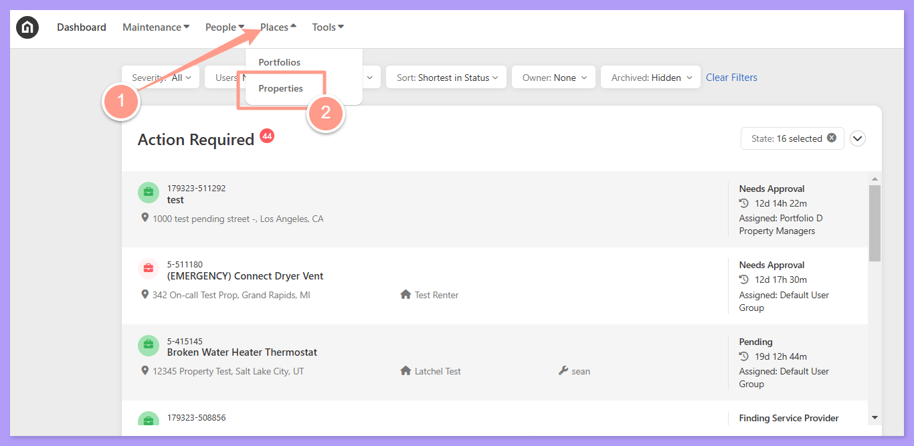
    </Frame>
  </Step>
  <Step title="**Open the property**" icon="2" iconType="sharp-solid" stepNumber={2} titleSize="p">
    Search for the property address, or scroll the property list, then click the **hyperlinked property address**.

    <Frame>
      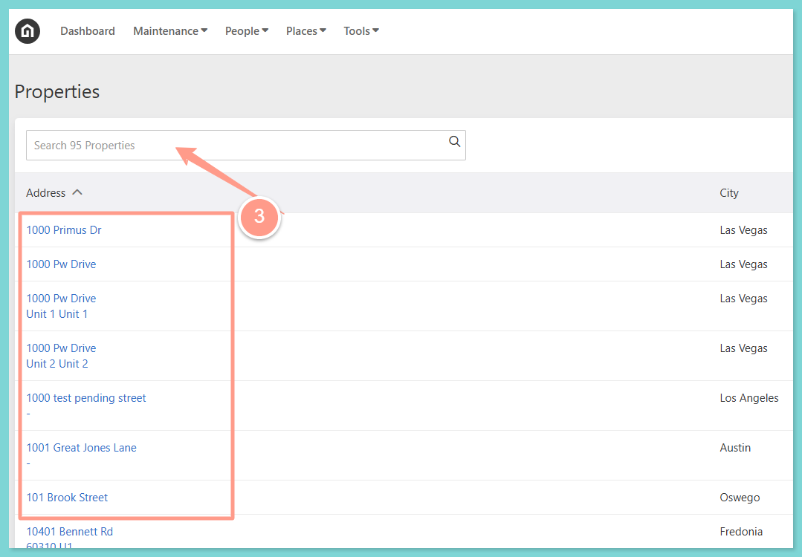
    </Frame>
  </Step>
  <Step title="**Click Override under Payments**" icon="3" iconType="sharp-solid" stepNumber={3} titleSize="p">
    Go to Payments, then click **Override** under **Latchel Service Provider Dispatch & Payments**. A blue toggle will appear.

    <Frame>
      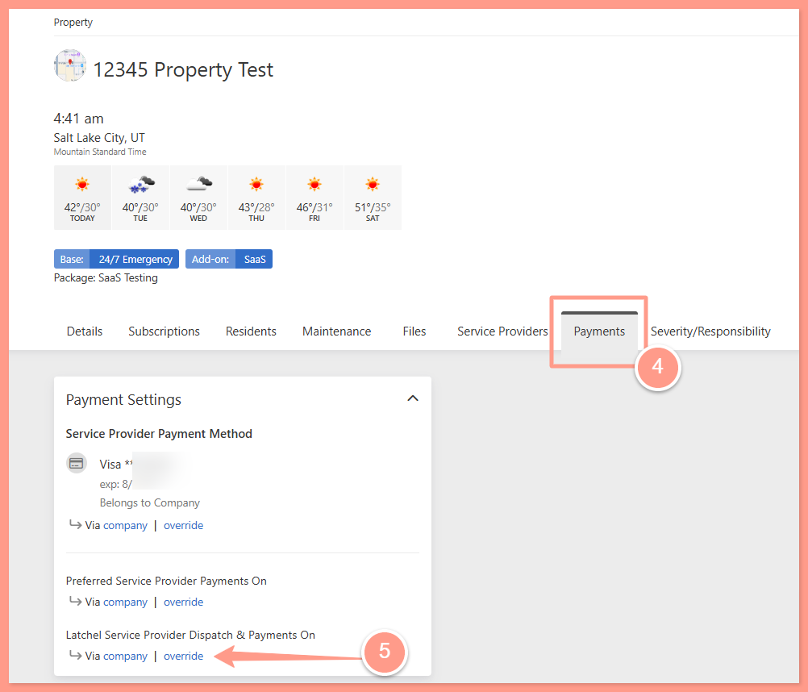
    </Frame>

    <Frame>
      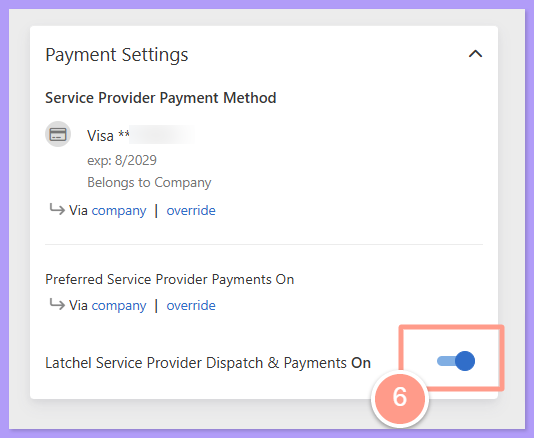
    </Frame>
  </Step>
  <Step title="**Turn off the toggle and save**" icon="4" iconType="sharp-solid" stepNumber={4} titleSize="p">
    Click the blue toggle to turn off. Then, click **Save**.

    <Frame>
      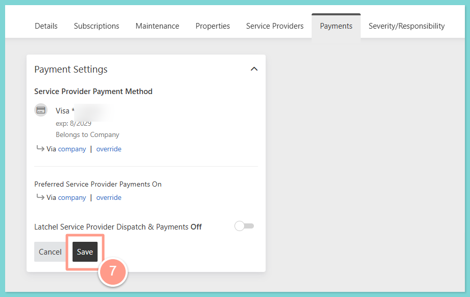
    </Frame>

    Please note that by making this change, Latchel Contracted Network service providers will no longer be assigned to work orders of any type. This may occasionally require your involvement to keep work orders moving forward smoothly. This means that _**for portfolios or properties that are opted-out from LCN, the work order will be forwarded to the property manager if the list Preferred Service Providers has been exhausted.**_
  </Step>
</Steps>
