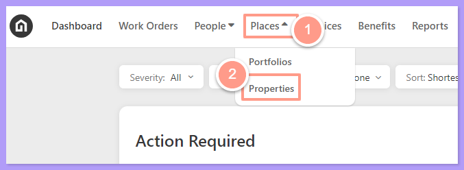
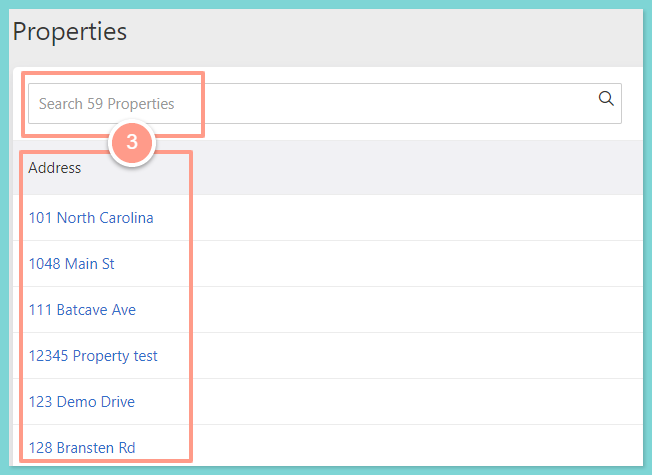
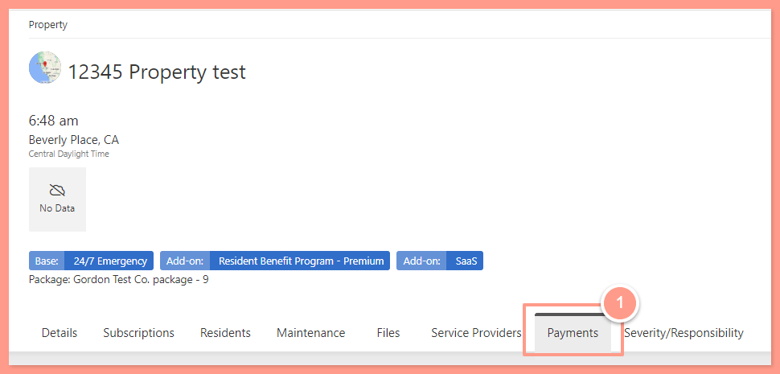
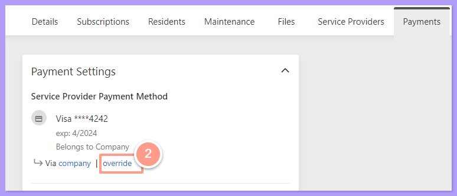
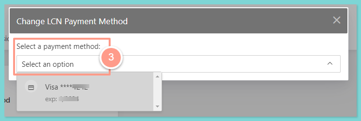
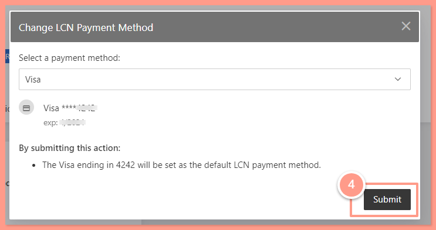
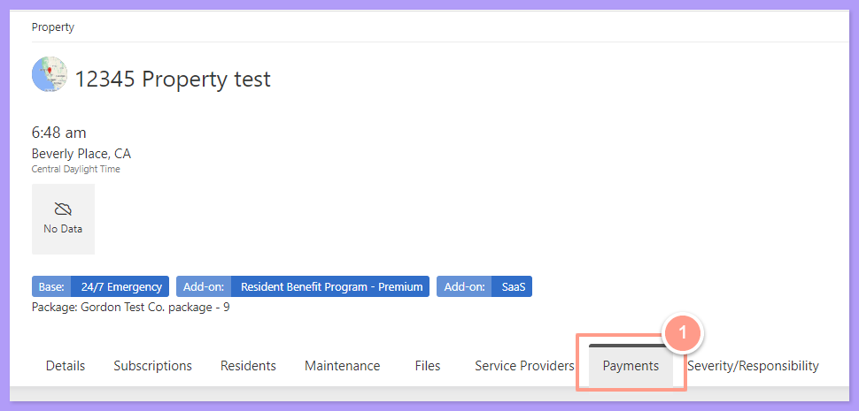
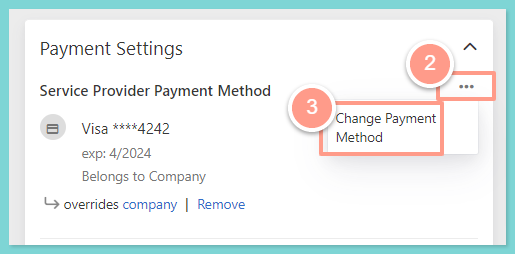
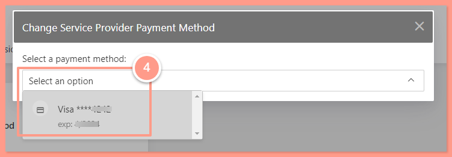
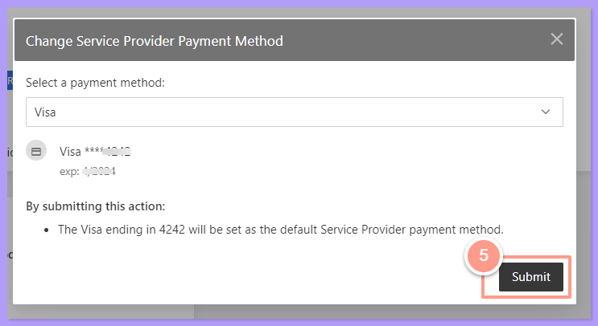

<Steps>
  <Step title="**Go to Properties**" icon="1" iconType="sharp-solid" stepNumber={1} titleSize="p">
    From your Latchel dashboard, click **Places**, then on the dropdown select **Properties**.

    <Frame>
      
    </Frame>
  </Step>
  <Step title="**Select or search for the property**" icon="2" iconType="sharp-solid" stepNumber={2} titleSize="p">
    From the property page either **select** a property on the list below or **search** the property that you need to edit.

    <Frame>
      
    </Frame>
  </Step>
</Steps>

## **Override Service Provider Payment Method**

<Steps>
  <Step title="**Go to the Payments tab**" icon="1" iconType="sharp-solid" stepNumber={1} titleSize="p">
    On the property page that you need to edit, go to the **Payments** tab.

    <Frame>
      
    </Frame>
  </Step>
  <Step title="**Click Override**" icon="2" iconType="sharp-solid" stepNumber={2} titleSize="p">
    From the Payment Settings section, click **Override** located under Service Provider Payment Method.

    <Frame>
      
    </Frame>
  </Step>
  <Step title="**Select the payment option**" icon="3" iconType="sharp-solid" stepNumber={3} titleSize="p">
    Then on the pop-up window, **select** the payment option that you want to use.

    <Frame>
      
    </Frame>
  </Step>
  <Step title="**Click Submit**" icon="4" iconType="sharp-solid" stepNumber={4} titleSize="p">
    And click **Submit.**

    <Frame>
      
    </Frame>
  </Step>
</Steps>

## **Change Service Provider Payment Method**

<Steps>
  <Step title="**Go to the Payments tab**" icon="1" iconType="sharp-solid" stepNumber={1} titleSize="p">
    On the property page that you need to edit, go to the **Payments** tab.

    <Frame>
      
    </Frame>
  </Step>
  <Step title="**Select Change Payment Method**" icon="2" iconType="sharp-solid" stepNumber={2} titleSize="p">
    Under the Payment Settings section, click the **ellipsis icon** of the Service Provider Payment Method and then select **Change Payment Method**.

    <Frame>
      
    </Frame>
  </Step>
  <Step title="**Select the payment option**" icon="3" iconType="sharp-solid" stepNumber={3} titleSize="p">
    Then on the pop-up window, **select** the payment option that you want to use.

    <Frame>
      
    </Frame>
  </Step>
  <Step title="**Click Submit**" icon="4" iconType="sharp-solid" stepNumber={4} titleSize="p">
    And click **Submit**.

    <Frame>
      
    </Frame>
  </Step>
</Steps>