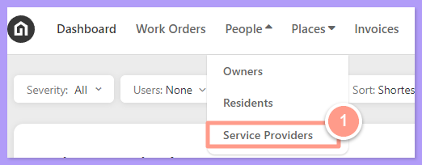
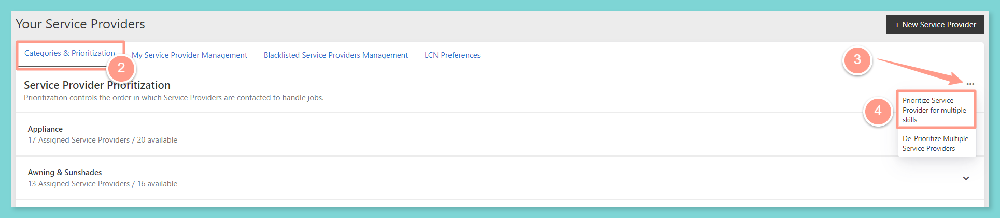
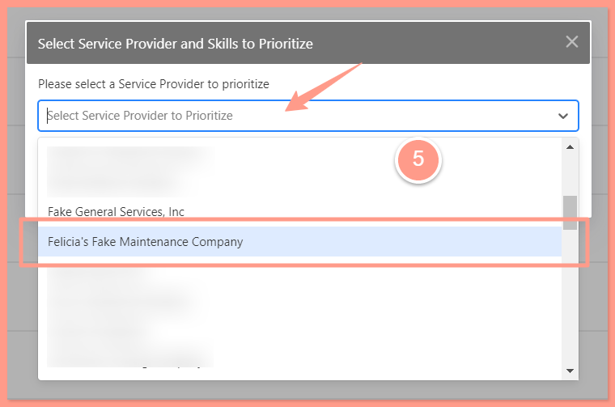
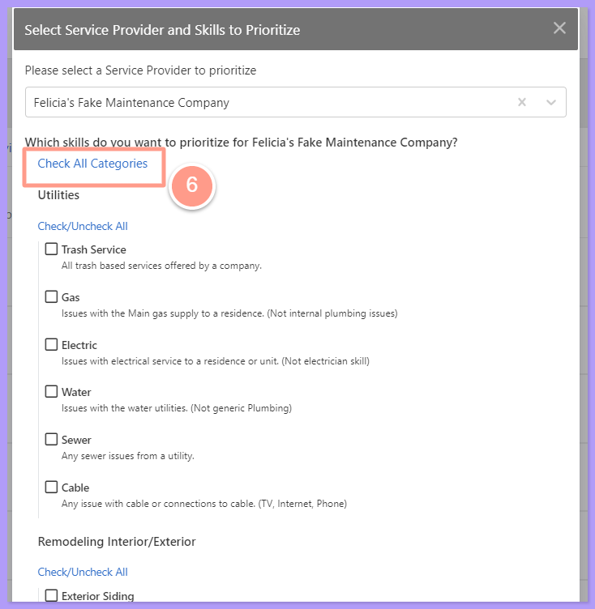
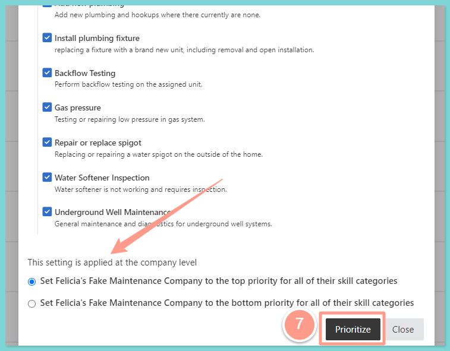
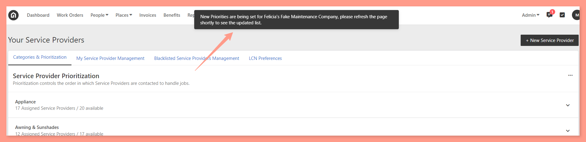

* Global or company settings
* Portfolio
* Property

## **How to Prioritize a Preferred Service Provider for Multiple Skills**

<Steps>
  <Step title="**Click People then Service Providers**" icon="1" iconType="sharp-solid" stepNumber={1} titleSize="p">
    From the main dashboard page, click on **People** then **Service Providers**.

    <Frame>
      
    </Frame>
  </Step>
  <Step title="**Choose Prioritize for multiple skills**" icon="2" iconType="sharp-solid" stepNumber={2} titleSize="p">
    Once on the Service Provider page, under **Categories & Prioritization**, click on the **ellipsis** and choose **Prioritize Service Provider for multiple skills.**

    <Frame>
      
    </Frame>
  </Step>
  <Step title="**Choose the service provider**" icon="3" iconType="sharp-solid" stepNumber={3} titleSize="p">
    A pop-up box will appear, choose the service provider that you wish to be modified by searching the name of the preferred service provider or scrolling through the list.

    <Frame>
      
    </Frame>
  </Step>
  <Step title="**Click Check All Categories**" icon="4" iconType="sharp-solid" stepNumber={4} titleSize="p">
    Previously, all categories must be checked one by one to add the skills to the service provider. Say goodbye to this because there is now an option to **Check All Categories**. This saves more time and effort in updating, changing, or managing your preferred service provider's skills. Simply click **Check All Categories** and viola! All subskills will be checked!

    <Frame>
      
    </Frame>
  </Step>
  <Step title="**Choose the priority level**" icon="5" iconType="sharp-solid" stepNumber={5} titleSize="p">
    Next, choose how you want the preferred service provider to be prioritized at the level:

    * to the **TOP** priority for all of their skill category
    * to the **BOTTOM** priority for all of their skill category
  </Step>
  <Step title="**Click Prioritize**" icon="6" iconType="sharp-solid" stepNumber={6} titleSize="p">
    Click **Prioritize** to save the changes you made.

    <Frame>
      
    </Frame>

    A pop-up box will appear at the top of the page announcing new priorities that have been set for the chosen service provider.

    <Frame>
      
    </Frame>
  </Step>
</Steps>

<Info>
  **NOTE:** _Prioritizing service providers for multiple skills can be done via Property Manager Profile and Admin access on Company, Property, and Portfolio levels. As an admin or property manager user, it is best to check first the inheritance setup to understand where the changes could be applied._
</Info>
