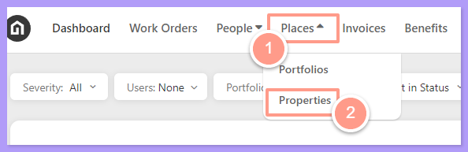
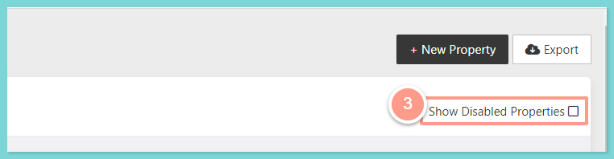
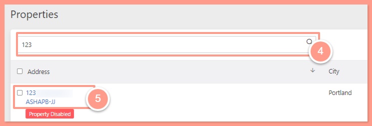
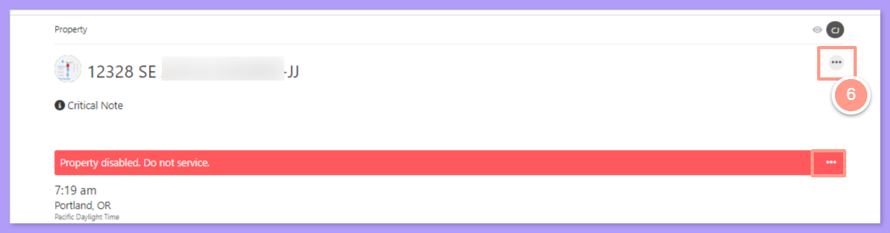
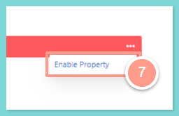
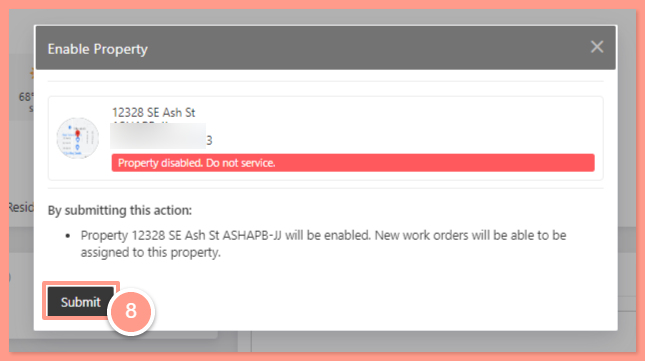
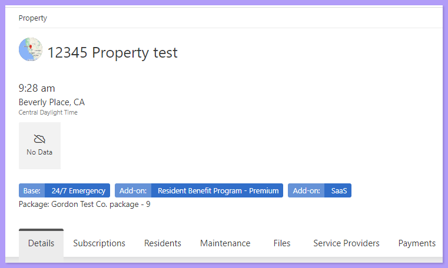

## **How to Re-Enable a Property**

<Steps>
  <Step title="**Go to Places then Properties**" icon="1" iconType="sharp-solid" stepNumber={1} titleSize="p">
    On the upper left-hand side of your page, click on the **Places** tab and select **Properties.**

    <Frame>
      
    </Frame>
  </Step>
  <Step title="**Click Show Disabled Properties**" icon="2" iconType="sharp-solid" stepNumber={2} titleSize="p">
    Once you are on the Properties page, click on **Show Disabled Properties.**

    <Frame>
      
    </Frame>
  </Step>
  <Step title="**Search for and open the property**" icon="3" iconType="sharp-solid" stepNumber={3} titleSize="p">
    Select the property you want to re-enable using the **search bar**. Then, click the hyperlinked property address once it shows.

    <Frame>
      
    </Frame>
  </Step>
  <Step title="**Click the three dots**" icon="4" iconType="sharp-solid" stepNumber={4} titleSize="p">
    From the property page, click the **three dots** at the upper-right corner of the page.

    <Frame>
      
    </Frame>
  </Step>
  <Step title="**Click Enable Property**" icon="5" iconType="sharp-solid" stepNumber={5} titleSize="p">
    Click on **Enable Property.**

    <Frame>
      
    </Frame>
  </Step>
  <Step title="**Click Submit**" icon="6" iconType="sharp-solid" stepNumber={6} titleSize="p">
    Click **Submit** to save.

    <Frame>
      
    </Frame>

    That's it\! The property is now **Enabled**.

    <Frame>
      
    </Frame>
  </Step>
</Steps>
