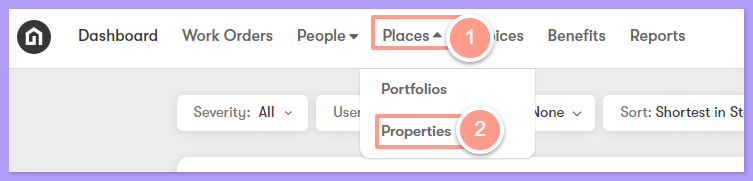
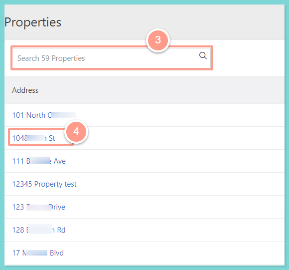
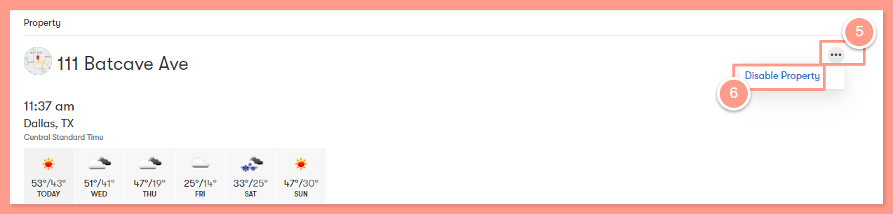
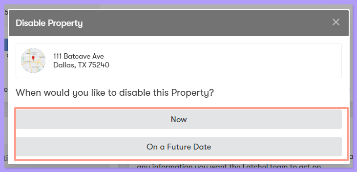
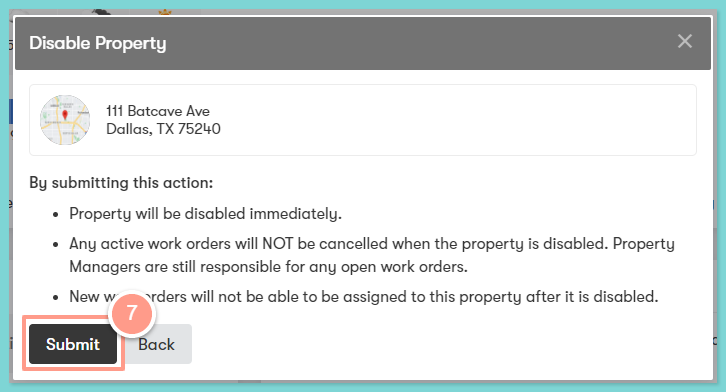
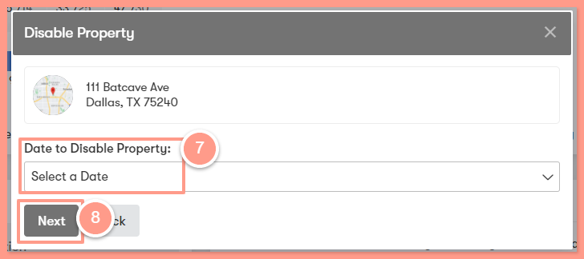
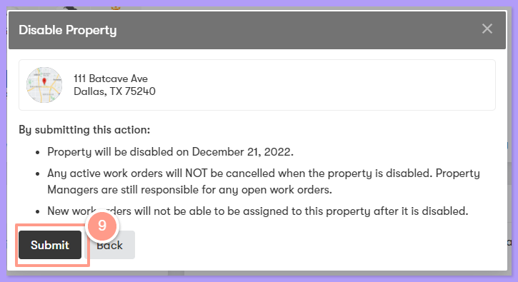

**There are 2 ways to remove a property:**

- **Now**: removes the property immediately.
- **On a Future Date**: removes the property on the date you will set.

## **How to Remove a Property**

<Steps>
  <Step title="**Go to Places then Properties**" icon="1" iconType="sharp-solid" stepNumber={1} titleSize="p">
    On the upper left-hand side of your dashboard, click **Places** then select **Properties.**

    <Frame>
      
    </Frame>
  </Step>
  <Step title="**Search for the property and click it**" icon="2" iconType="sharp-solid" stepNumber={2} titleSize="p">
    Search for the property and click it.

    <Frame>
      
    </Frame>
  </Step>
  <Step title="**Select Disable Property**" icon="3" iconType="sharp-solid" stepNumber={3} titleSize="p">
    On the upper right-hand side, click the **3 horizontal dots**, and select **Disable Property.**

    <Frame>
      
    </Frame>
  </Step>
  <Step title="**Choose Now or On a Future Date**" icon="4" iconType="sharp-solid" stepNumber={4} titleSize="p">
    You have two options to disable the property by selecting **Now**, or **On a Future Date**.

    <Frame>
      
    </Frame>

    **Option 1**. If you select **Now**, click **Submit** to save. This disables the property **immediately.**

    <Frame>
      
    </Frame>

    **Option 2**. If you select **On a Future Date,** please set your desired date on when the property should be disabled. Click **Next** then **Submit** to save. **Once the date you selected arrives, the property will be automatically disabled**.

    <Frame>
      
    </Frame>

    <Frame>
      
    </Frame>
  </Step>
</Steps>
