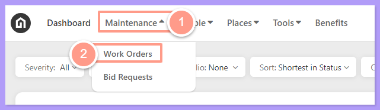
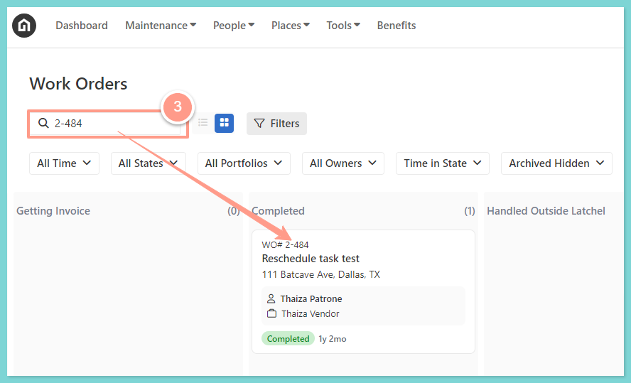
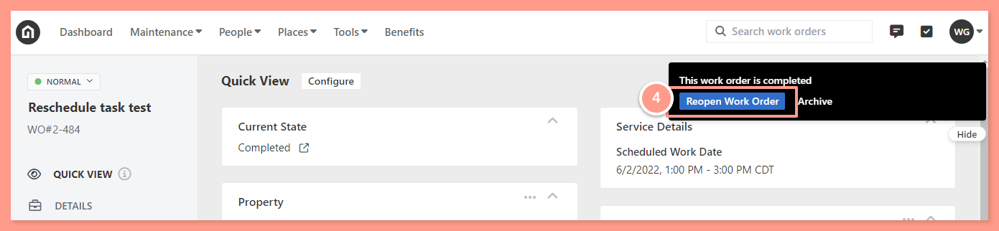
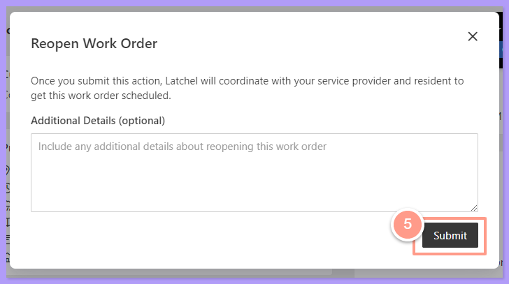
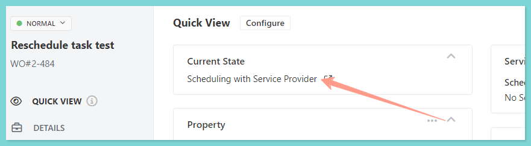

## **How to Reopen a Work Order**

<Frame>
  
</Frame>

<Steps>
  <Step title="**Search for the completed work order**" icon="1" iconType="sharp-solid" stepNumber={1} titleSize="p">
    From the work order page, **Search** for the completed work order that you want to reopen.

    <Frame>
      
    </Frame>
  </Step>
  <Step title="**Click Reopen Work Order**" icon="2" iconType="sharp-solid" stepNumber={2} titleSize="p">
    Once you are on the work order page, just click the **Reopen Work Order** option in the notification located in the right-hand corner of the page.

    <Frame>
      
    </Frame>
  </Step>
  <Step title="**Add details and submit**" icon="3" iconType="sharp-solid" stepNumber={3} titleSize="p">
    Then a pop-up window will appear, from there you can add some additional details or just hit **Submit** and you're done.

    <Frame>
      
    </Frame>
  </Step>
  <Step title="**Check the new status**" icon="4" iconType="sharp-solid" stepNumber={4} titleSize="p">
    After initiating the work order update, you can verify its status to confirm the changes. The work order will now move to **Rescheduling Resident** or **Scheduling Service Provider** status.

    <Frame>
      
    </Frame>
  </Step>
</Steps>