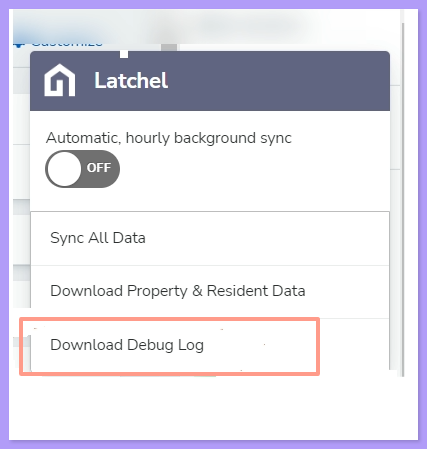

In the event of running our software or data sync tools, if you come across a bug or if the tool gets stuck, please report it to us so we can continue to improve your experience with our product.

<Steps>
  <Step title="**Open your Property Management System**" icon="1" iconType="sharp-solid" stepNumber={1} titleSize="p">
    First, you will need to open your Property Management System to use the tool.
  </Step>
  <Step title="**Download the debug log**" icon="2" iconType="sharp-solid" stepNumber={2} titleSize="p">
    The Latchel data sync has a debug tool that inspects each action taken on a page and shows the issues found. To open that tool, click on the floating Latchel logo on your Property Management System dashboard and select "**download debug log**" from the dropdown menu.

    <Frame>
      
    </Frame>
  </Step>
</Steps>

## **Share it with us**

The file you downloaded will be automatically saved to your computer downloads.

<Steps>
  <Step title="**Email the file to Customer Success**" icon="1" iconType="sharp-solid" stepNumber={1} titleSize="p">
    Go to your email account to send this file via email to the Customer Success team - [success@latchel.com](mailto:success@latchel.com)
  </Step>
  <Step title="**Describe the issue in the email**" icon="2" iconType="sharp-solid" stepNumber={2} titleSize="p">
    In the body of the email, please provide a short description of what has happened and let us know where you are experiencing this issue. Please also paste the link to your video (press Ctrl V). See below a template you can use to submit your issue:

    **Template:**

    * My name:
    * This is what I was trying to do:
    * This is what happened:
    * This is where I experienced the issue (include the link to the webpage):
    * This is the link to the screen recording:
    * If you have questions, use this contact information:
  </Step>
</Steps>
