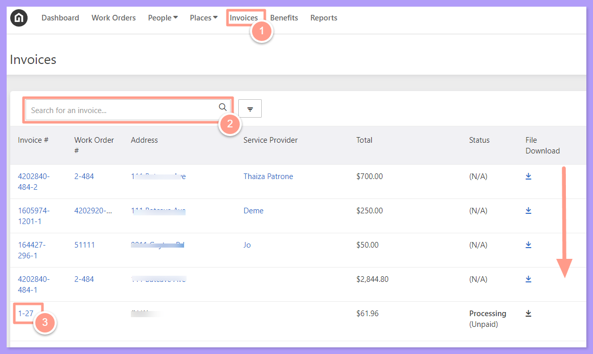
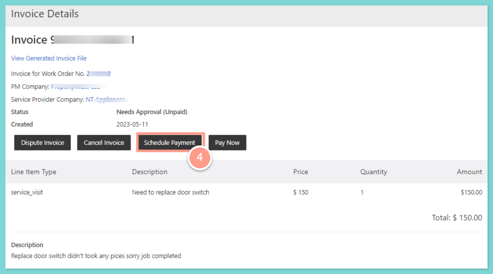
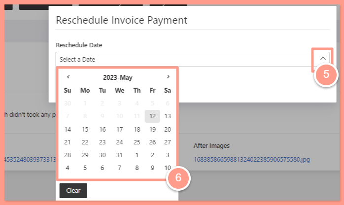
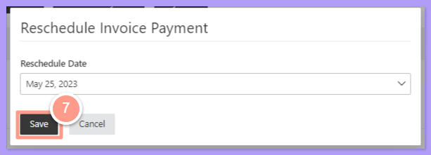

## **How to Schedule Service Provider Payments in Future Date**

<Steps>
  <Step title="**Open the invoice**" icon="1" iconType="sharp-solid" stepNumber={1} titleSize="p">
    From the dashboard, choose **Invoices**. Property Managers can search for the invoice number, use the filter, or **scroll down** to click the **invoice number** they wish to schedule a payment. 

    <Frame>
      
    </Frame>
  </Step>
  <Step title="**Click Schedule Payment**" icon="2" iconType="sharp-solid" stepNumber={2} titleSize="p">
    From the invoice details, click on **Schedule Payment**

    <Frame>
      
    </Frame>
  </Step>
  <Step title="**Choose the payment date**" icon="3" iconType="sharp-solid" stepNumber={3} titleSize="p">
    A pop-up box will appear, Property Manager may click on the arrow up for the calendar to appear and choose the desired date to schedule a payment.

    <Frame>
      
    </Frame>
  </Step>
  <Step title="**Click Save**" icon="4" iconType="sharp-solid" stepNumber={4} titleSize="p">
    Click on **Save** for the changes to proceed.

    <Frame>
      
    </Frame>
  </Step>
</Steps>
