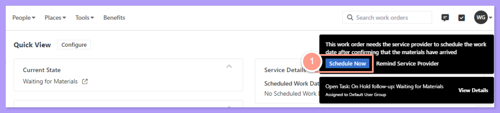
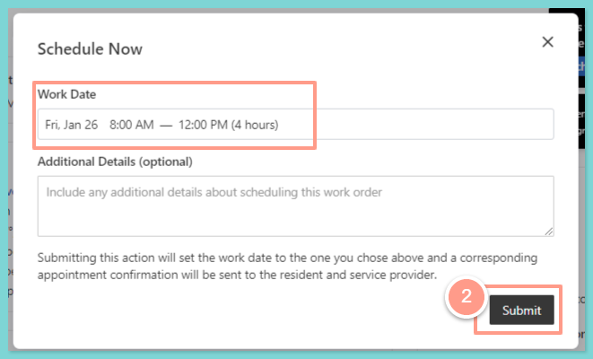
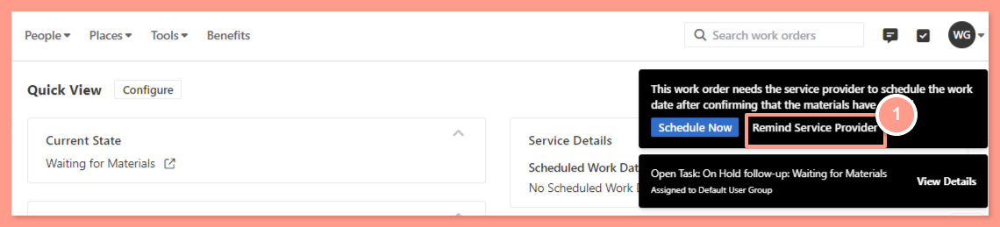

## **Schedule Now**

<Steps>
  <Step title="**Click Schedule Now**" icon="1" iconType="sharp-solid" stepNumber={1} titleSize="p">
    From the work order page click **Schedule Now** located at the top right corner.

    <Frame>
      
    </Frame>
  </Step>
  <Step title="**Adjust the work date and submit**" icon="2" iconType="sharp-solid" stepNumber={2} titleSize="p">
    Adjust the date and time of the work date if needed, then hit **Submit.**

    <Frame>
      
    </Frame>
  </Step>
</Steps>

## **Remind Service Provider**

<Steps>
  <Step title="**Click Remind Service Provider**" icon="1" iconType="sharp-solid" stepNumber={1} titleSize="p">
    If you have no idea about the availability of the service provider, click the **Remind Service Provider** on the upper right corner of the page.

    <Frame>
      
    </Frame>
  </Step>
  <Step title="**Add details and click Send**" icon="2" iconType="sharp-solid" stepNumber={2} titleSize="p">
    From here you could add some additional details, or just hit the **Send** button.

    <Frame>
      
    </Frame>
  </Step>
</Steps>

And that's how you can update a work order on a waiting for materials status\!

**Are you looking for a guide on how to update resident's availability on a work order? Check out this help guide:** [**How to Update the Resident's Availability**](/s/topic/0TO5e000000h9wqGAA/How-to-Update-the-Resident-s-Availability)