## **Pre-Requisites Before Setting Up**

Before starting, confirm that both prerequisites below are in place. Without them, contact rotations will not be available or function correctly.

1. **On-Call package is active (for on-call use only)**

Contact rotations are available to all Latchel customers. If you plan to use a rotation for the on-call feature specifically, your company must also be subscribed to the **ER-SaaS-RBP** with the **"On-Call"** package. If you're unsure whether this applies to your account, reach out to your Customer Success Manager.

2. **Service providers are marked as in-house**

Any service providers you want to add to a rotation must have the **"in-house"** toggle enabled on their profile for the PM company. Technicians without this setting will not appear as selectable in the rotation layer setup.

## **Setting Up the Contact Rotation**

<Steps>
  <Step title="**Go to Tools and choose Contact Rotations**" icon="1" iconType="sharp-solid" stepNumber={1} titleSize="p">
    From your dashboard, go to the **Tools** tab, then choose **Contact Rotations**.

    <Frame>
      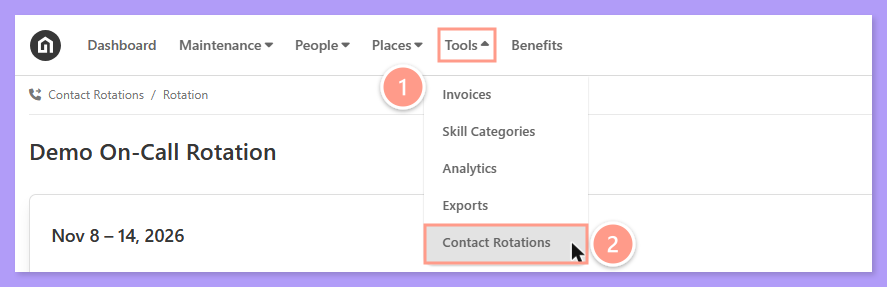
    </Frame>
  </Step>
  <Step title="**Create and name the rotation**" icon="2" iconType="sharp-solid" stepNumber={2} titleSize="p">
    On the next page, click **Create New**, then **give the rotation a clear, descriptive name** (e.g., "Emergency Maintenance" or "Parking Issues"). Click **OK** once done.

    <Frame>
      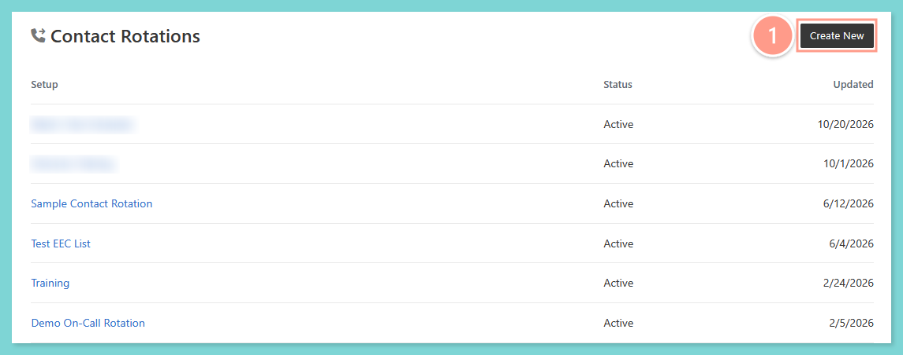
    </Frame>

    <Frame>
      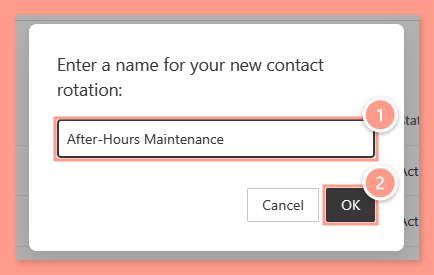
    </Frame>
  </Step>
  <Step title="**Click Add Layers or the pencil icon**" icon="3" iconType="sharp-solid" stepNumber={3} titleSize="p">
    In the new rotation, click **Add Layers** or the **pencil icon** at the right upper corner of the page to start setting up the schedules.

    <Frame>
      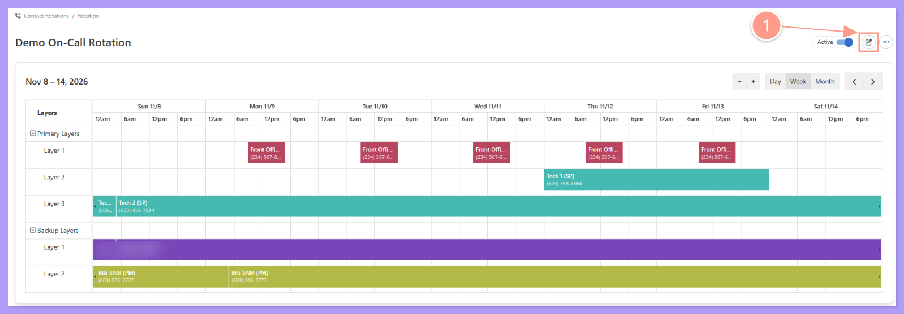
    </Frame>
  </Step>
  <Step title="**Add a tech or backup layer**" icon="4" iconType="sharp-solid" stepNumber={4} titleSize="p">
    In the Layers tab, click either **\+Add Primary Layer** or **\+Add Backup Layer**.

    <Note>
      **What are Layers?**

      - **Primary Layers (formerly Tech Layers) or First Responders** - The people who respond first. A primary layer can include either service providers (SPs) or property managers (PMs), and each person is labeled by type. Multiple layers allow for shift coverage and escalation.
      - **Backup Layers or Escalation Contacts** - Property managers or staff who should be notified if technicians don't respond. The safety net for critical situations.
    </Note>

    <Frame>
      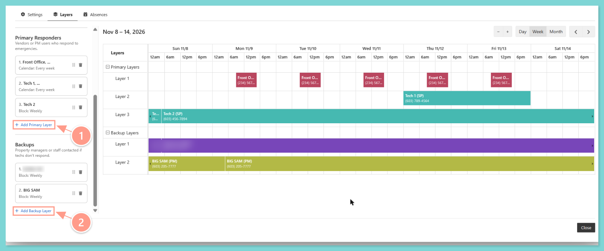
    </Frame>

    <Tip>
      Start with a primary layer to define your main contact schedule, then add a backup layer for peace of mind.
    </Tip>
  </Step>
  <Step title="**Select the rotation type and click Add Layer**" icon="5" iconType="sharp-solid" stepNumber={5} titleSize="p">
    Select the **rotation type**, then click **Add Layer**.

    <Note>
      **Rotation Types:**

      - **Calendar rotation** - Coverage for specific times and days
      - **Block rotation** - 24/7 continuous coverage
    </Note>

    <Frame>
      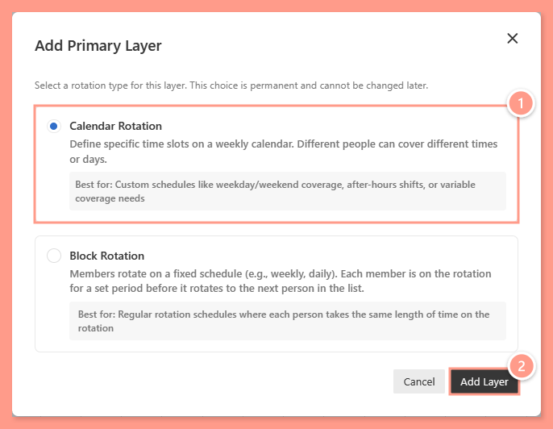
    </Frame>
  </Step>
</Steps>

### **A. Setup Calendar Rotation**

<Steps>
  <Step title="**Click and drag on an empty day**" icon="1" iconType="sharp-solid" stepNumber={1} titleSize="p">
    Next, click and drag on any **empty day** to open the **Add Time Slot** window.

    <Frame>
      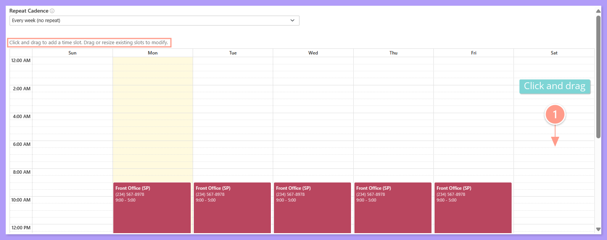
    </Frame>
  </Step>
  <Step title="**Select the technician and set the time slot**" icon="2" iconType="sharp-solid" stepNumber={2} titleSize="p">
    Select the **technician** (or backup) from the **dropdown**, or click **\+Create primary responder** if they are not yet listed. Then, **set the day and start and end times** for the schedule. Click **Add** to save.

    <Note>
      **Adding people is easier now.** The Add Member window lets you search by name or phone number, and filter the results to service providers only or property managers only. If the person isn't listed, you can create them as either a service provider or a property manager. You can't create someone with a phone number that's already in Latchel. Pick the existing person instead.
    </Note>

    <Frame>
      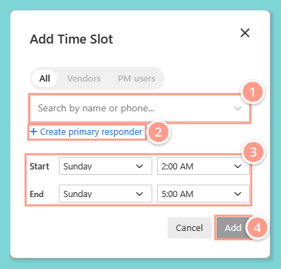
    </Frame>
  </Step>
  <Step title="**Repeat for each scheduled day**" icon="3" iconType="sharp-solid" stepNumber={3} titleSize="p">
    **Repeat these steps** for each day you want the technician scheduled on the rotation.

    <Warning>
      Make sure that the service provider you want to include on the contact rotation is set up with **In-House** billing.

      **Need help in setting up your service provider as In-house?** Check the help guide below.

      <Card title="Navigating Your Preferred Service Provider's Profile" color="#ff9b8a" icon="users-gear" iconType="duotone" href="s/topic/0TO5e000000h9wqGAA/How-to-Navigate-Preferred-Service-Providers-Profiles">
        Learn how to navigate your service provider details and make changes easily.
      </Card>
    </Warning>
  </Step>
  <Step title="**Adjust the Repeat Cadence**" icon="4" iconType="sharp-solid" stepNumber={4} titleSize="p">
    Finally, adjust the **Repeat Cadence**. This will set how often the weekly schedule repeats.

    <Frame>
      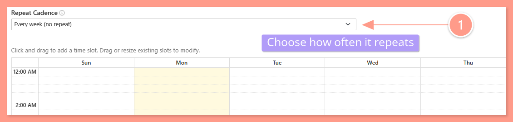
    </Frame>
  </Step>
</Steps>

### **B. Setup Block Rotation**

<Steps>
  <Step title="**Choose Block Rotation and click Add Layer**" icon="1" iconType="sharp-solid" stepNumber={1} titleSize="p">
    Choose **Block Rotation**, then click **Add Layer**.

    <Frame>
      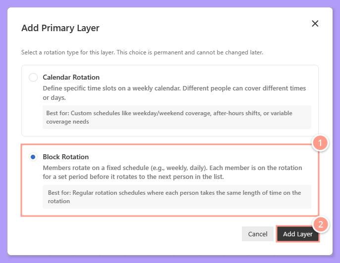
    </Frame>
  </Step>
  <Step title="**Select the technician and set the rotation**" icon="2" iconType="sharp-solid" stepNumber={2} titleSize="p">
    Under **Members**, click **\+Add member** to select the **Technician (or Backup)**, or create them (or a PM User if Backup Layer) if the person is not yet added in Latchel. Primary layers accept either service providers or property managers, but backups must still be property managers. Also setup the **Rotation Frequency**, and **Handoff Time**.

    <Tip>
      For **Rotation Frequency**, you can select the number of **days or weeks**. If the frequency is set to weeks, the **Handoff Time** will require you to **choose the day of the week** when the next person will be scheduled to be called.
    </Tip>

    <Frame>
      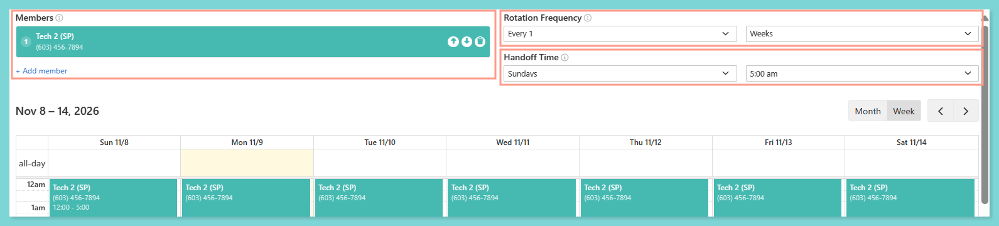
    </Frame>
  </Step>
  <Step title="**Click Close**" icon="3" iconType="sharp-solid" stepNumber={3} titleSize="p">
    When finished setting up your new contact rotation, click **Close** at the bottom of the screen. The new contact rotation will show on your screen.

    <Frame>
      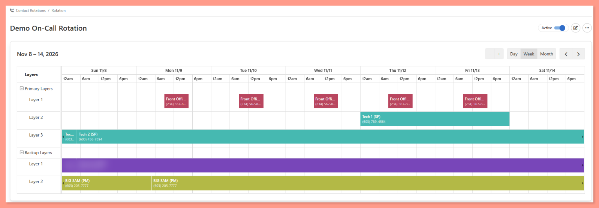
    </Frame>
  </Step>
</Steps>

## **Editing an Existing Contact Rotation**

Use these steps to add people, adjust schedules, or add new layers to a rotation you already created.

<Steps>
  <Step title="**Go to Tools and choose Contact Rotations**" icon="1" iconType="sharp-solid" stepNumber={1} titleSize="p">
    From your dashboard, go to the **Tools** tab, then choose **Contact Rotations**.

    <Frame>
      
    </Frame>
  </Step>
  <Step title="**Open the rotation and click Edit**" icon="2" iconType="sharp-solid" stepNumber={2} titleSize="p">
    **Open the rotation** you want to change, then click **Edit** or the **pencil icon** at the right upper corner of the page.

    <Frame>
      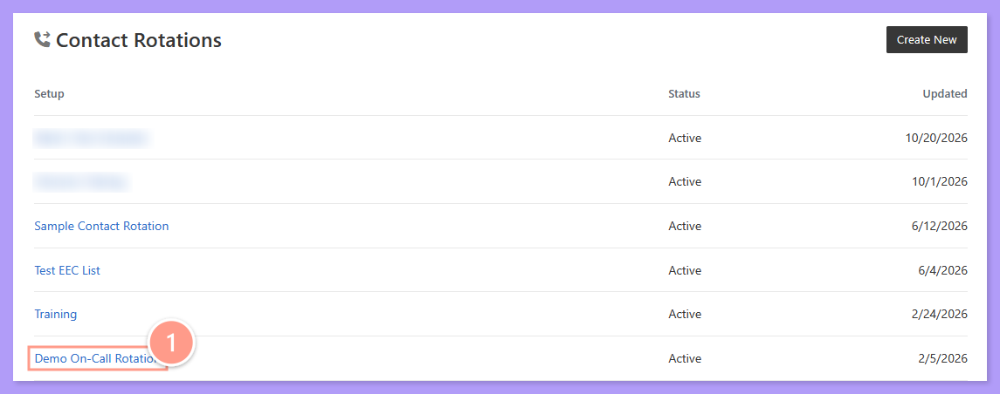
    </Frame>

    <Frame>
      
    </Frame>
  </Step>
  <Step title="**Make your changes in the Layers tab**" icon="3" iconType="sharp-solid" stepNumber={3} titleSize="p">
    In the **Layers** tab, make your changes:

    - **To add a new layer**, click **\+Add Primary Layer** or **\+Add Backup Layer**, then follow the [Calendar Rotation](#setting-up-the-contact-rotation) or Block Rotation steps above.
    - **To add a technician to a calendar layer**, click and drag on an **empty day** to open the **Add Time Slot** window. Select the technician, set the day and start and end times, then click **Add**.
    - **To change a block layer**, update the **Technician (or Backup)**, **Rotation Frequency**, or **Handoff Time**.
    - **To change how often a calendar schedule repeats**, adjust the **Repeat Cadence**.
  </Step>
  <Step title="**Click Close**" icon="4" iconType="sharp-solid" stepNumber={4} titleSize="p">
    When you finish, click **Close** at the bottom of the screen to return to the rotation.

    <Tip>
      If a technician is only out for a short time, you don't need to edit the rotation. Record an absence instead and pick a substitute. See the guide below.
    </Tip>

    <Card title="Setting Up Absences" color="#ff9b8a" icon="calendar-users" iconType="duotone" href="/s/topic/0TO5e000000h9wqGAA/setting-up-absences">
      Record time off and assign a substitute so alerts are not missed.
    </Card>
  </Step>
</Steps>
