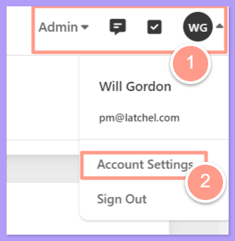
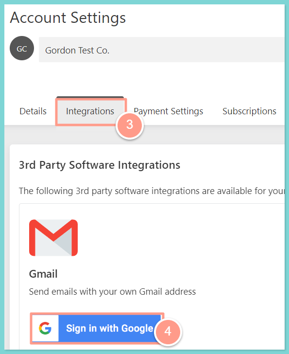
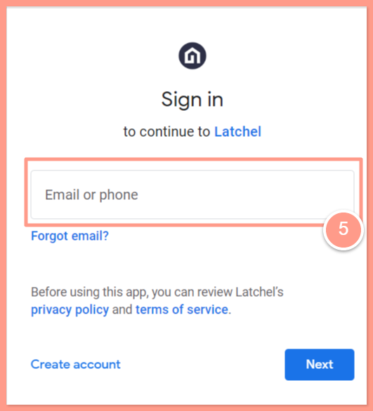
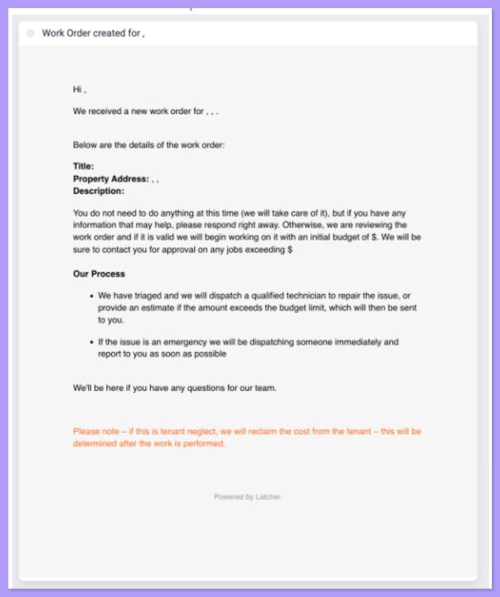
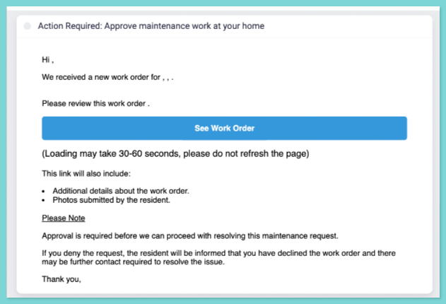

## **Introduction** 

Inside the email, owners can click a button to automatically approve work if you have budget approval or new work order approval notification turned on for that owner (see example emails at the end of this guide). To enable notifications to owners, you must first integrate your Google Gmail account and then create owner profiles on each property.

Once your owners are added, you can go to the owner’s profile and select from 3 types of :

1.  Notification when a maintenance request is created.
2.  Notification for work approval when a non-emergency maintenance request is created. This happens before a work order is ever sent to a service provider.
3.  Notification for a budget approval when a work order goes over the normal hard budget limit.

## **Setting Up Owner Communication**

<Steps>
  <Step title="**Open Account Settings**" icon="1" iconType="sharp-solid" stepNumber={1} titleSize="p">
    When logged into Latchel, click your initials/avatar on the top-right of the page and click **Account Settings**.

    <Frame>
      
    </Frame>
  </Step>
  <Step title="**Click Activate under Gmail**" icon="2" iconType="sharp-solid" stepNumber={2} titleSize="p">
    On the **Integrations** tab, click **Activate** under the Gmail section.

    <Frame>
      
    </Frame>
  </Step>
  <Step title="**Log in to your Gmail account**" icon="3" iconType="sharp-solid" stepNumber={3} titleSize="p">
    A new browser will open. Log in to the Gmail account you wish for Latchel to use for owner communications. 

    <Frame>
      
    </Frame>
  </Step>
  <Step title="**Send us your list of owners**" icon="4" iconType="sharp-solid" stepNumber={4} titleSize="p">
    If we do not already have it, please send us an email at [onboarding@latchel.com](mailto:onboarding@latchel.com) containing a list of owners with names, phone numbers, and email addresses along with what properties they cover. This owner information will need to be added to the Latchel portal for notifications to be sent out to your owners successfully. Without this data, the Latchel system will not send emails to your owners.
  </Step>
  <Step title="**Go to the owner's profile**" icon="5" iconType="sharp-solid" stepNumber={5} titleSize="p">
    Once your owners are added and when you go to the Owner’s profile you can select from 3 types of notifications:

    Notification when a maintenance request is created.
    Notification for work approval when a non-emergency maintenance request is created. _This happens before a work order is ever sent to a service provider._
    Notification for a budget approval when a work order goes over the normal hard budget limit.
  </Step>
  <Step title="**Toggle each notification type**" icon="6" iconType="sharp-solid" stepNumber={6} titleSize="p">
    Click the **toggle** to enable each type of notification. 

    Owner Notification Examples:

    <Frame>
      
    </Frame>
     

    <Frame>
      
    </Frame>
  </Step>
</Steps>
