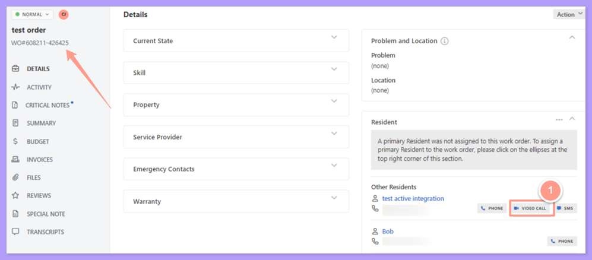
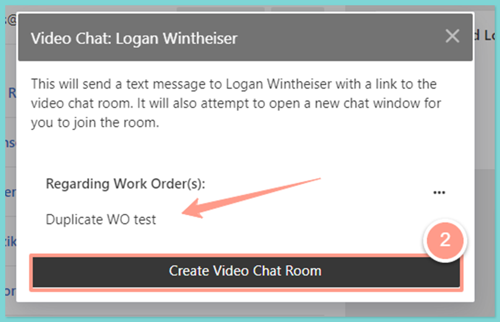
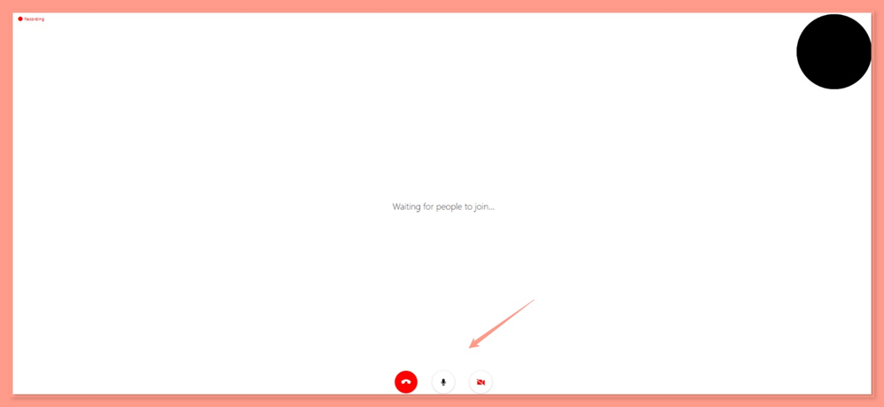
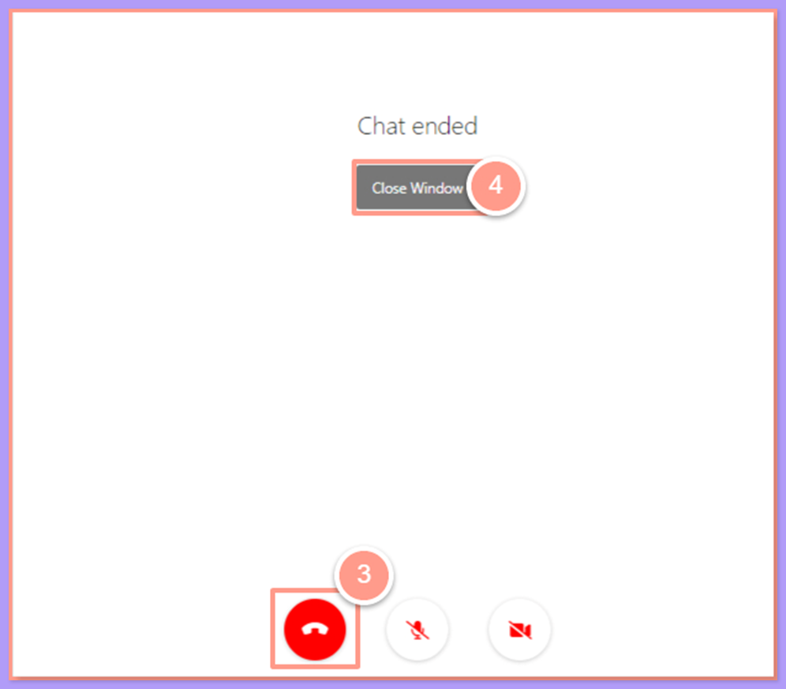
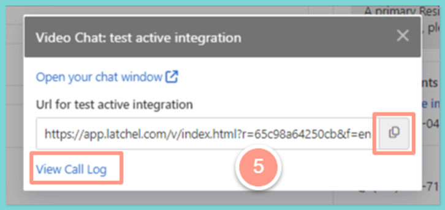
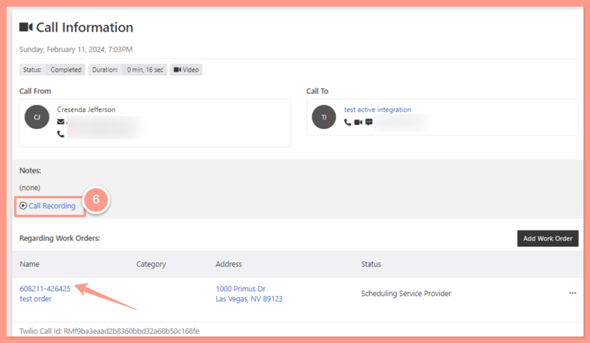

The purpose of this help guide is to ensure interaction with the resident will be recorded on the specific work order and here's how:

## **How to Tag Video Calls to a Work Order**

<Steps>
  <Step title="**Click the video call icon**" icon="1" iconType="sharp-solid" stepNumber={1} titleSize="p">
    From the work order page, scroll down to reach the resident lists and click the **video call icon** of the intended resident.

    <Frame>
      
    </Frame>
  </Step>
  <Step title="**Click Create Video Chat Room**" icon="2" iconType="sharp-solid" stepNumber={2} titleSize="p">
    Notice that the work order title will be visible for the video to be tagged, then click **Create Video Chat Room.**

    <Frame>
      
    </Frame>

    The video call will progress, and the resident should be available on the other line to share the maintenance issue.

    <Frame>
      
    </Frame>
  </Step>
  <Step title="**End the call and close the window**" icon="3" iconType="sharp-solid" stepNumber={3} titleSize="p">
    To finish the call, click on the **red headphone** icon, then **Close Window** to fully close the video call.

    <Frame>
      
    </Frame>
  </Step>
  <Step title="**Click View Call Log**" icon="4" iconType="sharp-solid" stepNumber={4} titleSize="p">
    Once the video session ends, a URL and the link to the **View Call Log** will be available to copy. For this help guide, click on **View Call Log.**

    <Frame>
      
    </Frame>

    The page will be routed to the **"Call information"** page. The call recording or video information will be available, and this is automatically tagged or associated with the work order.

    <Frame>
      
    </Frame>
  </Step>
</Steps>