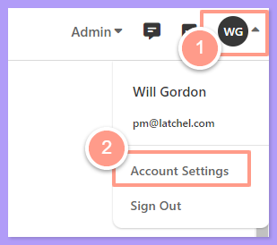
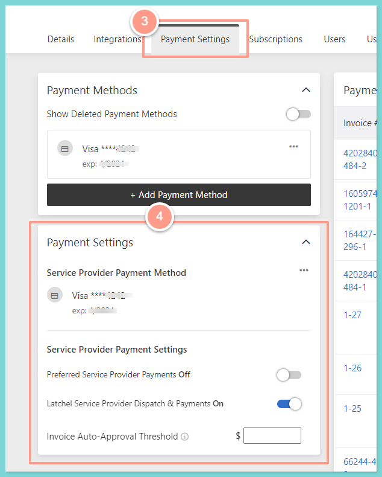
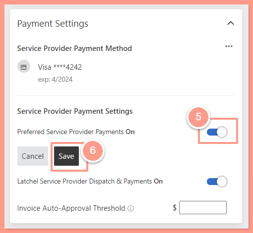

## **How to Turn on Preferred Service Provider Payments**

<Steps>
  <Step title="**Open Account Settings**" icon="1" iconType="sharp-solid" stepNumber={1} titleSize="p">
    On your Latchel dashboard, click the **initial icon** located at the right corner of the page, and then select **Account Settings** from the dropdown.

    <Frame>
      
    </Frame>
  </Step>
  <Step title="**Go to the Payment Settings section**" icon="2" iconType="sharp-solid" stepNumber={2} titleSize="p">
    In the **Payment Settings tab**, scroll down to the **Payment Settings** section.

    <Frame>
      
    </Frame>
  </Step>
  <Step title="**Turn on Preferred Service Provider Payments**" icon="3" iconType="sharp-solid" stepNumber={3} titleSize="p">
    Under the **Service Provider Payment Settings**, click the **toggle icon** for the **Preferred Service Provider Payments** and **Save**.

    <Frame>
      
    </Frame>

    Turning this on ensures any invoices that are submitted for service providers that are opted in or have a payment method set up will be processed through the Latchel Pay system.

    <Warning>
      If the service provider does not have a payment method set up, you won't be able to turn the preferred service provider payment option on.
    </Warning>
  </Step>
  <Step title="**Turn on Latchel Service Provider Dispatch & Payments**" icon="4" iconType="sharp-solid" stepNumber={4} titleSize="p">
    Furthermore, turning **ON Latchel Service Provider Dispatch & Payments** would allow Auto-Assign Latchel Vendor Network to get paid.

    <Frame>
      
    </Frame>
  </Step>
</Steps>

<Note>
  Latchel records every change to **Service Provider Payment Settings** in the company, portfolio, and property activity logs, including who made the change and when. For example: "Preferred Service Provider Payments: Off -> On". This covers **Preferred Service Provider Payments**, **Latchel Service Provider Dispatch & Payments**, the **Latchel Vendor Network** toggle, and the invoice auto-approval threshold.
</Note>
