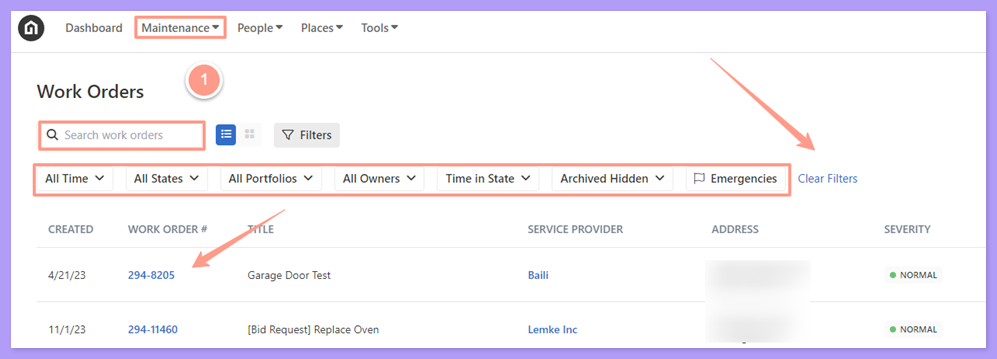
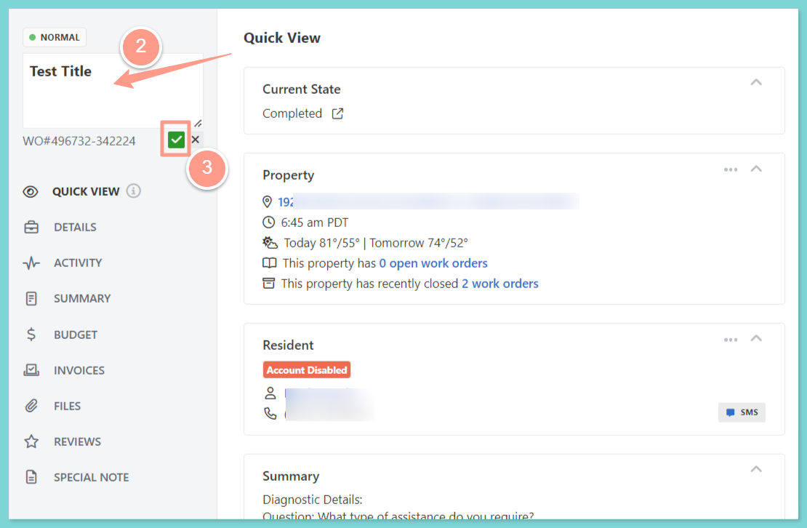

## **How to Update a Work Order Title**

You can also use the **Filter** and **Clear Filters** option for a more refined search. To learn more about how to use the Filter, check out this help guide:

<Card title="How to Use the Filter Options in the Work Order Tab Page" color="#ff9b8a" icon="filter-list" iconType="duotone" href="/s/topic/0TO5e000000h9wqGAA/How-to-Use-the-Filter-Options-in-the-Work-Order-Tab-Page">
  Learn how to use filters in the Work Order tab to quickly sort, find, and manage the requests you care about most.
</Card>

<Frame>
  
</Frame>

From the work order page, click the **current title** to activate it. Then type in your preferred work order title. Don't forget to click the **green check** icon to save the changes.

<Frame>
  
</Frame>

**Do you also need to update the work order number? Follow the steps from this help guide:**

<Card title="How to Change a Work Order Number" color="#ff9b8a" icon="input-numeric" iconType="duotone" href="/s/topic/0TO5e000000h9wqGAA/How-to-Change-a-Work-Order-Number-New-Experience">
  Update the work order ID to match internal tracking systems if needed.
</Card>