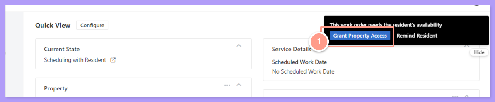
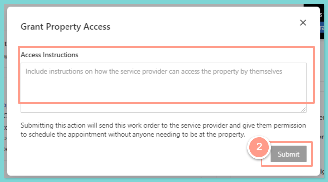
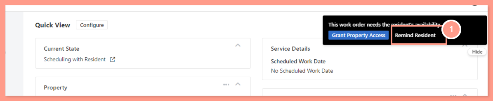
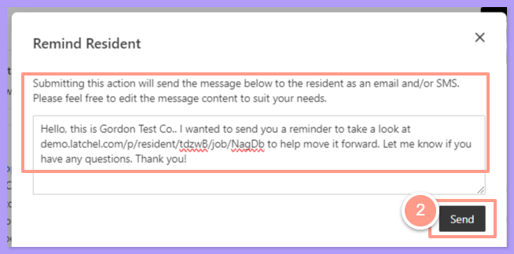
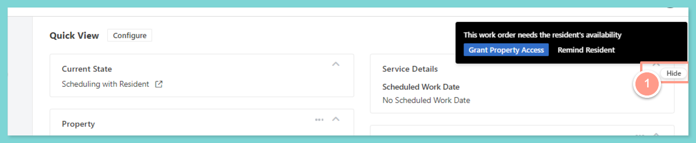
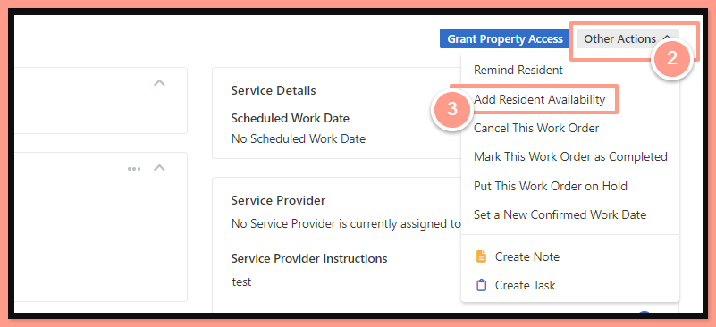
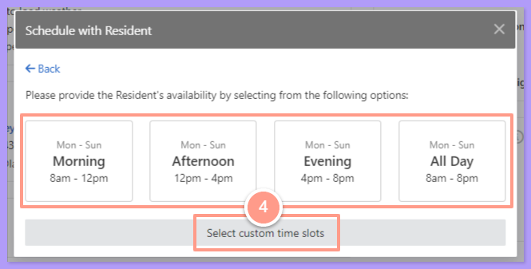
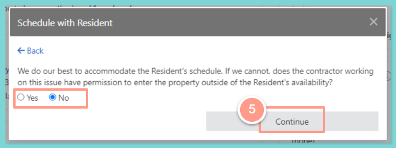
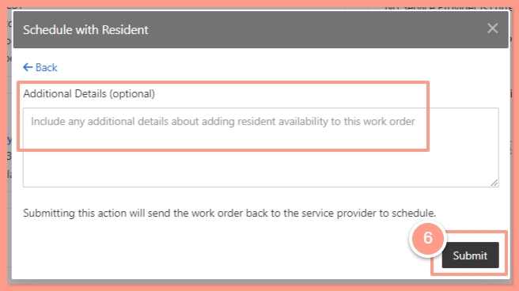

## **Grant Property Access**

<Steps>
  <Step title="**Click Grant Property Access**" icon="1" iconType="sharp-solid" stepNumber={1} titleSize="p">
    From the work order page hit the **Grant Property Access** in the notification located at the upper right-hand corner of the page.

    <Frame>
      
    </Frame>
  </Step>
  <Step title="**Add instructions and click Submit**" icon="2" iconType="sharp-solid" stepNumber={2} titleSize="p">
    Then on the pop-up screen, you can provide additional instructions and click **Submit**.

    <Frame>
      
    </Frame>
  </Step>
</Steps>

## **Remind a Resident**

If you need to send an email or SMS to a resident to remind them of a pending task that requires their action on a work order, follow the steps below.

<Steps>
  <Step title="**Click Remind Resident**" icon="1" iconType="sharp-solid" stepNumber={1} titleSize="p">
    Also located at the upper right corner of the work order page, click the **Remind Resident** button.

    <Frame>
      
    </Frame>
  </Step>
  <Step title="**Edit the message and click Send**" icon="2" iconType="sharp-solid" stepNumber={2} titleSize="p">
    And from the pop-up screen, you can edit the reminder message or just hit **Send**.

    <Frame>
      
    </Frame>
  </Step>
</Steps>

## **Add Resident Availability**

<Steps>
  <Step title="**Click Hide on the floating section**" icon="1" iconType="sharp-solid" stepNumber={1} titleSize="p">
    Click the **Hide** button of the floating section located in the upper right corner.

    <Frame>
      
    </Frame>
  </Step>
  <Step title="**Select Add Resident Availability**" icon="2" iconType="sharp-solid" stepNumber={2} titleSize="p">
    From there, select **Other Actions**, then click **Add Resident Availability**.

    <Frame>
      
    </Frame>
  </Step>
  <Step title="**Choose a time slot**" icon="3" iconType="sharp-solid" stepNumber={3} titleSize="p">
    Now you can choose from the available schedule, or custom a specific time slot.

    <Frame>
      
    </Frame>
  </Step>
  <Step title="**Confirm entry permission and continue**" icon="4" iconType="sharp-solid" stepNumber={4} titleSize="p">
    Next, acknowledge if the service provider has permission to enter the property outside of the Resident's availability, and click **Continue**.

    <Frame>
      
    </Frame>
  </Step>
  <Step title="**Click Submit**" icon="5" iconType="sharp-solid" stepNumber={5} titleSize="p">
    Lastly, hit **Submit** if there are no other details you want to add.

    <Frame>
      
    </Frame>
  </Step>
</Steps>

And that's it\! That's how you can update the resident availability through a work order.