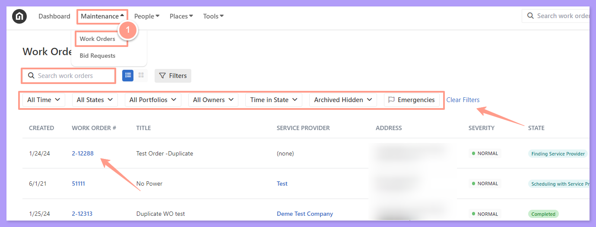
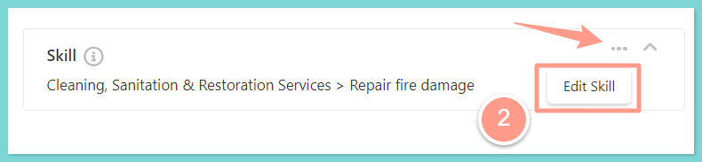
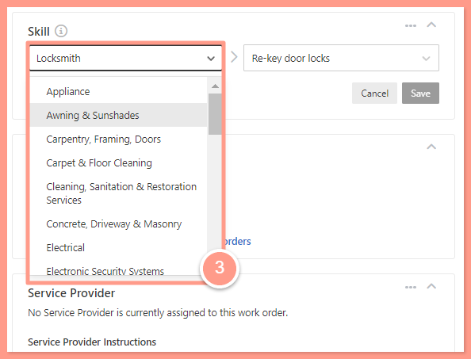
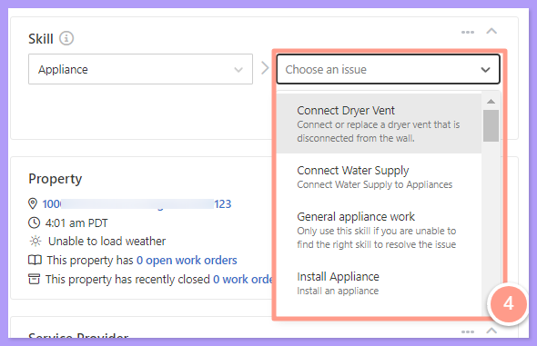
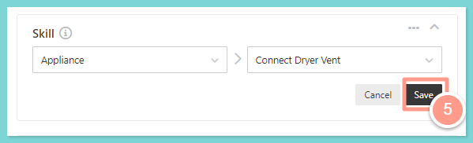

## **How to Update the Skill Required on a Work Order**

<Frame>
  
</Frame>

<Steps>
  <Step title="**Select Edit Skill**" icon="1" iconType="sharp-solid" stepNumber={1} titleSize="p">
    From the work order view, look for **Skill** and the three dots, an option to **Edit Skill** will appear.

    <Frame>
      
    </Frame>

    Please note, that there are main skill categories which is the field on the left-hand side (e.g.Plumbing, HVAC, Appliance) and then there are skills within the category (e.g.connecting dryer vents, clearing drains, etc.) which is the field on the right-hand side. We'll show you how to update both options below:
  </Step>
  <Step title="**Choose the category**" icon="2" iconType="sharp-solid" stepNumber={2} titleSize="p">
    Choose the Category by clicking one of the listed items in the drop-down menu.

    <Frame>
      
    </Frame>
  </Step>
  <Step title="**Select a skill**" icon="3" iconType="sharp-solid" stepNumber={3} titleSize="p">
    By clicking a category, a list of other skills will pop up. You can select a better-fitting skill for the work order from the dropdown list.

    <Frame>
      
    </Frame>
  </Step>
  <Step title="**Click Save**" icon="4" iconType="sharp-solid" stepNumber={4} titleSize="p">
    Once one of the skills is clicked, click on the Save option for the change to take effect.

    <Frame>
      
    </Frame>
  </Step>
</Steps>

And that's how you can edit the skill required on a work order\!
