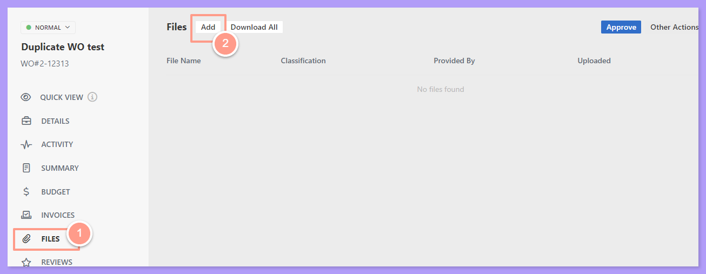
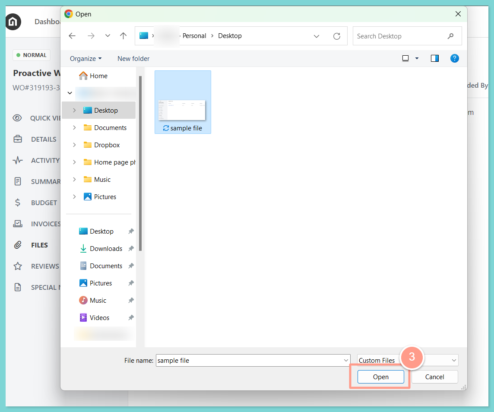
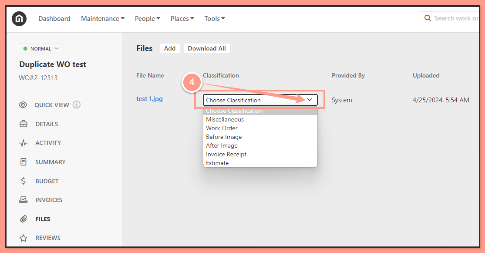

## **How to Upload Files to a Work Order for Property Manager**

<Steps>
  <Step title="**Click Add Files**" icon="1" iconType="sharp-solid" stepNumber={1} titleSize="p">
    From the work order page, go to **Files** and click **Add Files.**

    <Frame>
      
    </Frame>
  </Step>
  <Step title="**Select the file and click Open**" icon="2" iconType="sharp-solid" stepNumber={2} titleSize="p">
    Select the file from your computer and click **Open.**

    <Frame>
      
    </Frame>
  </Step>
  <Step title="**Choose the file classification**" icon="3" iconType="sharp-solid" stepNumber={3} titleSize="p">
    Once the file is uploaded, it will appear under **Attached Files.** Under Classification, choose the type of file to identify what type of file is uploaded.

    You may choose from the following options:

    - Miscellaneous
    - Work Order
    - Before Image - the image of the site before work is done
    - After Image - the finished result after work is done
    - Invoice Receipt
    - Estimate

    For this example, we will choose After Image.

    <Frame>
      
    </Frame>
  </Step>
</Steps>

And that's how you can attach a file in a work order\!