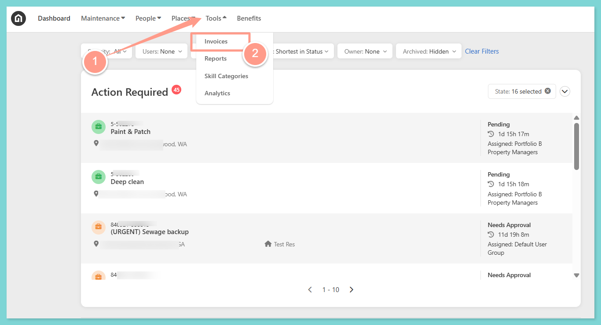
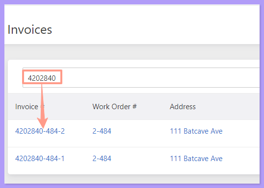
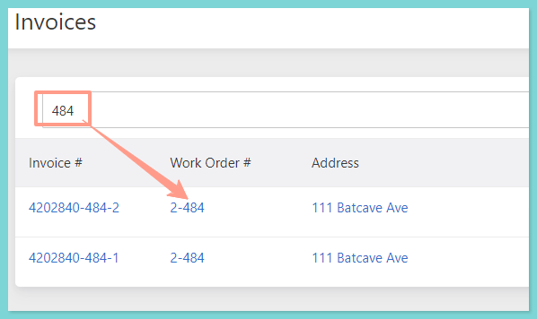
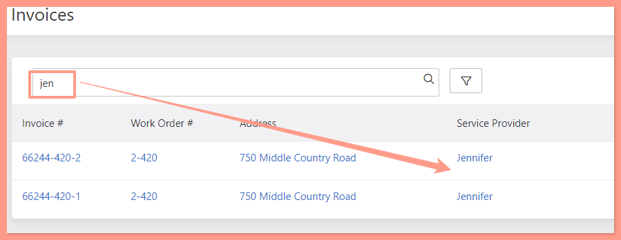
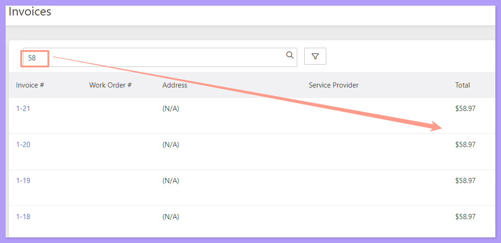
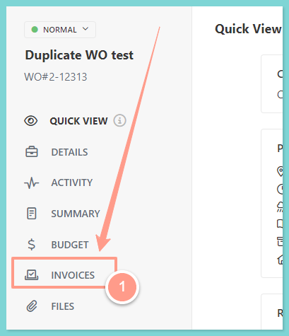
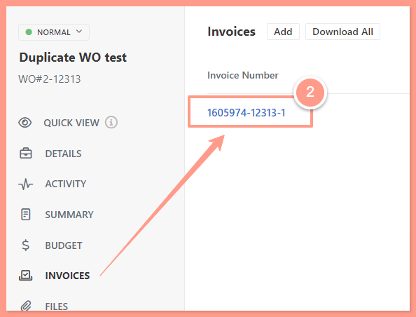
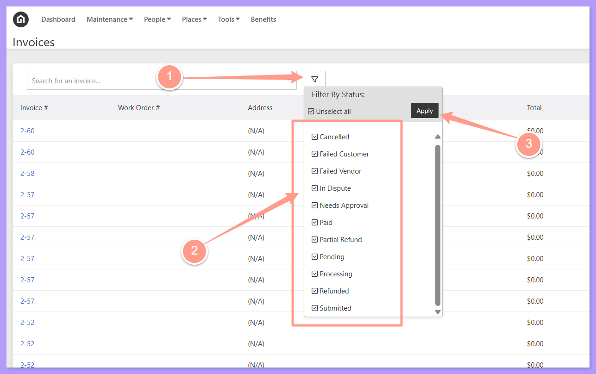
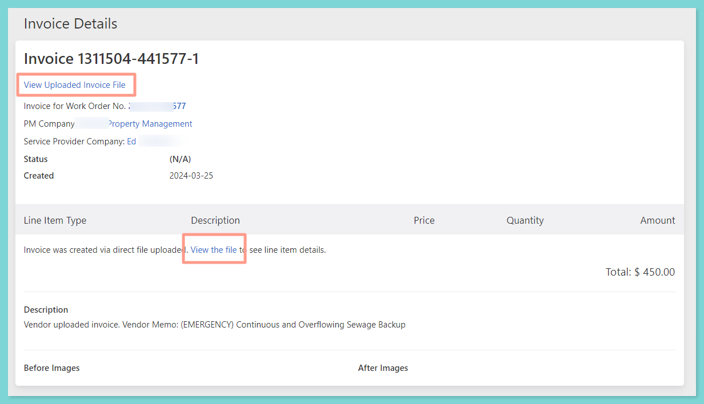

From your dashboard, select **Tools** and click **Invoices**.

<Frame>
  
</Frame>

## **Searching Invoices in Multiple Ways**

1. Using the **Invoice Number**

<Frame>
  
</Frame>

2. Using the **Work Order Number**

<Frame>
  
</Frame>

3. Using the **Assigned Service Provider**

<Frame>
  
</Frame>

4. Using the **Invoice Amount**

<Frame>
  
</Frame>

## **Accessing an Invoice Via the Work Order**

<Steps>
  <Step title="**Open the work order and click Invoices**" icon="1" iconType="sharp-solid" stepNumber={1} titleSize="p">
    Search for the work order. To do this you may follow the steps in the guide below. Then, from the left side of the work order page, click **Invoices**.

    <Card title="Quick Search Box for Work Orders" color="#ff9b8a" icon="box-open" iconType="duotone" href="/s/topic/0TO5e000000h9wqGAA/Quick-Search-Box-for-Work-Orders">
      Use the search bar to instantly locate specific work orders by keyword, number, or address.
    </Card>

    <Frame>
      
    </Frame>
  </Step>
  <Step title="**Select the invoice number**" icon="2" iconType="sharp-solid" stepNumber={2} titleSize="p">
    Then select the **Invoice Number** you want to access.

    <Frame>
      
    </Frame>
  </Step>
</Steps>

## **Searching Invoices Using the Filter**

On the invoice page, invoices can now be easily searched using the filter options. **Filter options** available are **by Status**:

- **Unpaid:** The invoice has been issued but has not yet been paid.
- **In Dispute:** There's an active issue or disagreement regarding the invoice that needs resolution.
- **Paid:** The invoice has been fully paid.
- **Cancelled:** The invoice was voided and is no longer valid for payment.
- **Partial Paid:** A portion of the invoice has been paid, but a balance remains.
- **Refunded:** The payment made on the invoice was returned to the payer.
- **Needs Approval:** The invoice is awaiting approval from the necessary party before it can move forward.
- **Pending:** The invoice is in a waiting state—typically awaiting action like review, approval, or payment.
- **Processing:** The invoice is actively being handled, such as being reviewed, approved, or queued for payment.
- **Submitted:** The invoice has been officially submitted into the system and is waiting for the next step in the workflow (e.g., approval or payment).
- **Failed Customer:** This means that there was a problem charging the customer, usually an issue with the payment method.
- **Failed Vendor:** means there was an issue paying out the vendor.

From the invoice page, click on the **Filter icon**, **check or uncheck**the desired filter box, and click on **Apply.**

<Frame>
  
</Frame>

## **Invoice Preview**

<Steps>
  <Step title="**Click the invoice number**" icon="1" iconType="sharp-solid" stepNumber={1} titleSize="p">
    Once you have found the invoice you are looking for, click the **hyperlinked invoice number** to get into the **Invoice Details**.
  </Step>
  <Step title="**View the uploaded invoice file**" icon="2" iconType="sharp-solid" stepNumber={2} titleSize="p">
    In the Invoice Details page, click **View Uploaded Invoice File** or **View the file**, then a new window tab will open containing the invoice preview.

    <Frame>
      
    </Frame>
  </Step>
</Steps>

And that's how easy you can search and preview your work order invoices\!
