<Frame>
  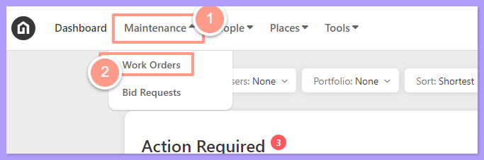
</Frame>

Search for the work order ID in the **Search box** on the **Work Order** page then click the **Work Order ID**. You may also use the **Filter** option for easy searching.

<Frame>
  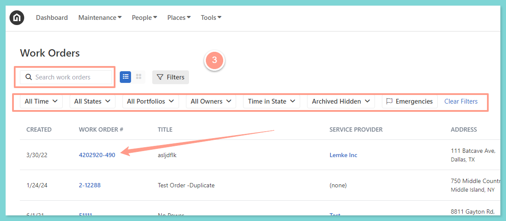
</Frame>

To update the user notification group from a billing/invoicing perspective, you need to know what kind of inheritance the work order has, whether it's via Company, Property, or Portfolio level.

<Steps>
  <Step title="**Check the notification group**" icon="1" iconType="sharp-solid" stepNumber={1} titleSize="p">
    To check the notification group of the property in the work order, simply go to the **Details** tab of the work orderlocated on the right panel of the page. Then scroll the page downwards until you find the **Notification Settings** at the lower right corner of the page.

    <Frame>
      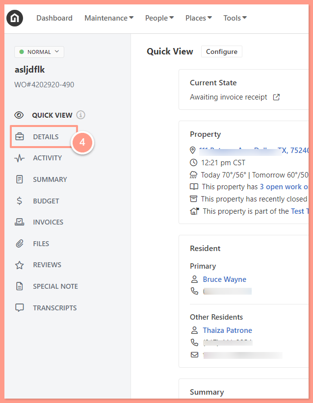
    </Frame>

     

    <Frame>
      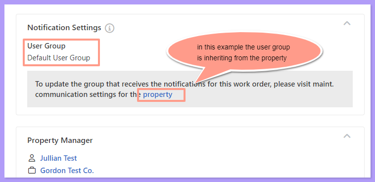
    </Frame>

    In the example above, the notification group is inherited via the property, so you will need to change the user notification group at the **Property Level.**
  </Step>
  <Step title="**Open the property**" icon="2" iconType="sharp-solid" stepNumber={2} titleSize="p">
    To update the Notification Group, go back to the top of the page. From there, you will find the property address. By clicking the hyperlinked property address, it will take you to the property details.

    <Frame>
      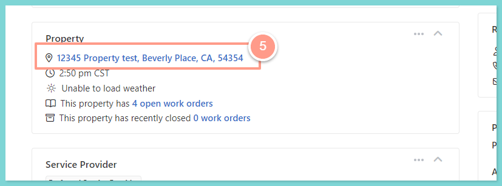
    </Frame>
  </Step>
  <Step title="**Find Maint. Communication Settings**" icon="3" iconType="sharp-solid" stepNumber={3} titleSize="p">
    From the property page under the **Details** tab, you will find the **Maint. Communication Settings**. If the Notification Group has not been overridden, the Overridden option will be available. Otherwise, click **Edit** as shown below. 

    <Frame>
      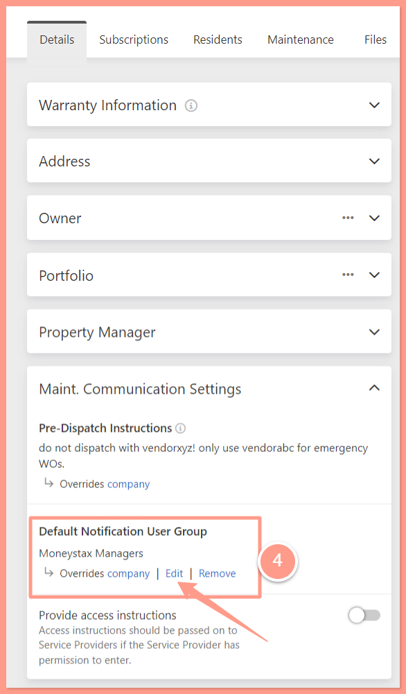
    </Frame>
  </Step>
  <Step title="**Choose a notification group and save**" icon="4" iconType="sharp-solid" stepNumber={4} titleSize="p">
    Next, choose from the list of your notification groups. Then click **Save**. 

    <Frame>
      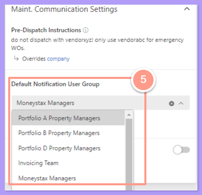
    </Frame>

    <Frame>
      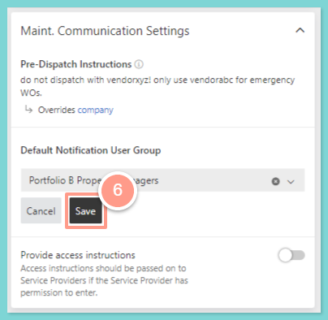
    </Frame>
  </Step>
</Steps>

## **If the inheritance is at the Portfolio level**

<Steps>
  <Step title="**Click the property**" icon="1" iconType="sharp-solid" stepNumber={1} titleSize="p">
    From your work order page, click the Hyperlinked property to go to the property level.

    <Frame>
      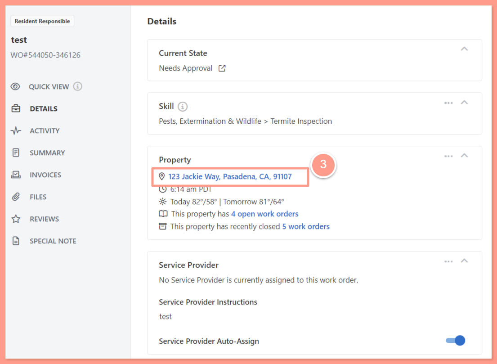
    </Frame>
  </Step>
  <Step title="**Click the portfolio name**" icon="2" iconType="sharp-solid" stepNumber={2} titleSize="p">
    At the property level, click the hyperlinked name of the **portfolio** to go to the property's portfolio page. 

    <Frame>
      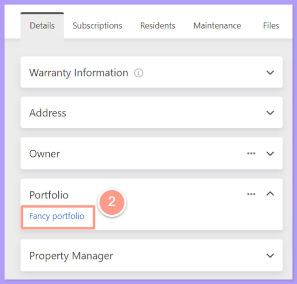
    </Frame>
  </Step>
  <Step title="**Open Maint. Communication Settings**" icon="3" iconType="sharp-solid" stepNumber={3} titleSize="p">
    On the **Portfolio** page, simply click the **Maint. Communication Settings** drop-down and you can change it from there.

    <Frame>
      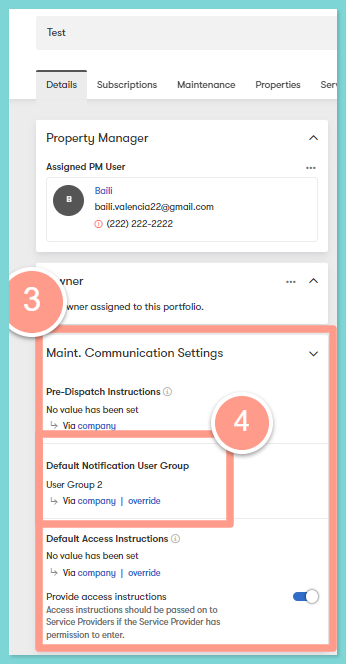
    </Frame>
  </Step>
  <Step title="**Click Override**" icon="4" iconType="sharp-solid" stepNumber={4} titleSize="p">
    Then, click **Override** and it will show the dropdown list of user groups available.

    <Frame>
      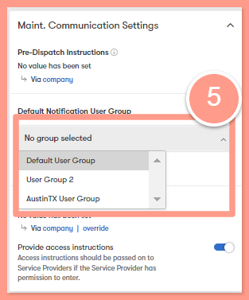
    </Frame>
  </Step>
</Steps>

## **If the inheritance is at the Company level**

<Steps>
  <Step title="**Open Account settings**" icon="1" iconType="sharp-solid" stepNumber={1} titleSize="p">
    Simply go to your account settings found in the top-right of your screen and select **Account settings**.

    <Frame>
      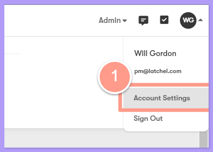
    </Frame>
  </Step>
  <Step title="**Choose the Default Notification User Group**" icon="2" iconType="sharp-solid" stepNumber={2} titleSize="p">
    In your account settings page under maintenance communication settings, click the drop-down under **Default Notification User Group** and you will see the drop-down list of the user groups available.

    <Frame>
      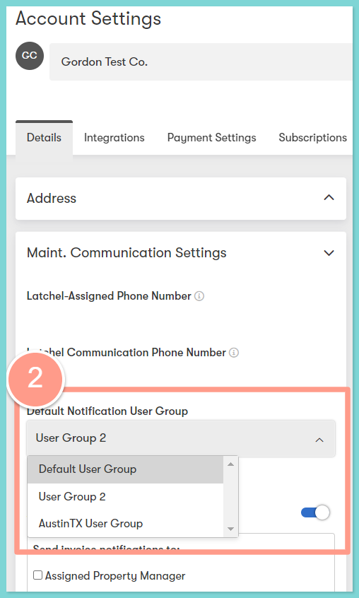
    </Frame>
  </Step>
  <Step title="**Click Save**" icon="3" iconType="sharp-solid" stepNumber={3} titleSize="p">
    Lastly, click the **Save** button to save your changes.
  </Step>
</Steps>
