## **Create a Portfolio for a Specific Owner**

<Steps>
  <Step title="**Select Portfolios from Places**" icon="1" iconType="sharp-solid" stepNumber={1} titleSize="p">
    On the Latchel dashboard, select **Portfolios** from the **Places** dropdown.

    <Frame>
      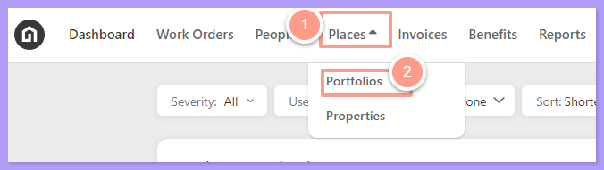
    </Frame>
  </Step>
  <Step title="**Select New Portfolio**" icon="2" iconType="sharp-solid" stepNumber={2} titleSize="p">
    Select **New Portfolio** located on the left of the page.

    <Frame>
      
    </Frame>
  </Step>
  <Step title="**Enter the name and click Create**" icon="3" iconType="sharp-solid" stepNumber={3} titleSize="p">
    Enter the **Portfolio Name** (which may also be the owner's name), then click **Create**.

    <Frame>
      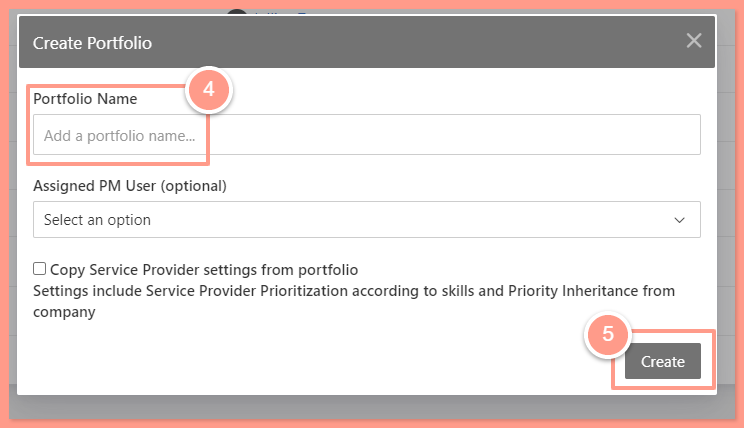
    </Frame>
  </Step>
  <Step title="**Add the owner's properties**" icon="4" iconType="sharp-solid" stepNumber={4} titleSize="p">
    After creating the portfolio, return to the portfolio page and assign the properties managed by the owner by clicking the **Properties** tab and selecting **\+ Add Property**.

    <Frame>
      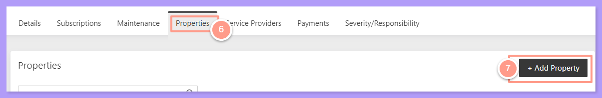
    </Frame>
  </Step>
  <Step title="**Search for the property and submit**" icon="5" iconType="sharp-solid" stepNumber={5} titleSize="p">
    In the pop-up window, search for the property and click **Submit** after selecting the correct one.

    <Frame>
      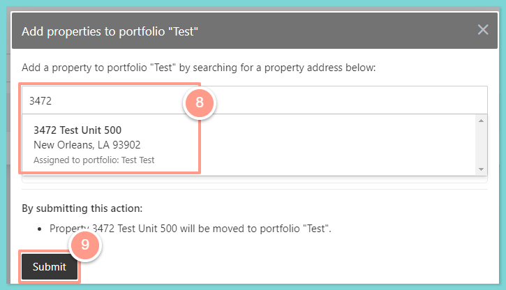
    </Frame>
  </Step>
</Steps>

## **Create Owner as a Service Provider**

<Steps>
  <Step title="**Go to People then Service Provider**" icon="1" iconType="sharp-solid" stepNumber={1} titleSize="p">
    On the dashboard click **People**, then select **Service Provider.**

    <Frame>
      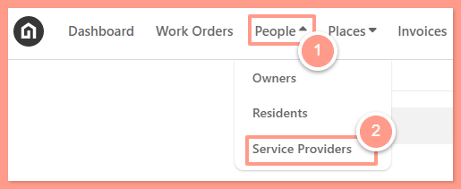
    </Frame>
  </Step>
  <Step title="**Click New Service Provider**" icon="2" iconType="sharp-solid" stepNumber={2} titleSize="p">
    Click the **\+New Service Provider** icon on the left side of the Service Provider page to create a new service provider.

    <Frame>
      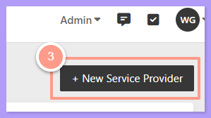
    </Frame>
  </Step>
  <Step title="**Enter the information and click Next**" icon="3" iconType="sharp-solid" stepNumber={3} titleSize="p">
    Input all the relevant information and click **Next**.

    <Frame>
      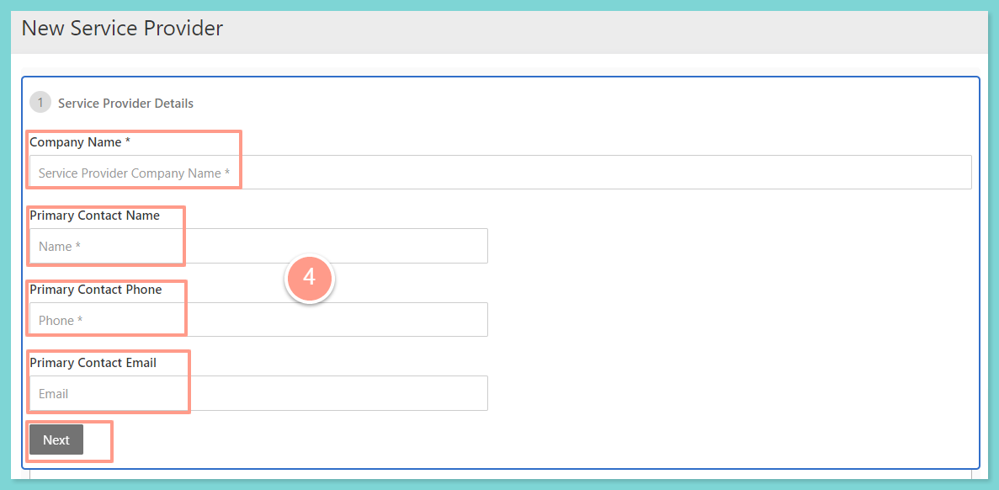
    </Frame>
  </Step>
  <Step title="**Add the owner's skills**" icon="4" iconType="sharp-solid" stepNumber={4} titleSize="p">
    On the following page, add the necessary skills or skill set based on the range of work orders the owner intends to manage.

    If the owner handles only specific types of work orders, select **\+ Add skills**, and a category bar will appear for you to search and choose the relevant skills.

    <Frame>
      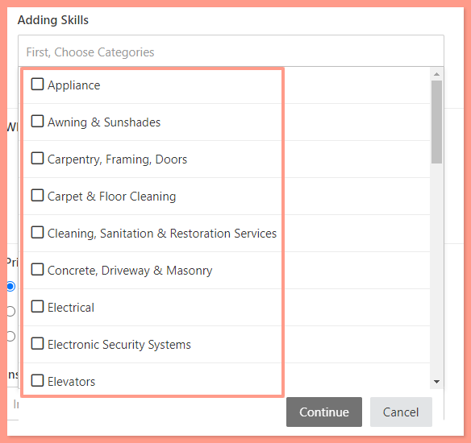
    </Frame>

    If the owner will manage all services and work orders for their properties, select **\+ Add "Quick Create"** **skill set**, and choose **All Skills and All Trades**.

    <Frame>
      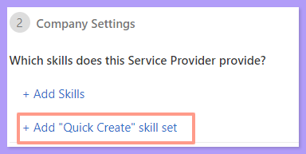
    </Frame>

    <Frame>
      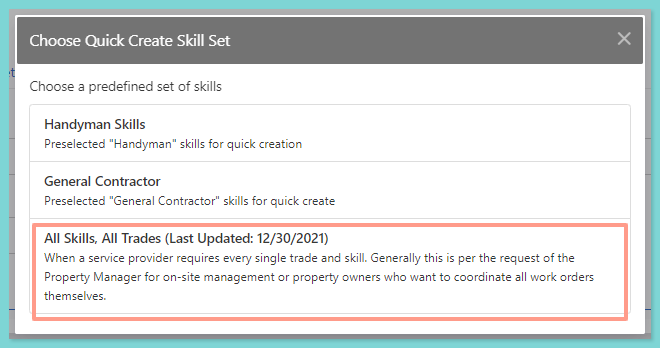
    </Frame>
  </Step>
  <Step title="**Choose I will prioritize later and save**" icon="5" iconType="sharp-solid" stepNumber={5} titleSize="p">
    After selecting the skill set, choose whether to prioritize them or not. Since this is for a specific portfolio, select "**I will prioritize later**" and then click **Save**.

    <Frame>
      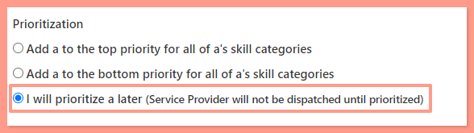
    </Frame>
  </Step>
  <Step title="**Return to the owner's portfolio**" icon="6" iconType="sharp-solid" stepNumber={6} titleSize="p">
    Now, return to the Portfolio page and choose the portfolio specific to the owner that you recently created. From there, prioritize the owner as the service provider so that they are the sole contact for work orders.
  </Step>
  <Step title="**Prioritize the service provider**" icon="7" iconType="sharp-solid" stepNumber={7} titleSize="p">
    Select the **Service Provider tab.** On the right side of the page, click the **three dots** option and select **Prioritize Service Provider for multiple skills.**

    <Frame>
      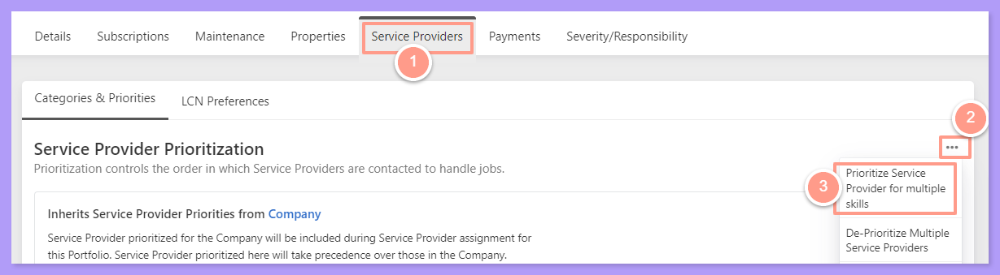
    </Frame>
  </Step>
  <Step title="**Select the owner and skills**" icon="8" iconType="sharp-solid" stepNumber={8} titleSize="p">
    Search for the owner's name (service provider) and select the specific skill, or choose all of the skills if the owner wishes to be contacted for all work orders.

    <Frame>
      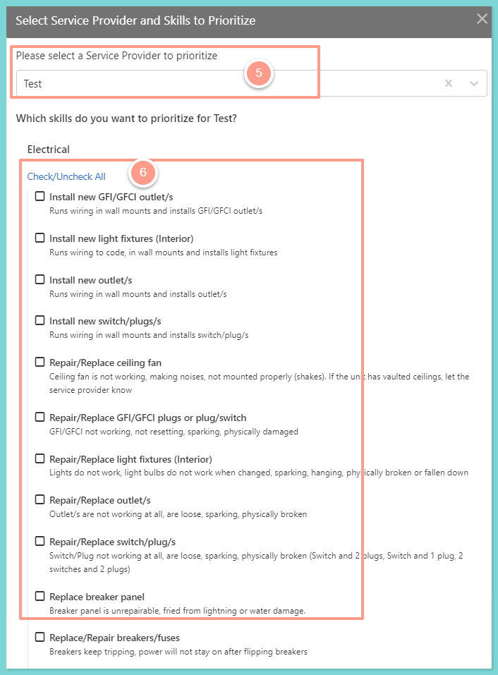
    </Frame>
  </Step>
  <Step title="**Choose the position and click Prioritize**" icon="9" iconType="sharp-solid" stepNumber={9} titleSize="p">
    Next, select whether to prioritize them at the top or bottom of the skill categories, then click **Prioritize**.

    <Frame>
      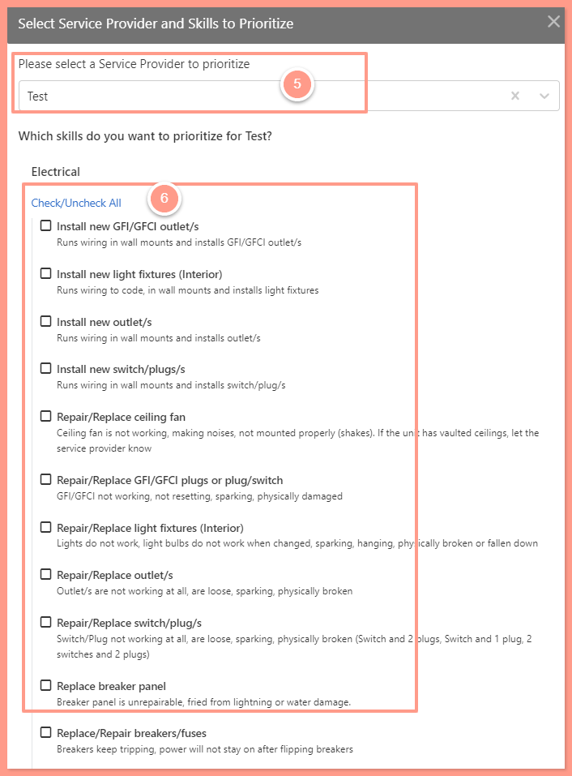
    </Frame>
  </Step>
  <Step title="**Disable inheritance from the company**" icon="10" iconType="sharp-solid" stepNumber={10} titleSize="p">
    To ensure that only the owner is contacted, disable inheritance from the company and avoid contacting any vendors if the owner does not respond.

    <Frame>
      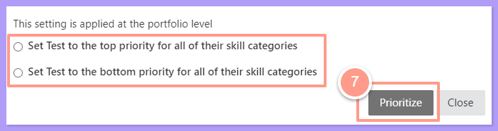
    </Frame>
  </Step>
</Steps>