## **Creating New Inspection**

<Steps>
  <Step title="**Go to Maintenance and choose Inspections**" icon="1" iconType="sharp-solid" stepNumber={1} titleSize="p">
    To create new inspection, go to **Maintenance** and choose either **Inspections**.
  </Step>
  <Step title="**Click Create Your First Inspection**" icon="2" iconType="sharp-solid" stepNumber={2} titleSize="p">
    If it's your first time creating one, you will find the image below. Click **Create Your First Inspection.**

    <Frame>
      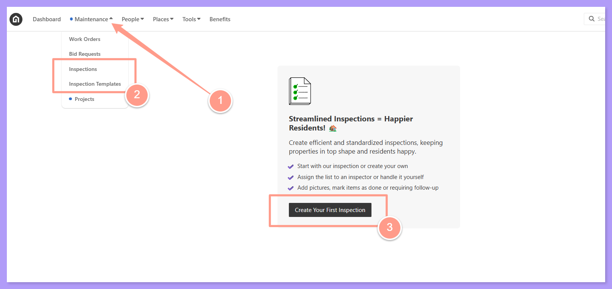
    </Frame>

    <Tip>
      If you already have a list of inspections, click **Create New** at the top of the page.
    </Tip>
  </Step>
  <Step title="**Click Create Inspection**" icon="3" iconType="sharp-solid" stepNumber={3} titleSize="p">
    Then, in the next page, click **Create Inspection**.

    <Frame>
      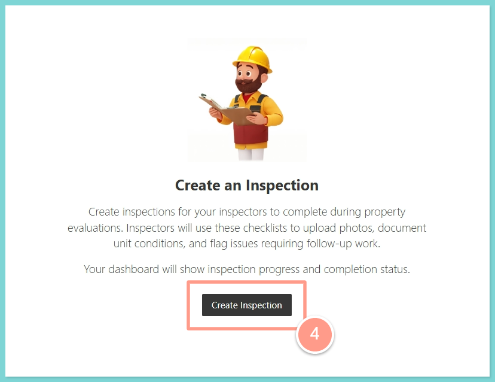
    </Frame>
  </Step>
  <Step title="**Choose an inspection template**" icon="4" iconType="sharp-solid" stepNumber={4} titleSize="p">
    Next, **choose an inspection template**, click **Next** once done.

    <Frame>
      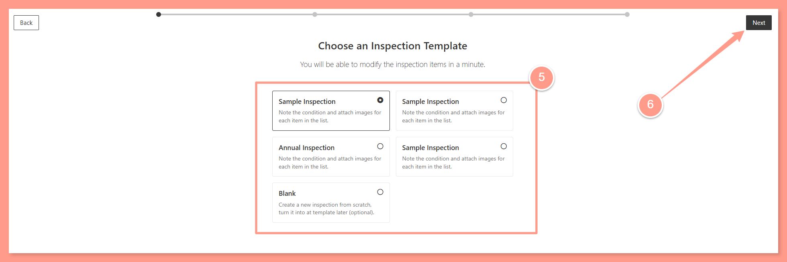
    </Frame>

    <Note>
      In this example, we will select **Blank**.
    </Note>
  </Step>
  <Step title="**Search for the property**" icon="5" iconType="sharp-solid" stepNumber={5} titleSize="p">
    In the next step, **search for the property** associated with the inspection, or click **Skip** if the inspection is not linked to any property.

    <Frame>
      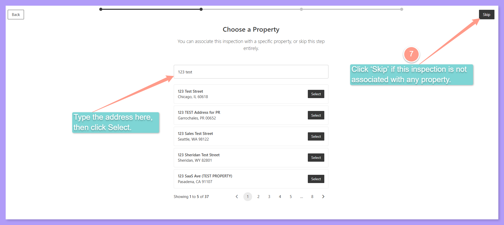
    </Frame>
  </Step>
  <Step title="**Name and describe the inspection**" icon="6" iconType="sharp-solid" stepNumber={6} titleSize="p">
    Enter a **name for the inspection** and provide a **brief description** of its purpose. Click **Create List** once you're finished.

    <Frame>
      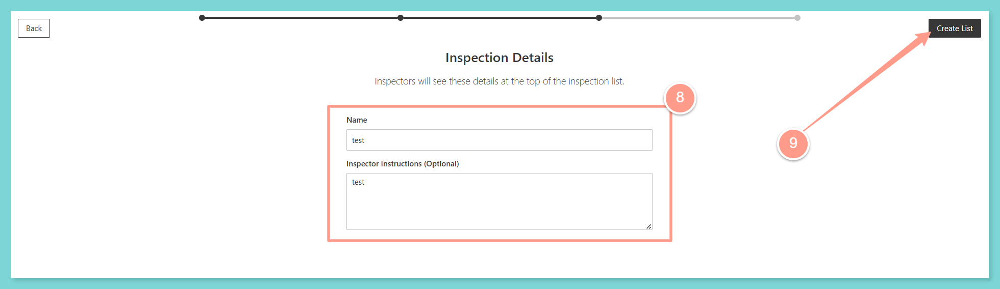
    </Frame>
  </Step>
  <Step title="**Click My Inspections**" icon="7" iconType="sharp-solid" stepNumber={7} titleSize="p">
    Congratulations\! You've successfully created your inspection. Click **My Inspections** to view the inspection you just created.

    <Frame>
      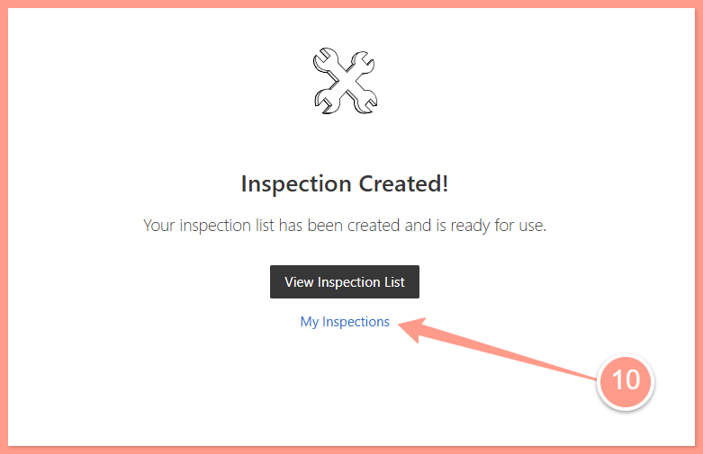
    </Frame>
  </Step>
</Steps>

## **Adding a New Item Within an Inspection**

If you need to capture specific details or areas unique to your property, follow these steps to add custom items to your existing inspection.

<Steps>
  <Step title="**Open the inspection**" icon="1" iconType="sharp-solid" stepNumber={1} titleSize="p">
    From your inspection list, click the **hyperlinked title** of the inspection you want to add new custom item.

    <Frame>
      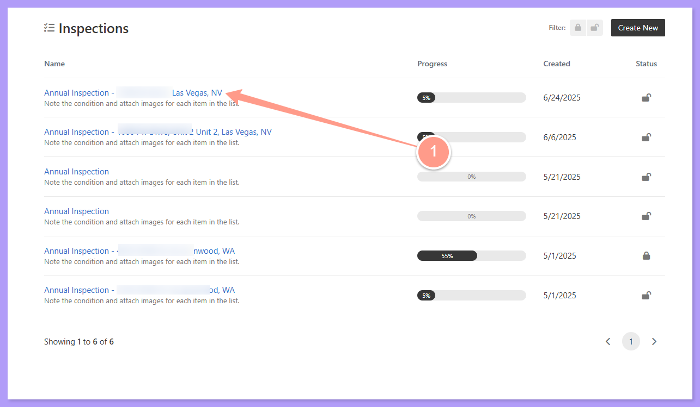
    </Frame>
  </Step>
  <Step title="**Click the plus icon**" icon="2" iconType="sharp-solid" stepNumber={2} titleSize="p">
    On the inspection page, click the **plus (\+) icon** located at the top right corner.

    <Frame>
      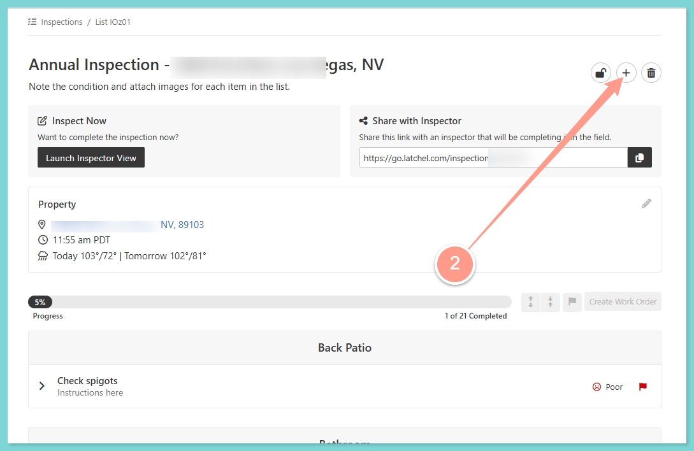
    </Frame>
  </Step>
  <Step title="**Enter the item details and click Add**" icon="3" iconType="sharp-solid" stepNumber={3} titleSize="p">
    Then, **select the area**, **enter the item name and description**, and click **Add** once you're finished.

    <Frame>
      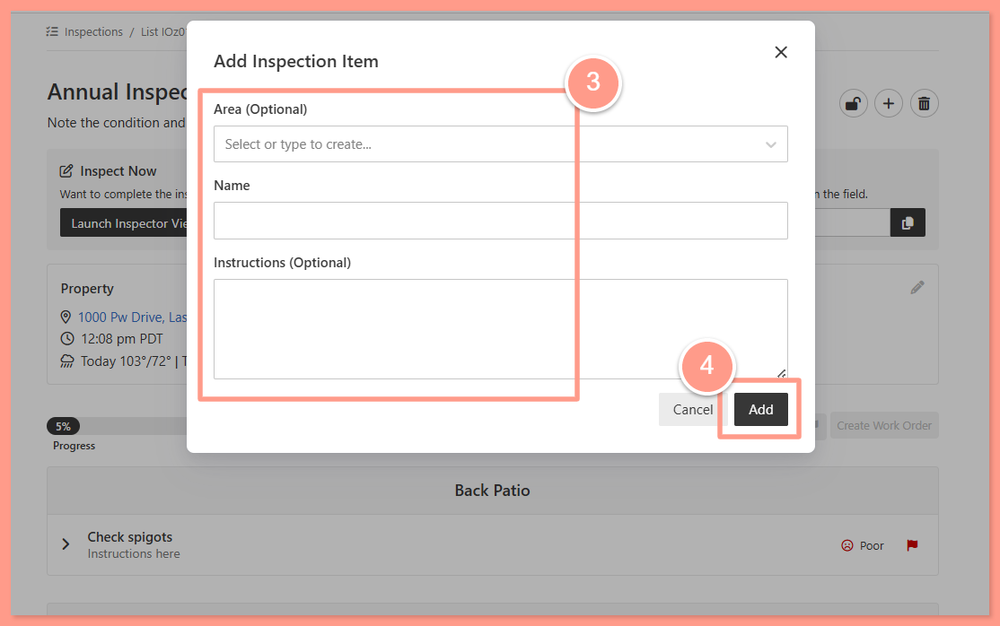
    </Frame>

    A prompt will show that the Inspection item is added.

    <Frame>
      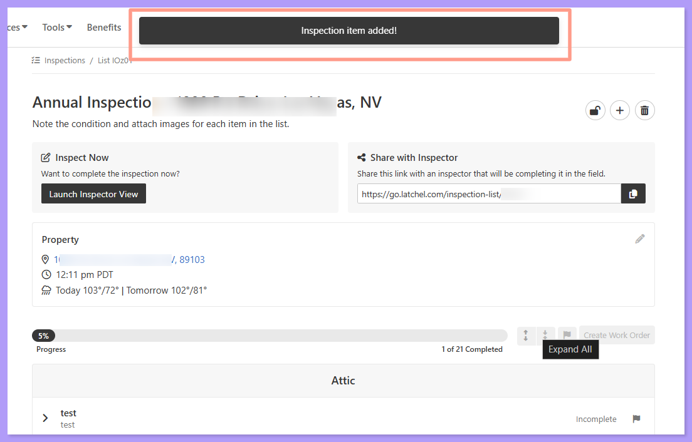
    </Frame>
  </Step>
</Steps>

## **Deleting an Inspections**

If an inspection you previously created is no longer needed, you can delete either the entire inspection list or specific items within it by following the steps below.

- **Deleting the Entire Inspection Order**

<Steps>
  <Step title="**Open the inspection**" icon="1" iconType="sharp-solid" stepNumber={1} titleSize="p">
    From your inspection list, click the **hyperlinked title** of the inspection you want to delete.

    <Frame>
      
    </Frame>
  </Step>
  <Step title="**Click the trash icon**" icon="2" iconType="sharp-solid" stepNumber={2} titleSize="p">
    Then, click the **trash icon** at the top of the page.

    <Frame>
      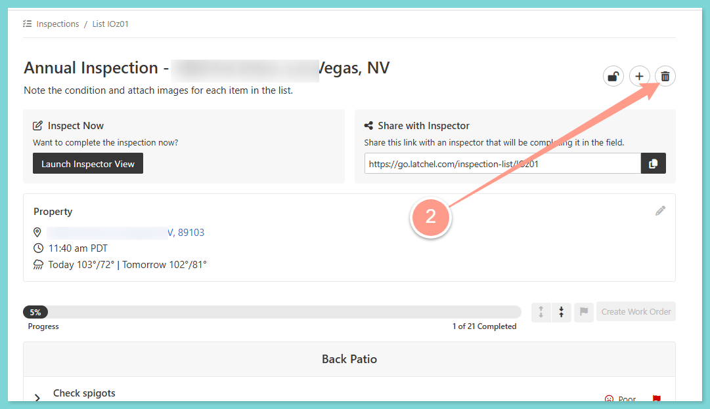
    </Frame>
  </Step>
  <Step title="**Click OK**" icon="3" iconType="sharp-solid" stepNumber={3} titleSize="p">
    When prompted, click **OK**.

    <Frame>
      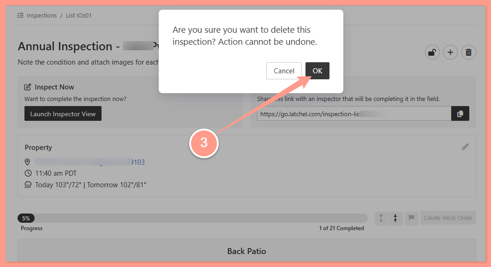
    </Frame>

    The page will refresh, and you’ll see that the inspection has been removed from your list.
  </Step>
</Steps>

- **Deleting an Item within an Inspection**

If a specific item in your inspection order is no longer needed, you can remove it by following the steps

<Steps>
  <Step title="**Locate the item**" icon="1" iconType="sharp-solid" stepNumber={1} titleSize="p">
    Navigate to your inspection page and **locate the item** you wish to delete.

    <Frame>
      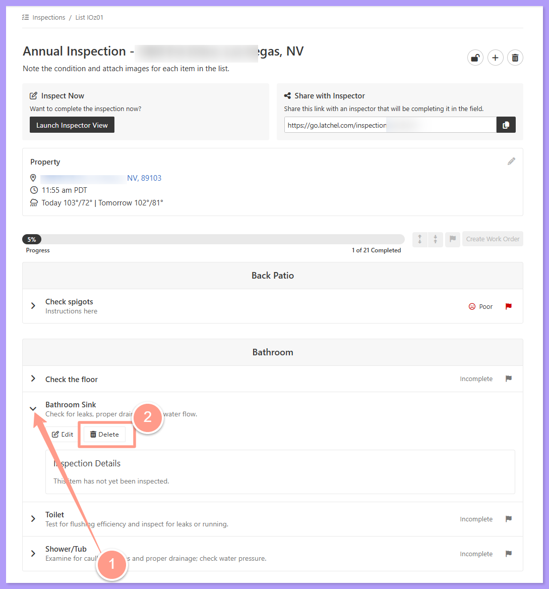
    </Frame>
  </Step>
  <Step title="**Expand the item and click Delete**" icon="2" iconType="sharp-solid" stepNumber={2} titleSize="p">
    **Expand** the item, then click **Delete**. The item will be removed from the list.

    <Frame>
      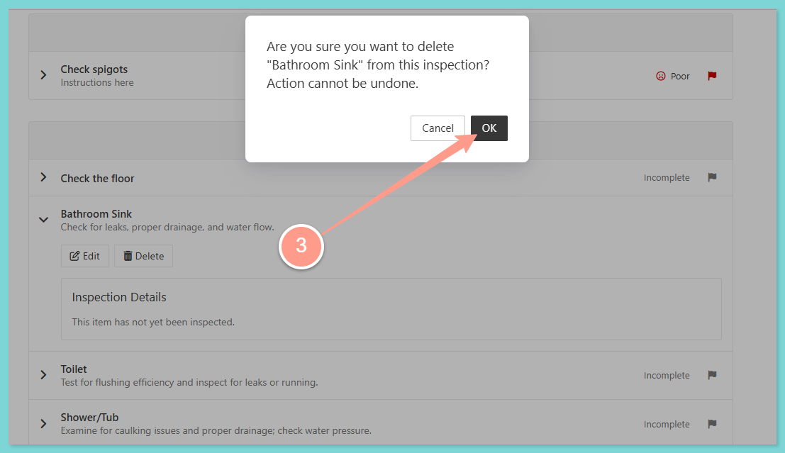
    </Frame>
  </Step>
</Steps>

## **Updating an Existing Inspection**

If you need to make changes to an in-progress inspection—edit details, property address, changing the inspection name, follow the steps below.

- **Update the Inspection Name**

<Steps>
  <Step title="**Open the inspection**" icon="1" iconType="sharp-solid" stepNumber={1} titleSize="p">
    From your inspection list, click the **hyperlinked title of the inspection** you want to update.

    <Frame>
      
    </Frame>
  </Step>
  <Step title="**Edit the name and click Save**" icon="2" iconType="sharp-solid" stepNumber={2} titleSize="p">
    To update the inspection title or name, **double-click the current name**, **make your changes**, and click **Save** when you're done.

    <Frame>
      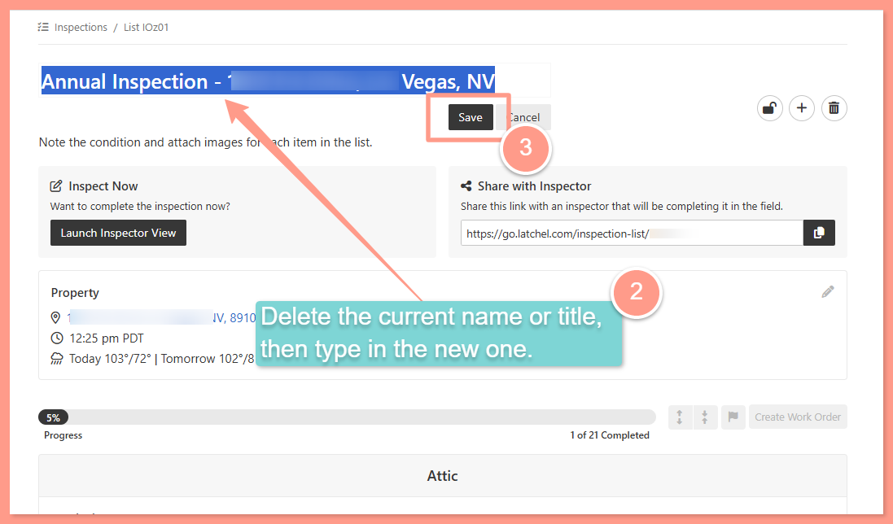
    </Frame>
  </Step>
</Steps>

- **Update the Property Address**

<Steps>
  <Step title="**Click the pencil icon**" icon="1" iconType="sharp-solid" stepNumber={1} titleSize="p">
    If you need to update the property address associated to the inspection, first click the **pencil () icon**.

    <Frame>
      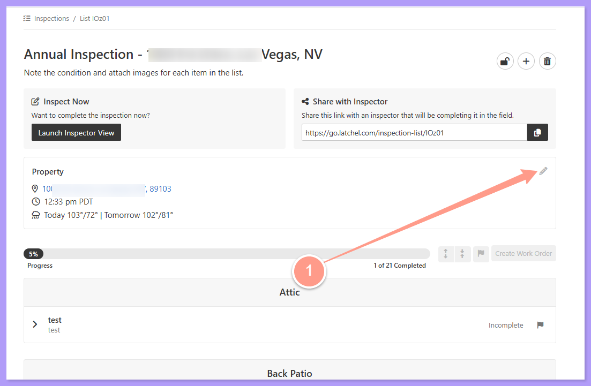
    </Frame>
  </Step>
  <Step title="**Search for the address and click Select**" icon="2" iconType="sharp-solid" stepNumber={2} titleSize="p">
    Next, **search for the property address** and click **Select** to proceed.

    <Frame>
      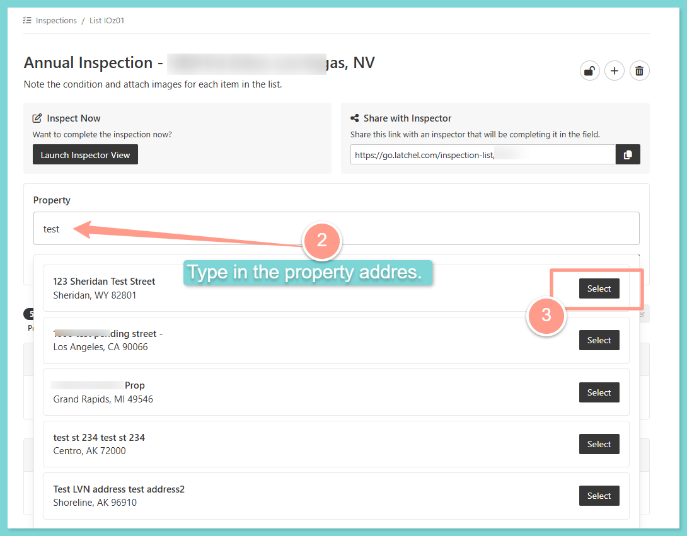
    </Frame>

    The new address will automatically appear.

    <Frame>
      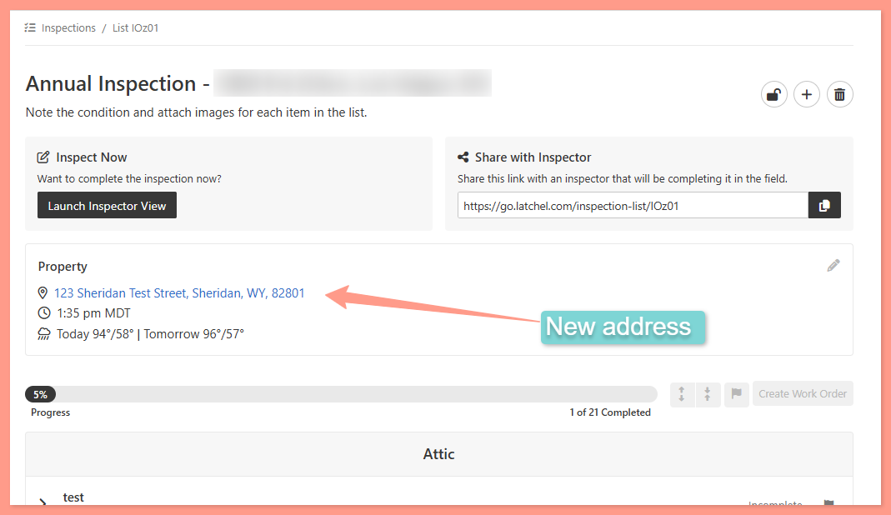
    </Frame>
  </Step>
</Steps>

- **Update/Edit the Inspection Description**

To update the inspection description, **double-click the current description**, **make your changes**, and click **Save** when you're done.

<Frame>
  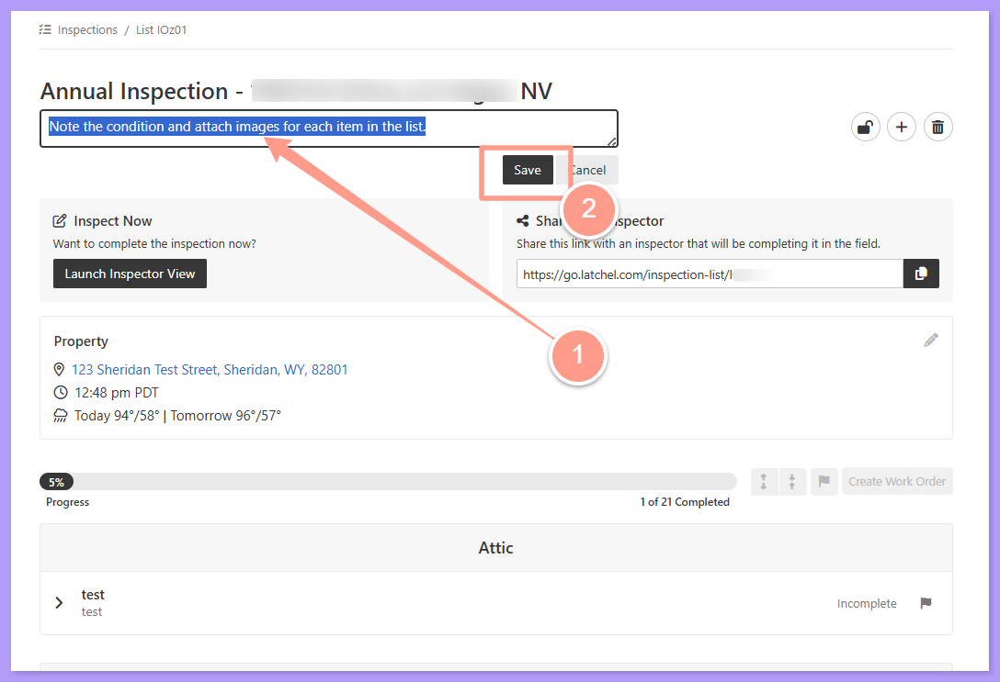
</Frame>

- **Update/Edit an Inspection Item**

<Steps>
  <Step title="**Expand the item and click Edit**" icon="1" iconType="sharp-solid" stepNumber={1} titleSize="p">
    To update an inspection item, **locate the item** you need to edit, **expand it** to reveal the Edit button, then click **Edit**.

    <Frame>
      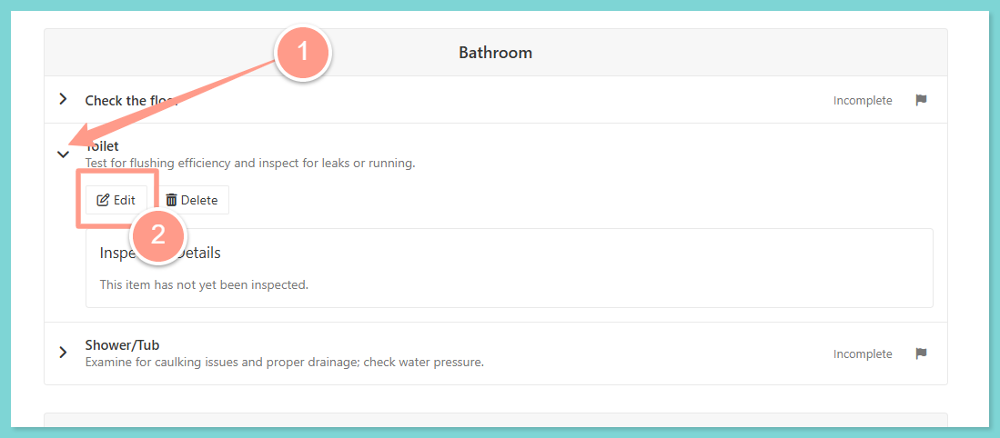
    </Frame>
  </Step>
  <Step title="**Make your changes and click Update**" icon="2" iconType="sharp-solid" stepNumber={2} titleSize="p">
    **Make the changes** you need—**area, name, or instructions**. Click **Update** once you're finish.

    <Frame>
      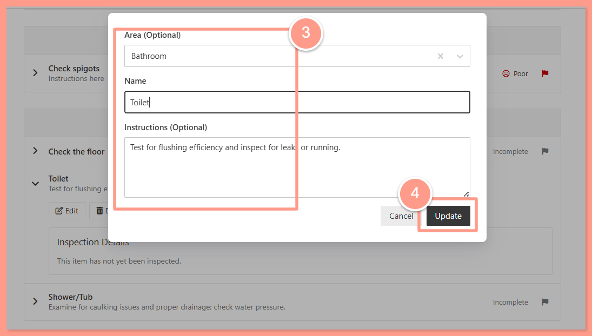
    </Frame>

    The changes you made will automatically **appear** instantly.

    <Frame>
      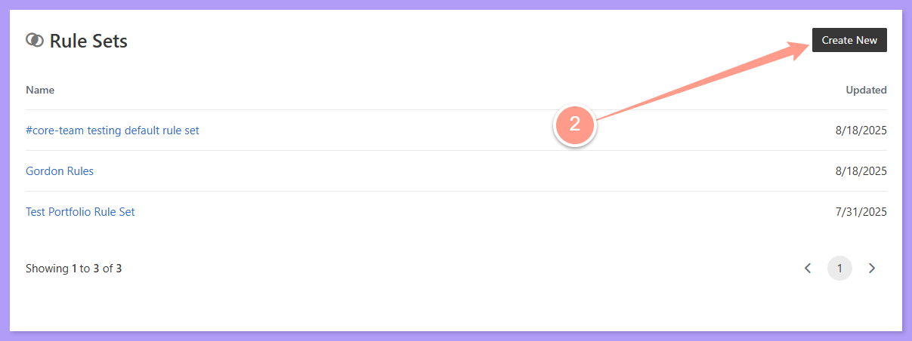
    </Frame>
  </Step>
</Steps>