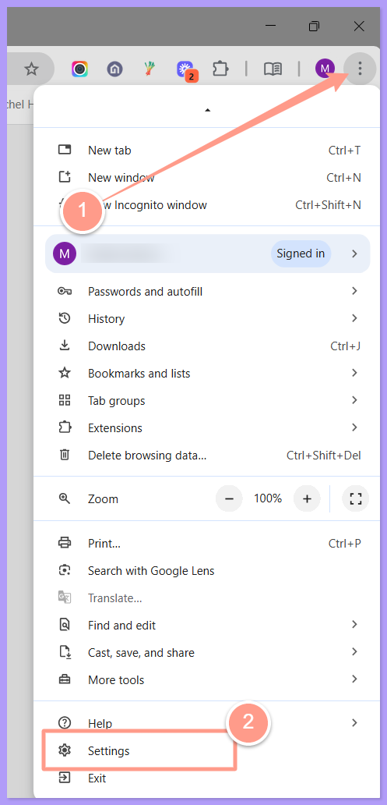
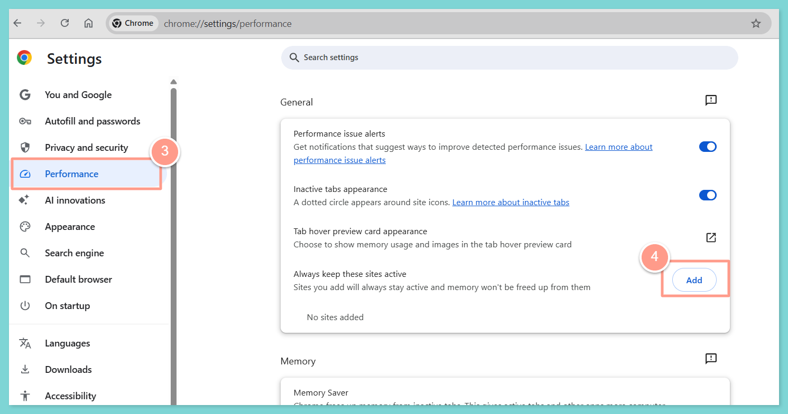
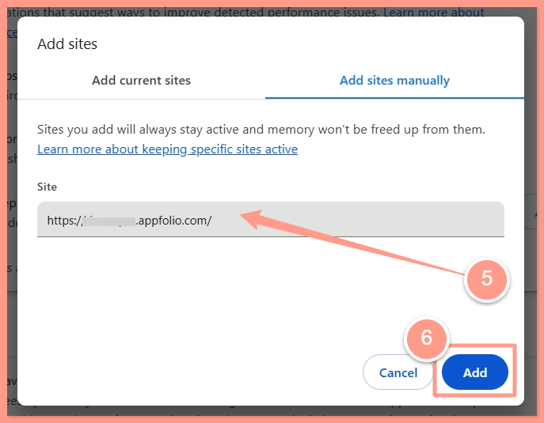
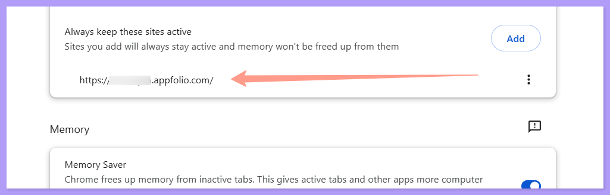

By default, **Chrome puts inactive tabs to sleep**, which can pause the auto sync process in the background. If you’ve ever seen a **“sync not running”** message, this might be the culprit.

## **How to Prevent It**

<Steps>
  <Step title="**Open Chrome Settings**" icon="1" iconType="sharp-solid" stepNumber={1} titleSize="p">
    Open **Chrome Settings**. Click the **three dots** in the top-right corner of Chrome, then go to Settings.

    <Frame>
      
    </Frame>
  </Step>
  <Step title="**Go to Performance Settings and click Add**" icon="2" iconType="sharp-solid" stepNumber={2} titleSize="p">
    Go to **Performance Settings**. Scroll to **Always keep these sites active**. Click **Add**.

    <Frame>
      
    </Frame>
  </Step>
  <Step title="**Add your platform URL**" icon="3" iconType="sharp-solid" stepNumber={3} titleSize="p">
    Whitelist your third-party platform dashboard. Enter your platform URL. This ensures Chrome doesn't suspend the tab. Click **Add** to confirm the change. Make sure **your URL** now **appears** in the **"Always Active"** list.

    <Frame>
      
    </Frame>

    <Frame>
      
    </Frame>
  </Step>
</Steps>

And that's how you can prevent Chrome from interrupting your automatic data sync\! 