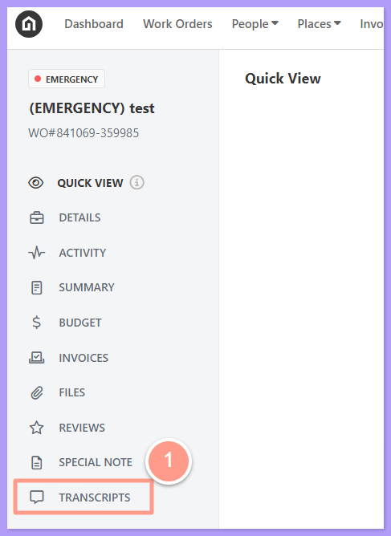
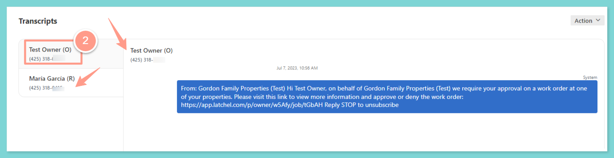

This feature is designed to provide a comprehensive view of all conversations related to a specific work order, including those between resident owners, service providers, and anyone at your company or Latchel.

## **How to View SMS Transcripts**

<Steps>
  <Step title="**Click Transcripts**" icon="1" iconType="sharp-solid" stepNumber={1} titleSize="p">
    From the work order page, click **Transcripts** on the left bottom part of the page.
    <Frame>
      
    </Frame>
  </Step>
  <Step title="**Select the SMS conversation**" icon="2" iconType="sharp-solid" stepNumber={2} titleSize="p">
    From here, you will see the conversations related to the work order. If there are multiple SMS conversations, select the SMS conversation you wish to view by clicking the **recipient's name** on the left.

    <Frame>
      
    </Frame>

    <Note>
      SMS conversations must be tagged to the correct work order. We also recognize that residents, service providers, and owners might have multiple contact numbers. For ease of reference, these numbers are conveniently located right below the individual's name. The contact numbers of the recipient can be seen both in the SMS header and the left tab.
    </Note>
  
  </Step>
</Steps>
