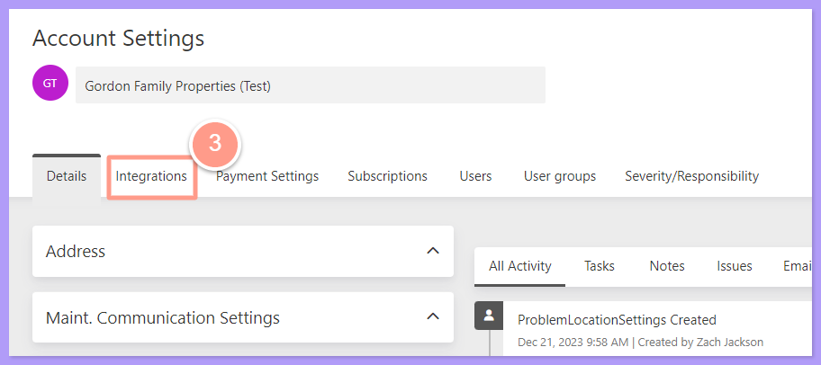
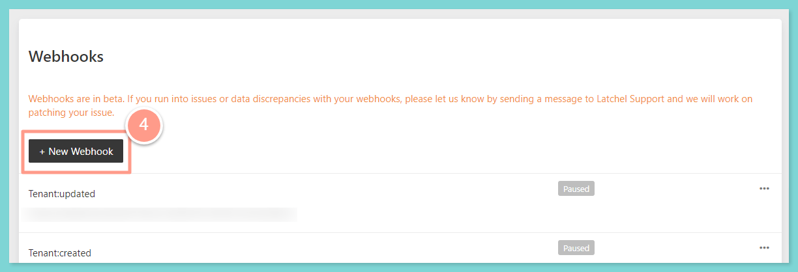
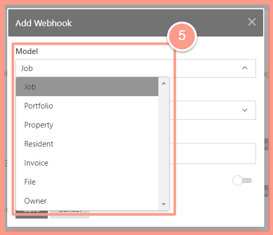
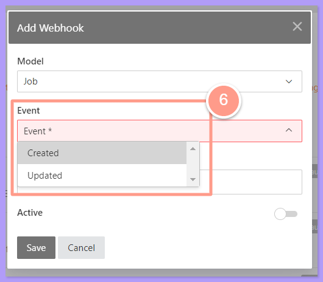
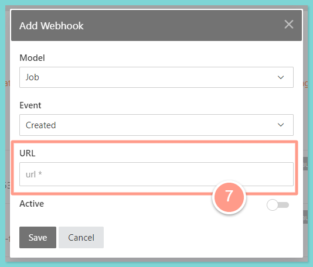

## **How to Set Up a Webhook Subscription**

<Steps>
  <Step title="**Open Account Settings**" icon="1" iconType="sharp-solid" stepNumber={1} titleSize="p">
    From the Latchel dashboard click the **Account Dropdown** icon located at the upper right corner, and select **Account Settings**.

    <Frame>
      
    </Frame>
  </Step>
  <Step title="**Click the Integrations tab**" icon="2" iconType="sharp-solid" stepNumber={2} titleSize="p">
    In the Account Settings page click the **Integrations** tab.

    <Frame>
      
    </Frame>
  </Step>
  <Step title="**Click the New Webhook icon**" icon="3" iconType="sharp-solid" stepNumber={3} titleSize="p">
    Scroll down to the Webhook section, then click the **New Webhook icon.**

    <Frame>
      
    </Frame>
  </Step>
  <Step title="**Set the Model, Event, and URL**" icon="4" iconType="sharp-solid" stepNumber={4} titleSize="p">
    Then on the pop-up window set the desired **Model**, **Event**, and the **URL** that the webhook developer will provide.

    <Frame>
      
    </Frame>

     

     

    <Frame>
      
    </Frame>
  </Step>
  <Step title="**Set the toggle to Active**" icon="5" iconType="sharp-solid" stepNumber={5} titleSize="p">
    Set the toggle to **Active**.

    <Frame>
      
    </Frame>
  </Step>
</Steps>

## **Related Guides**

**Do you want to learn more about Latchel Webhooks? Check the link below\!**

<CardGroup cols={2}>
  <Card title="Latchel Webhooks (1.0.0)" icon="webhook" iconType="duotone" horizontal href="https://papi.latchel.com/api-docs/webhooks/">
    
  </Card>
</CardGroup>