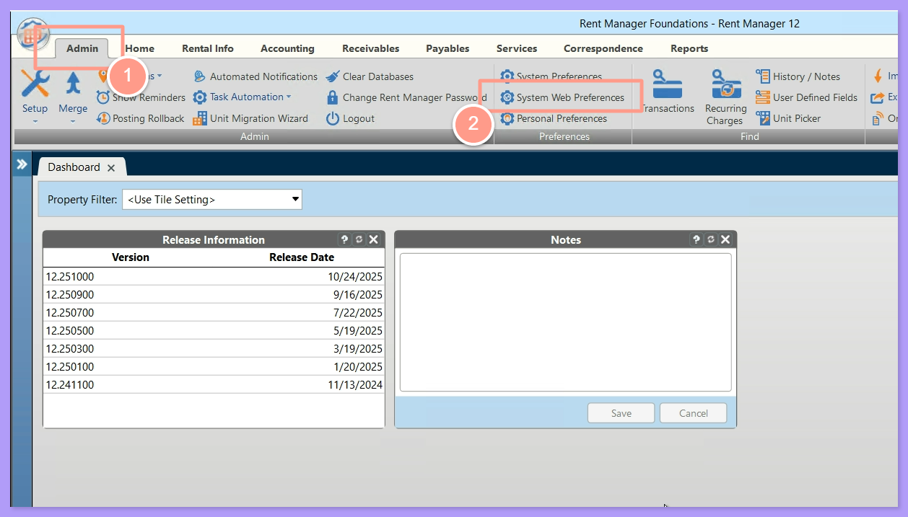
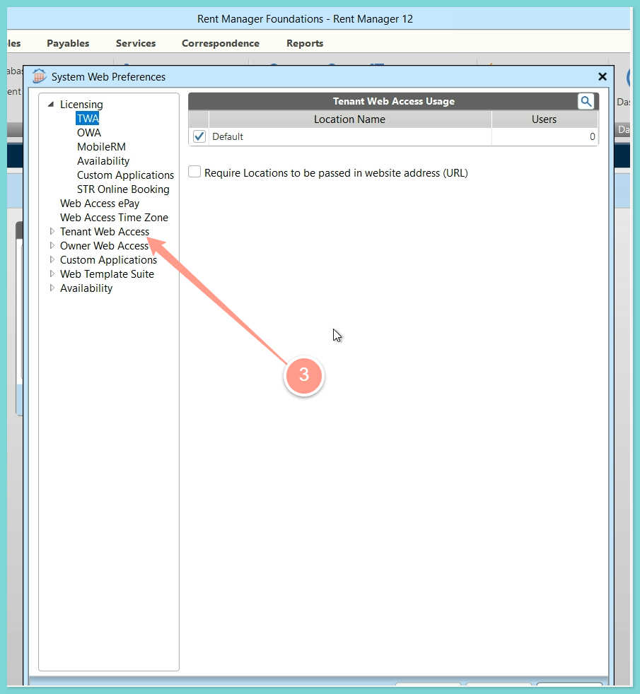
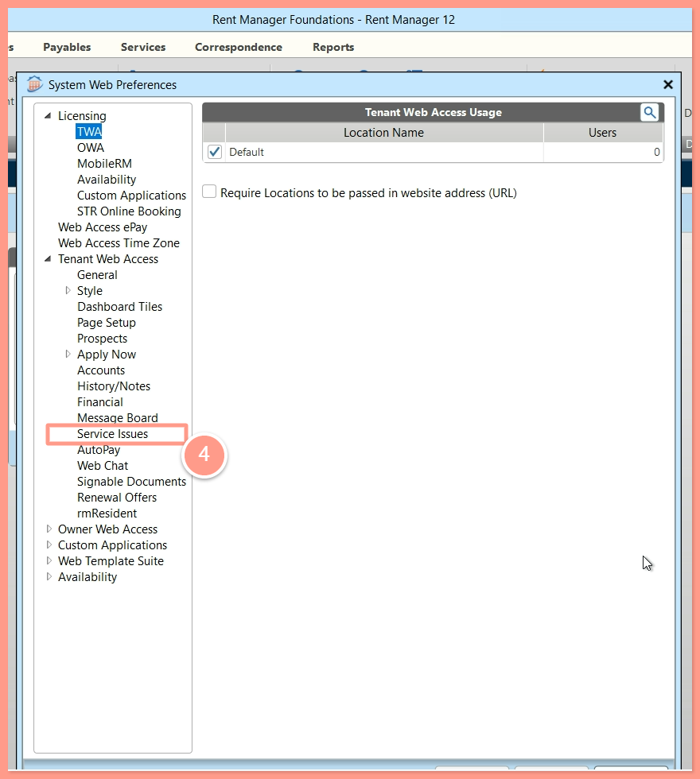
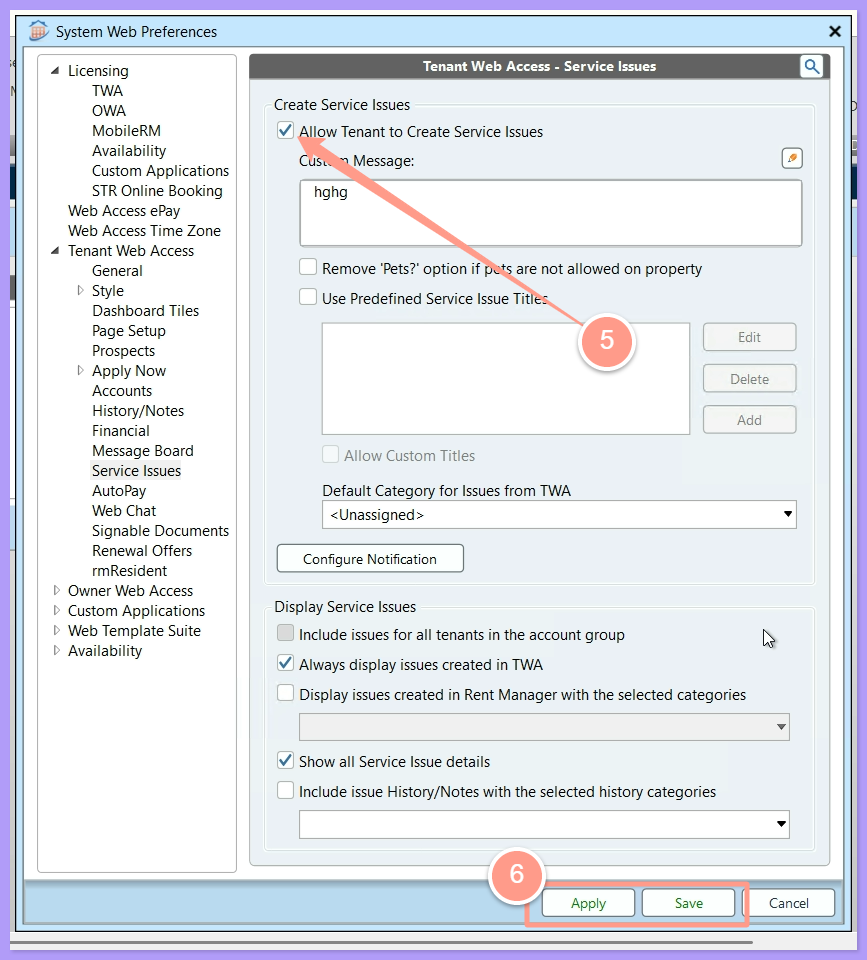
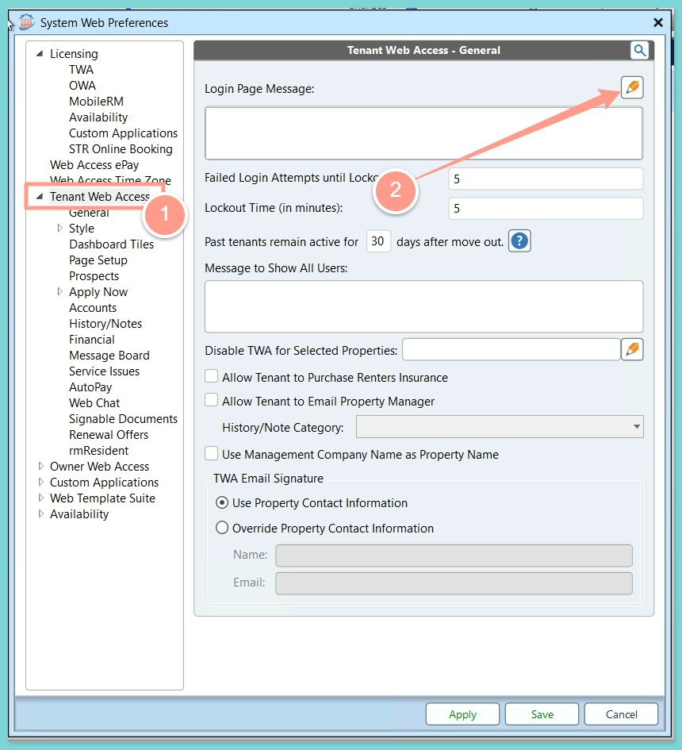
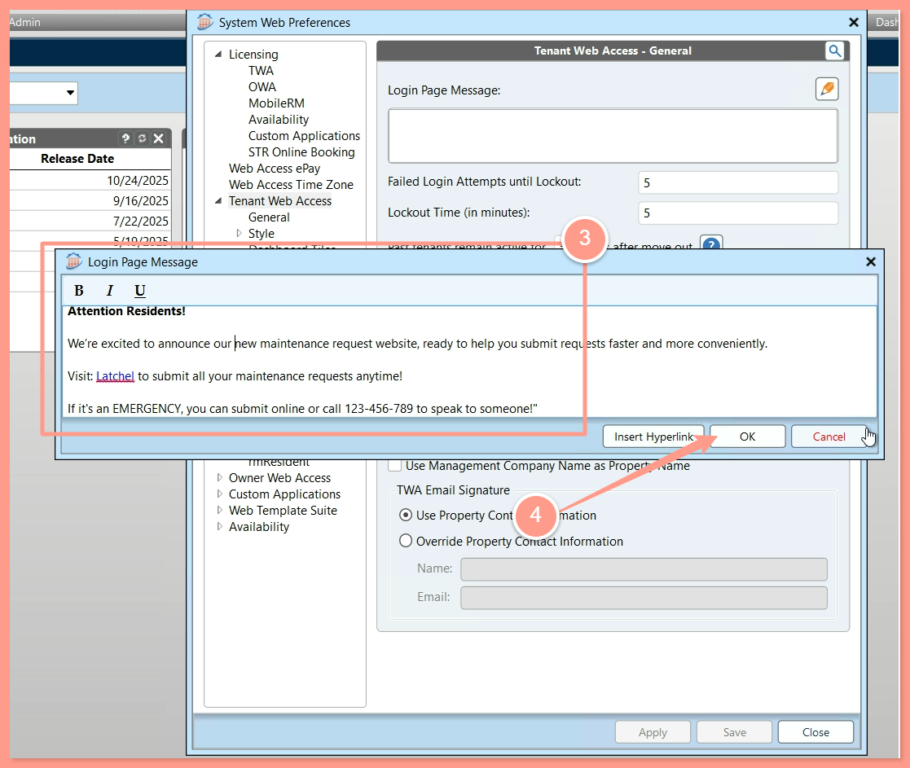
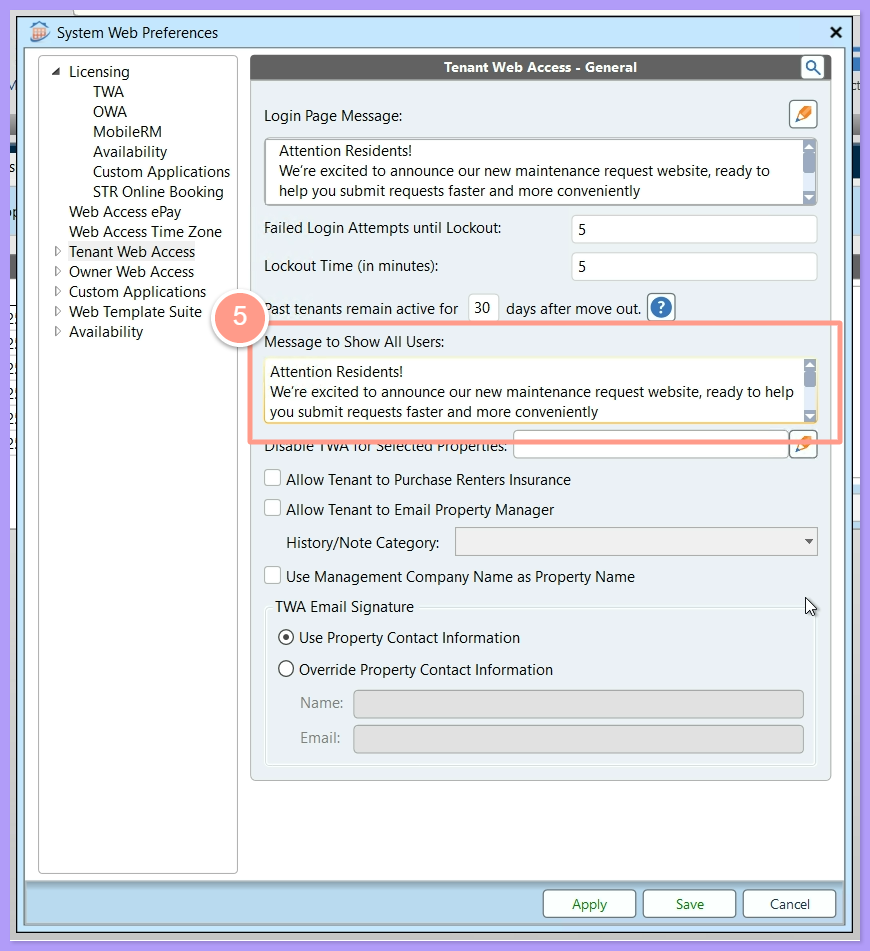
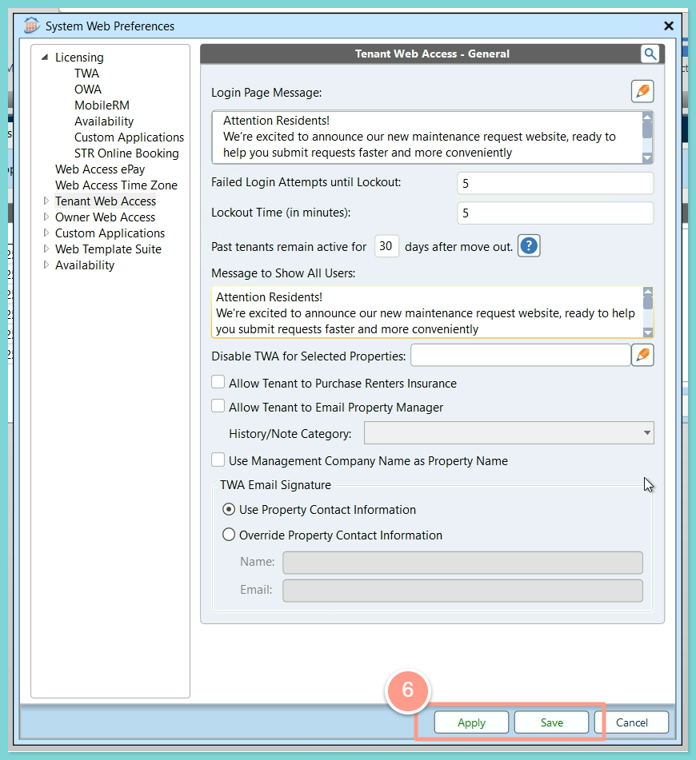

## **Disabling Tenant to Create Service Issues**

<Steps>
  <Step title="**Open System Web Preferences**" icon="1" iconType="sharp-solid" stepNumber={1} titleSize="p">
    Go to your **Admin** page in your Rent Manager account. Then open **System Web Preferences**.

    <Frame>
      
    </Frame>
  </Step>
  <Step title="**Select Tenant Web Access**" icon="2" iconType="sharp-solid" stepNumber={2} titleSize="p">
    Select **Tenant Web Access** from the list on the left.

    <Frame>
      
    </Frame>
  </Step>
  <Step title="**Select Service Issues**" icon="3" iconType="sharp-solid" stepNumber={3} titleSize="p">
    Select **Service Issues** from the options presented.

    <Frame>
      
    </Frame>
  </Step>
  <Step title="**Uncheck Allow Tenant to Create Service Issues**" icon="4" iconType="sharp-solid" stepNumber={4} titleSize="p">
    Uncheck the box labeled **Allow Tenant to Create Service Issues** to disable this feature, then click **Apply** and **Save**.

    <Frame>
      
    </Frame>

    <Warning>
      This option is only viable if Latchel is handling maintenance for **all units** in Rent Manager, as it applies a global change across the system.
    </Warning>
  </Step>
</Steps>

## **Redirect Maintenance: Before Login to Rent Manager**

After disabling tenant access to create maintenance requests in Rent Manager, add a **login page banner** to redirect residents to Latchel. This ensures requests are submitted directly through Latchel for proper tracking and faster service.

<Steps>
  <Step title="**Click the pencil icon**" icon="1" iconType="sharp-solid" stepNumber={1} titleSize="p">
    Also under **System Web Preferences**, go to **Tenant Web Access**. Then click the **pencil icon**.

    <Frame>
      
    </Frame>
  </Step>
  <Step title="**Add your banner and click OK**" icon="2" iconType="sharp-solid" stepNumber={2} titleSize="p">
    Then **add your personalized banner** as shown below. You can customize your banner however you like. Click **OK** to save.

    <Tip>
      If you like to redirect customers to Latchel, just add your resident's work order URL by clicking **Insert Hyperlink**.
    </Tip>

    <Frame>
      
    </Frame>

    <Tip>
      **Sample Banner:**

      Attention Residents!

      We’re excited to announce our new maintenance request website, ready to help you submit requests faster and more conveniently.

      - Visit: [RESIDENT WO URL] to submit all your maintenance requests anytime!
      - If it's an EMERGENCY, you can submit online or call [LATCHEL ASSIGNED PHONE] to speak to someone!
    </Tip>
  </Step>
  <Step title="**Paste the message in Message to Show All Users**" icon="3" iconType="sharp-solid" stepNumber={3} titleSize="p">
    Next, **copy** your customized login page message and **paste it** into the **Message to Show All Users** field as well.

    <Frame>
      
    </Frame>
  </Step>
  <Step title="**Click Apply and Save**" icon="4" iconType="sharp-solid" stepNumber={4} titleSize="p">
    Click **Apply and Save** once done.

    <Frame>
      
    </Frame>
  </Step>
</Steps>