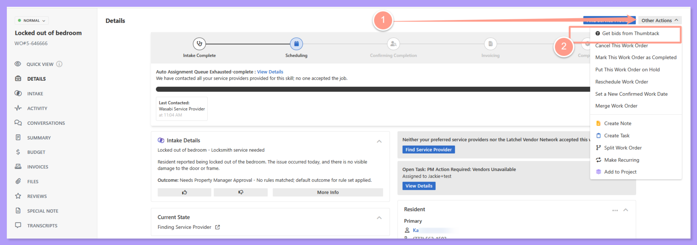
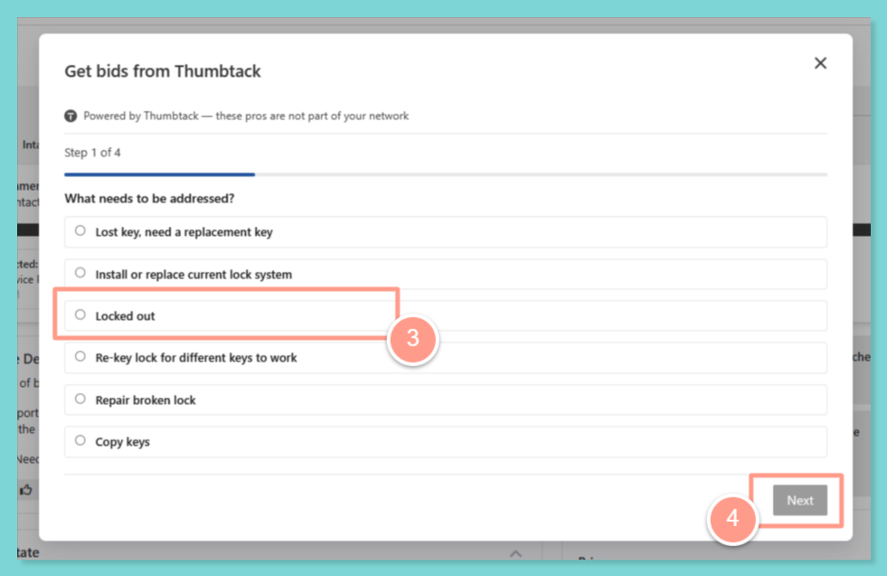
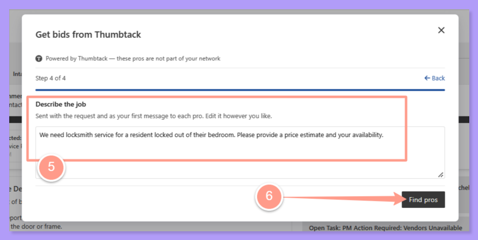

<Note>
  Thumbtack search is available on work orders that don't have a service provider assigned yet. Questions? Email [**success@latchel.com**](mailto:success@latchel.com).
</Note>

Running short on service providers in an area? Latchel's partnership with **Thumbtack** puts a wider bench of local pros right inside your work order. You can get real quotes from new pros, assign one to the job, and keep the ones you like for next time, all without leaving Latchel.

<Check>
  **In other words:**

  When you don't have a service provider for a job, you can find one on Thumbtack from the work order, get quotes, and add the pro to your network if they do great work.
</Check>

## **What This Feature Does**

<CardGroup cols={2}>
  <Card title="Suggested when you need it" color="#ff9b8a" icon="lightbulb-on" iconType="duotone">
    If your auto-queue comes up empty, Latchel suggests looking for a pro on Thumbtack.
  </Card>

  <Card title="Real quotes, not just names" color="#7ed5d5" icon="file-invoice-dollar" iconType="duotone">
    Answer a few quick questions about the job, then message one or more nearby pros for quotes.
  </Card>

  <Card title="Right inside the work order" color="#7ed5d5" icon="table-columns" iconType="duotone">
    Your search and messages with pros live in a **Thumbtack** tab on the work order.
  </Card>

  <Card title="Grow your network" color="#ff9b8a" icon="user-plus" iconType="duotone">
    Liked how a pro handled the job? Add them as a preferred service provider.
  </Card>
</CardGroup>

## **How to Get Bids From New Service Providers with Thumbtack**

<Steps>
  <Step title="**Open the work order.**" icon="1" iconType="sharp-solid" stepNumber={1} titleSize="p">
    Go to **Work Orders** on your Latchel dashboard and open a work order that doesn't have a service provider assigned yet.

    {/* TODO: screenshot of a work order with no service provider assigned */}
  </Step>
  <Step title="**Start a Thumbtack search.**" icon="2" iconType="sharp-solid" stepNumber={2} titleSize="p">
    Click **Other Actions** and choose the option to find a pro on Thumbtack. If your auto-queue came up empty, you'll also see a suggestion to look for a pro on Thumbtack.

    <Frame>
      
    </Frame>
  </Step>
  <Step title="**Answer a few questions about the job.**" icon="3" iconType="sharp-solid" stepNumber={3} titleSize="p">
    Tell us a bit about the work. We'll pre-fill what we can from the work order, so you only need to fill in the rest.

    <Frame>
      
    </Frame>
  </Step>
  <Step title="**Message pros for quotes.**" icon="4" iconType="sharp-solid" stepNumber={4} titleSize="p">
    Pick one or more nearby pros and message them for quotes from the **Thumbtack** tab on the work order.

    <Frame>
      
    </Frame>
  </Step>
  <Step title="**Assign the pro to the work order.**" icon="5" iconType="sharp-solid" stepNumber={5} titleSize="p">
    Once you've chosen a pro, assign them to the work order so they can get started.

    {/* TODO: screenshot of assigning a Thumbtack pro */}
  </Step>
  <Step title="**Add them to your network.**" icon="6" iconType="sharp-solid" stepNumber={6} titleSize="p">
    When the job is done and you liked the work, add the pro as a preferred service provider so they're easy to bring back next time.
  </Step>
</Steps>

## **Things to Remember**

<Tip>
  You don't have to wait for the auto-queue. You can start a Thumbtack search any time from **Other Actions** on a work order that doesn't have a service provider yet.
</Tip>

## **Frequently Asked Questions**

<AccordionGroup>
  <Accordion title="Can I ask more than one pro for a quote?">
    Yes. You can message one or more nearby pros for quotes from the **Thumbtack** tab on the work order.
  </Accordion>

  <Accordion title="Which work orders can I use Thumbtack on?">
    Thumbtack search is available on work orders that don't have a service provider assigned yet.
  </Accordion>

  <Accordion title="Can I use the same pro again?">
    Yes. After the job is done, add them as a preferred service provider and they'll be part of your network for future work orders.
  </Accordion>
</AccordionGroup>
