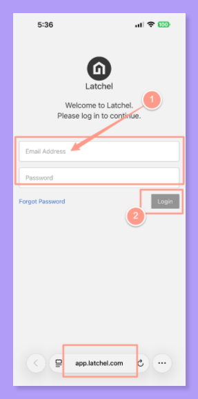
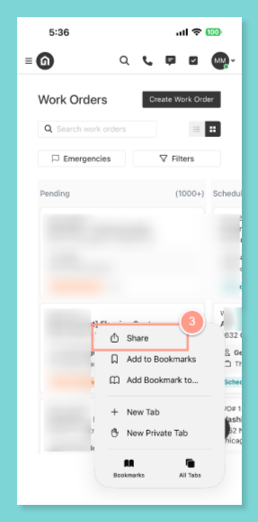
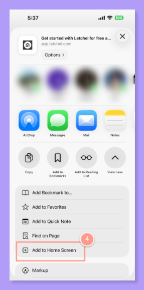
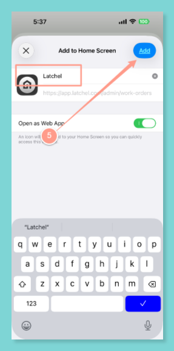
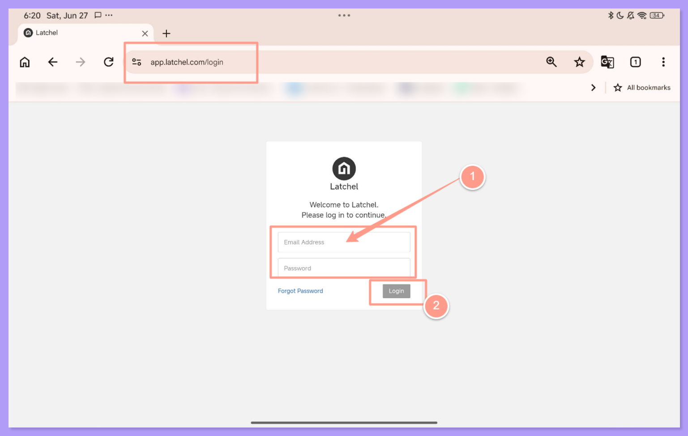
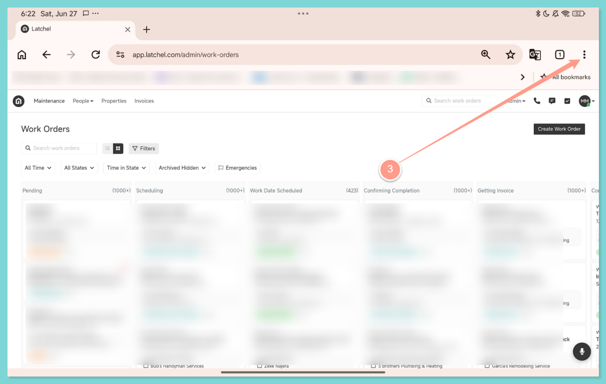
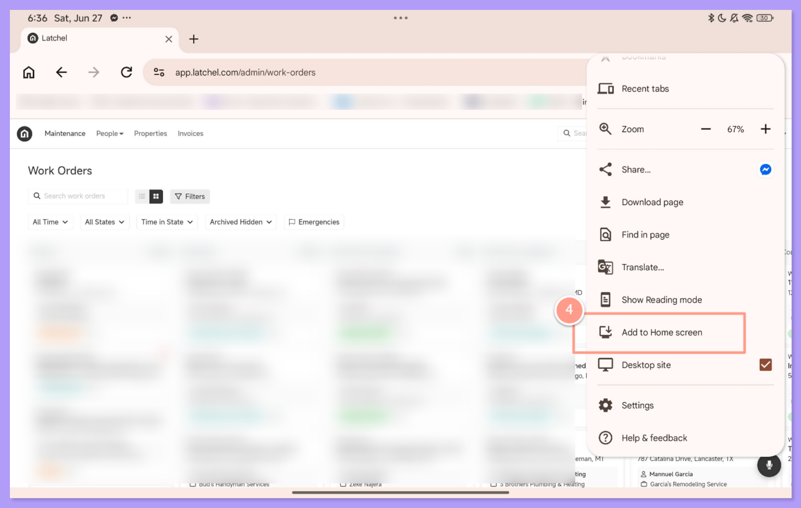
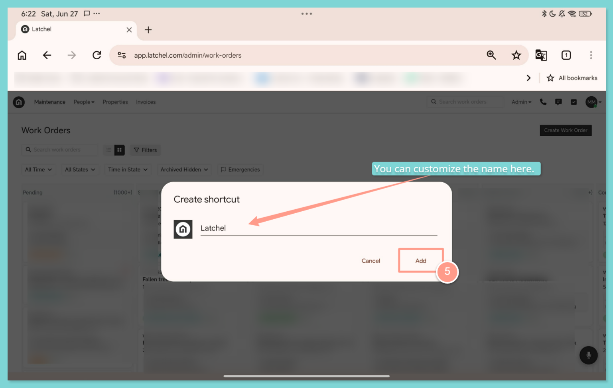

Latchel works as a Progressive Web App (PWA), which means you can add it to your phone's home screen for quick, app-like access — no App Store or Play Store download required.

<Note>
  This adds a shortcut to the Latchel web app — it is not a download from the App Store or Google Play. There is currently no native Latchel app in either store.
</Note>

## **iPhone / iPad (Safari)**

<Steps>
  <Step title="**Open Safari and go to Latchel**" icon="1" iconType="sharp-solid" stepNumber={1} titleSize="p">
    Open Safari and go to [app.latchel.com](http://app.latchel.com). Log in if prompted.

    <Frame>
      
    </Frame>
  </Step>
  <Step title="**Tap the Share icon**" icon="2" iconType="sharp-solid" stepNumber={2} titleSize="p">
    Tap the **Share icon** (the square with an arrow pointing up) in the bottom toolbar.

    <Frame>
      
    </Frame>
  </Step>
  <Step title="**Tap Add to Home Screen**" icon="3" iconType="sharp-solid" stepNumber={3} titleSize="p">
    Scroll down and tap **Add to Home Screen**.

    <Frame>
      
    </Frame>
  </Step>
  <Step title="**Edit the name and tap Add**" icon="4" iconType="sharp-solid" stepNumber={4} titleSize="p">
    Edit the name if you'd like, then tap **Add** in the top-right corner.

    <Frame>
      
    </Frame>

    The Latchel icon will now appear on your home screen — tap it any time for quick access.
  </Step>
</Steps>

## **Android (Chrome)**

<Steps>
  <Step title="**Open Chrome and go to Latchel**" icon="1" iconType="sharp-solid" stepNumber={1} titleSize="p">
    Open Chrome and go to [app.latchel.com](http://app.latchel.com). Log in if prompted.

    <Frame>
      
    </Frame>
  </Step>
  <Step title="**Tap the three-dot menu**" icon="2" iconType="sharp-solid" stepNumber={2} titleSize="p">
    Tap the **three-dot menu** in the top-right corner.

    <Frame>
      
    </Frame>
  </Step>
  <Step title="**Tap Add to Home screen**" icon="3" iconType="sharp-solid" stepNumber={3} titleSize="p">
    Tap **Add to Home screen** (you may see this as **Install app** depending on your Android/Chrome version).

    <Frame>
      
    </Frame>
  </Step>
  <Step title="**Confirm by tapping Add or Install**" icon="4" iconType="sharp-solid" stepNumber={4} titleSize="p">
    Confirm by tapping **Add** or **Install**.

    <Frame>
      
    </Frame>

    The Latchel icon will now appear on your home screen — tap it any time for quick access.
  </Step>
</Steps>

## **Why Add Latchel to Your Home Screen?**

- **Quicker access** — no need to type the URL or dig through browser bookmarks
- **Full-screen, app-like experience**
- **Notifications and updates** work the same as logging in through your browser