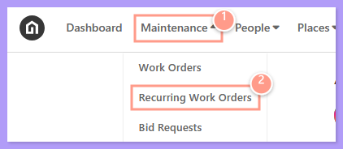
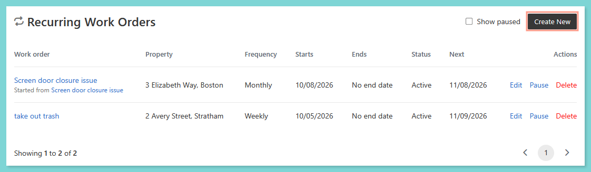
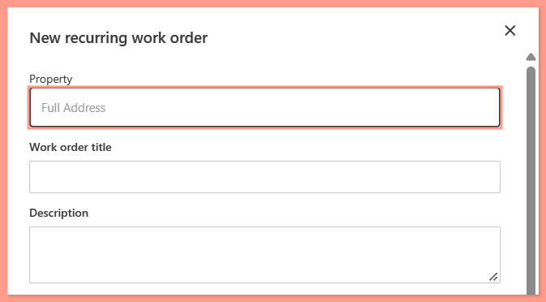
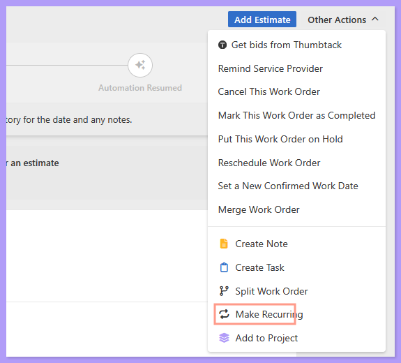
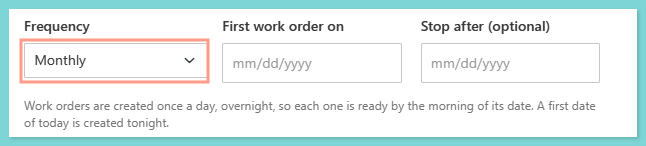
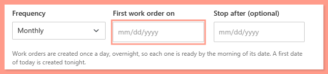
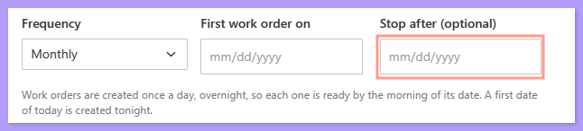
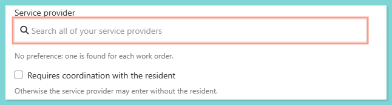
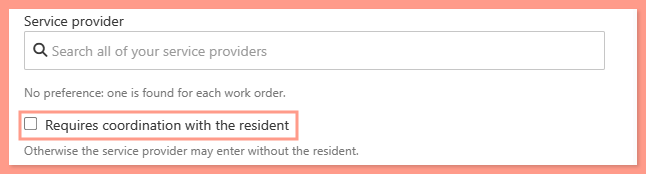
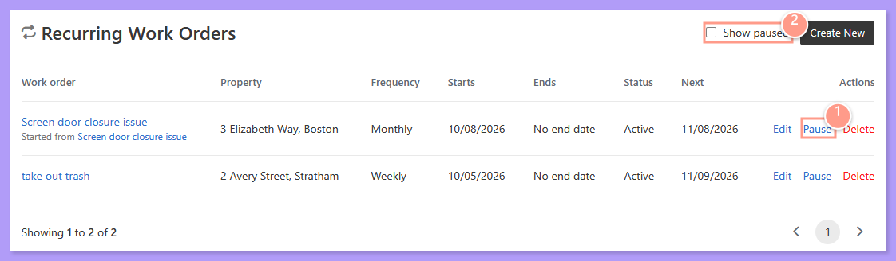

Recurring Work Orders allow you to automate repeating maintenance tasks — like landscaping, pest control, pool cleaning, or HVAC filter changes — so you don't have to manually create the same work order every week, month, or quarter. You can now **create, view, and manage your recurring work orders directly in Latchel**, with no forms to fill out.

**New to Recurring Work Orders? Check out:**

<Card title="Recurring Work Orders" color="#ff9b8a" icon="arrows-spin" horizontal href="/s/topic/0TO5e000000h9wqGAA/recurring-work-orders">
  A quick guide for property managers on how to automate and manage repetitive maintenance using Latchel's recurring work order system.
</Card>

<Note>
  **Already have recurring work orders set up with Latchel?** Recurring work orders that our team set up for you through the previous request form will be moved into your **Recurring Work Orders** page by Latchel. You don't need to submit them again.
</Note>

## **Creating a New Recurring Work Order**

There are three ways to create a recurring work order. Each one asks for the same schedule details (see [Setting the Schedule and Details](#setting-the-schedule-and-details) below).

### **Option 1 — From the Recurring Work Orders Page**

<Steps>
  <Step title="**Go to Recurring Work Orders**" icon="1" iconType="sharp-solid" stepNumber={1} titleSize="p">
    From your dashboard, go to the **Maintenance** tab and select **Recurring Work Orders**.

    <Frame>
      
    </Frame>
  </Step>
  <Step title="**Create the work order and select the property**" icon="2" iconType="sharp-solid" stepNumber={2} titleSize="p">
    Create a new recurring work order, then search for and select the **property** where the work needs to be done. Describe the work, then set the schedule and details.

    <Frame>
      
    </Frame>

    <Frame>
      
    </Frame>
  </Step>
</Steps>

### **Option 2 — From an Existing Work Order**

Any work order can be turned into a recurring one. Open the work order and click **Make Recurring**.

<Frame>
  
</Frame>

The work order's information is pre-filled for you, so you only need to set the schedule and details.

### **Option 3 — While Creating a New Work Order**

Anywhere in Latchel where you can create a work order, you'll see the option to **Repeat this work order on a schedule**. Select it, complete the work order as usual, and set the schedule and details.

## **Setting the Schedule and Details**

<Steps>
  <Step title="**Choose the frequency**" icon="1" iconType="sharp-solid" stepNumber={1} titleSize="p">
    **Frequency** — Choose how often the work order should repeat.

    <Frame>
      
    </Frame>
  </Step>
  <Step title="**Choose the start date**" icon="2" iconType="sharp-solid" stepNumber={2} titleSize="p">
    **Start Date** — Choose when the series should begin.

    <Frame>
      
    </Frame>
  </Step>
  <Step title="**Add an end date**" icon="3" iconType="sharp-solid" stepNumber={3} titleSize="p">
    **End Date (optional)** — Add a stop date if the work should only repeat for a set period. Leave it blank to keep the series going.

    <Frame>
      
    </Frame>
  </Step>
  <Step title="**Select a service provider**" icon="4" iconType="sharp-solid" stepNumber={4} titleSize="p">
    **Service Provider (optional)** — If you always want the same vendor to complete this work, select them here and they'll be assigned to every work order in the series.

    <Frame>
      
    </Frame>
  </Step>
  <Step title="**Choose resident coordination**" icon="5" iconType="sharp-solid" stepNumber={5} titleSize="p">
    **Requires coordination with resident** — Choose whether Latchel needs to coordinate with the resident:
       - **Selected:** The resident will be notified and asked for their availability. Use this for work that requires entering the home, like HVAC maintenance.
       - **Not selected:** The work order is treated as having **permission to enter**. Use this for work that doesn't require entering the home, like mowing or pool treatments.

    <Frame>
      
    </Frame>
  </Step>
</Steps>

<Tip>
  **Use an outside tool for recurring inspections?** Create a recurring work order in Latchel and add the link to your external inspection tool in the **work order description**.
</Tip>

## **How the Series Works**

- The **next work order** in the series is created once the current one is **completed**.
- When you open a recurring work order from the **Recurring Work Orders** page, you'll see the next work order in the series and a list of the work orders created so far.
- Work orders that belong to a series show a **Recurring Work Order** indicator on the work order page, so you can easily tell them apart from one-time jobs.
- Recurring work orders created from an existing work order show which work order they were **started from**.

## **Pausing and Resuming a Recurring Work Order**

From the **Maintenance** tab, open **Recurring Work Orders** to see all of your recurring work orders.

- **To pause** a recurring work order, select **Pause**. No new work orders will be created while it's paused.
- **To resume** a paused recurring work order, find it in your paused list and select **Resume**.

<Frame>
  
</Frame>

## **Recurring Work Orders for Common Areas**

If the work is for a whole building or common area (for example, hallways or landscaping), the common area must exist as a property in Latchel before you can select it. If you don't see the common area property you need, contact [opsintegrations@latchel.com](mailto:opsintegrations@latchel.com) and we'll create it for you.

## **Have Questions?**

<Tip>
  For assistance with recurring work orders, contact the Latchel Operations Integrations team: [opsintegrations@latchel.com](mailto:opsintegrations@latchel.com)
</Tip>
