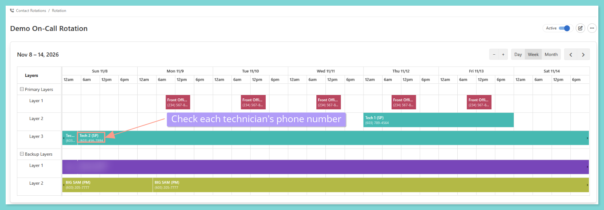

<Note>
  **This guide is for property managers who use on-call alerts.** Share it with your on-call technicians so they know how to make sure alerts reach them. On-call needs the ER-SaaS-RBP package with "On-Call". If you're not sure it applies to you, reach out to your Customer Success Manager.
</Note>

Nothing slows down an emergency like an alert that never reaches your technician. This guide helps your technicians get on-call calls and texts from Latchel, and shows what to check when they don't.

<Check>
  **In other words:**

  Make sure the technician's number is right, let Latchel's alerts through on their phone, and reply to the alert to accept it.
</Check>

## **How On-Call Alerts Reach Your Technicians**

<CardGroup cols={2}>
  <Card title="Calls or texts" color="#ff9b8a" icon="phone-volume" iconType="duotone">
    Alerts notify your technician by call or text.
  </Card>

  <Card title="Reply to accept" color="#7ed5d5" icon="message-check" iconType="duotone">
    A technician accepts an alert by replying to the call or text.
  </Card>

  <Card title="No reply, next person" color="#7ed5d5" icon="forward" iconType="duotone">
    If the technician takes no action, the alert passes to the next person in the rotation.
  </Card>

  <Card title="Email as a last resort" color="#ff9b8a" icon="envelope" iconType="duotone">
    If no one acknowledges after all attempts, the final escalation group gets an email.
  </Card>
</CardGroup>

New to contact rotations? See the guide below to learn how alerts move through them.

<Card title="Contact Rotation: Getting Started" color="#ff9b8a" icon="calendar-plus" iconType="duotone" href="/s/topic/0TO5e000000h9wqGAA/on-call-rotation-getting-started">
  How contact rotations work and how alerts move through them.
</Card>

## **How to Make Sure Technicians Receive On-Call Alerts**

<Steps>
  <Step title="**Check the technician's phone number in the rotation**" icon="1" iconType="sharp-solid" stepNumber={1} titleSize="p">
    Open your contact rotation and confirm each technician's phone number is correct.

    <Frame>
      
    </Frame>

    Need the steps for opening or editing a rotation? See the guide below.

    <Card title="How to Set Up and Edit a Contact Rotation" color="#ff9b8a" icon="calendar-pen" iconType="duotone" href="/s/topic/0TO5e000000h9wqGAA/How-to-Set-up-an-On-Call-Rotation">
      Create a rotation, add layers and people, and change it later.
    </Card>
  </Step>
  <Step title="**Let the Latchel on-call number through on the technician's phone**" icon="2" iconType="sharp-solid" stepNumber={2} titleSize="p">
    Have each technician save the Latchel on-call number and allow calls and texts from it.

    Make a one-page setup guide with your logo and your Latchel numbers, then download it or share the link with your technicians. It covers the iPhone and Android settings step by step.

    <Card title="Technician Setup Guide for Emergency Alerts" color="#7ed5d5" icon="mobile-screen-button" iconType="duotone" href="/s/topic/0TO5e000000h9wqGAA/technician-emergency-alerts-setup-guide">
      Build a branded one-pager that shows technicians how to let on-call calls and texts through.
    </Card>
  </Step>
  <Step title="**Reply to the alert to accept it**" icon="3" iconType="sharp-solid" stepNumber={3} titleSize="p">
    When an alert comes in by call or text, the technician replies to accept it.

    {/* TODO: screenshot of an on-call alert text */}
  </Step>
  <Step title="**Add a backup contact**" icon="4" iconType="sharp-solid" stepNumber={4} titleSize="p">
    Add backup layers to your rotation so the alert moves on if the first technician can't answer. See the guide below.

    <Card title="How to Set Up and Edit a Contact Rotation" color="#ff9b8a" icon="calendar-pen" iconType="duotone" href="/s/topic/0TO5e000000h9wqGAA/How-to-Set-up-an-On-Call-Rotation">
      Create a rotation, add layers and people, and change it later.
    </Card>
  </Step>
</Steps>

## **Things to Remember**

<Tip>
  The shortest wait between alert attempts is 2 minutes. Normal phone delays can stretch that to about 3 minutes, so technicians should keep their phones close.
</Tip>

<Note>
  After a technician accepts an alert, they can call the resident from the alert page. See the guide below.

  <Card title="How to Call a Resident From an On-Call Alert" color="#ff9b8a" icon="phone-arrow-up-right" iconType="duotone" href="/s/topic/0TO5e000000h9wpGAA/how-to-call-a-resident-from-an-on-call-alert">
    Call the resident straight from the alert page after you accept it.
  </Card>
</Note>

## **Frequently Asked Questions**

<AccordionGroup>
  <Accordion title="What if a technician still isn't getting alerts?">
    Check the phone number in the rotation first, then check that the technician allows calls and texts from the Latchel on-call number. If it still doesn't work, email [**success@latchel.com**](mailto:success@latchel.com).
  </Accordion>

  <Accordion title="What happens if nobody answers the alert?">
    The alert passes to the next person in the rotation. If no one acknowledges it after all attempts, the final escalation group gets an email.
  </Accordion>
</AccordionGroup>
