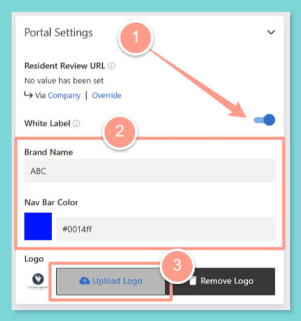

<Note>
  White labeling is set at the **Portfolio** level. It only changes what residents see for the properties in that portfolio.
</Note>

Want residents to see the name of the community they live in, instead of your company's name or Latchel's? Turn on white labeling for a portfolio, and the resident-facing screens and messages below show the community name. Residents get an experience that matches the place they call home.

<Check>
  **In other words:**

  Turn on white labeling for a portfolio, and residents there see the community name instead of property manager or Latchel branding.
</Check>

## **What This Feature Does**

When white labeling is on for a portfolio, the community name replaces property manager and Latchel branding on:

- The **resident dashboard**
- **On-call alert** public pages
- **On-call notifications**, by email and SMS

## **How to Turn On White Labeling for a Portfolio**

<Steps>
  <Step title="**Open the portfolio.**" icon="1" iconType="sharp-solid" stepNumber={1} titleSize="p">
    Click **Places**, select **Portfolios**, and open the portfolio you want to white label. Need a refresher? See our guide below.

    <Card title="Managing Your Portfolios" color="#FF9B8A" icon="folders" iconType="duotone" href="/s/topic/0TO5e000000h9wqGAA/How-to-Create-Manage-Portfolios">
      Organize properties into portfolios and streamline team or notification settings by group.
    </Card>

    {/* TODO: screenshot of the Portfolios page */}
  </Step>
  <Step title="**Turn on white labeling.**" icon="2" iconType="sharp-solid" stepNumber={2} titleSize="p">
    In the portfolio's **Portal Settings**, turn on **White Label**, then save your changes.

    <Frame>
      
    </Frame>

    {/* TODO: screenshot of White Label in the portfolio's Portal Settings */}
  </Step>
</Steps>

## **Things to Remember**

<Warning>
  Work order messages to residents can still mention your company or Latchel. White labeling doesn't cover those messages yet.
</Warning>

## **Frequently Asked Questions**

<AccordionGroup>
  <Accordion title="Does this change every portfolio?">
    No. White labeling only applies to the portfolio where you turn it on.
  </Accordion>

  <Accordion title="Will residents still see Latchel in work order texts?">
    For now, yes. Work order messages can still mention your company or Latchel.
  </Accordion>
</AccordionGroup>
