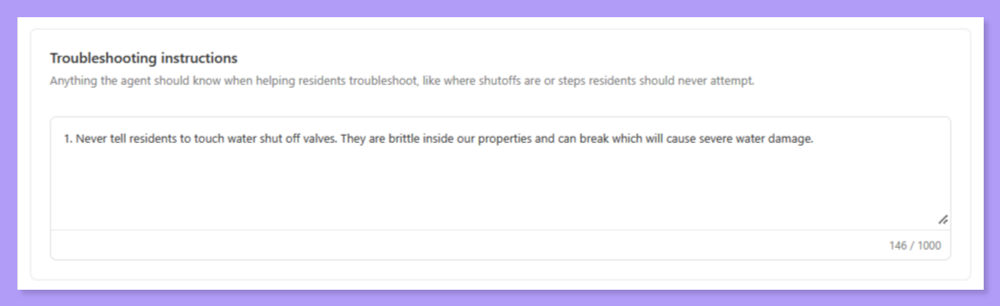
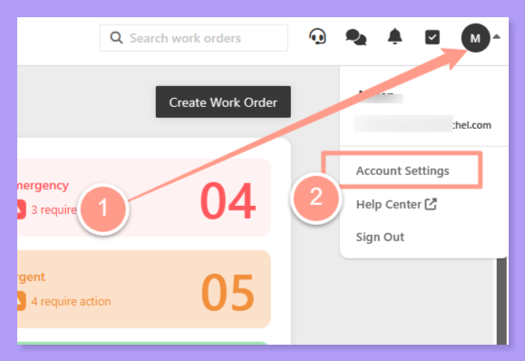
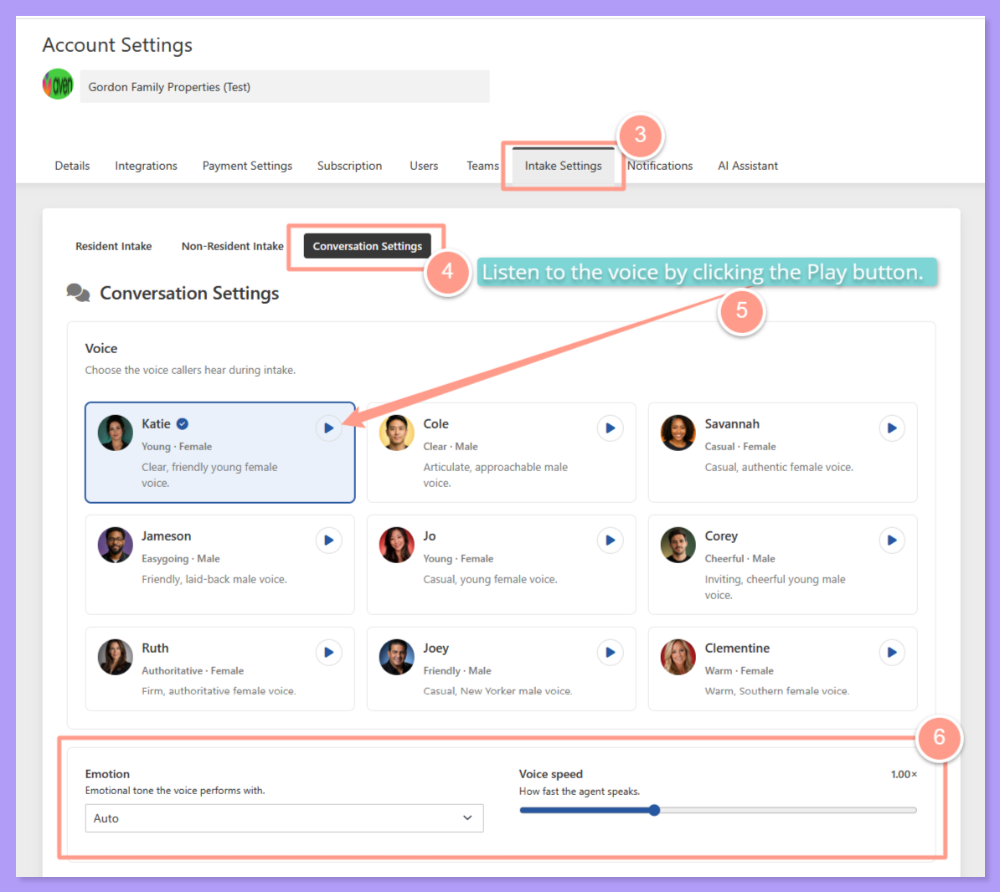
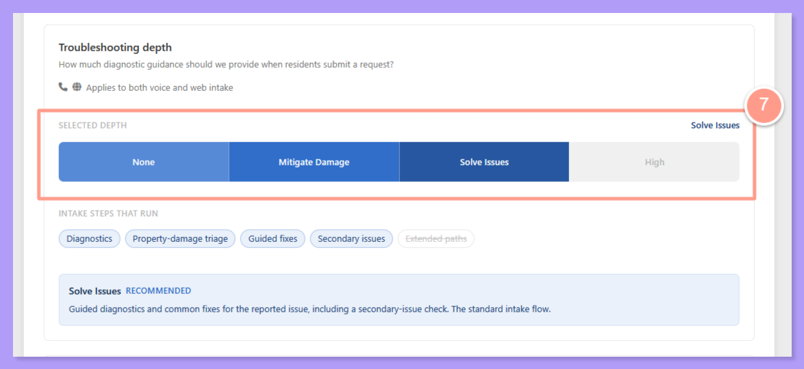

## **What is Intake Conversation Settings?**

Every resident who calls in or submits a request online meets your Latchel AI intake — and now, that AI can sound and behave the way **you** want it to.

**Intake Conversation Settings** let you personalize two things: the **voice** residents hear (including its tone and pace), and the **troubleshooting depth** they're guided through before a technician gets involved. Whether you want a calm, reassuring voice paired with hands-off troubleshooting, or a brisk, no-nonsense voice that walks residents through every possible fix first — it's your call.

<Check>
  This applies across both phone and web intake, so residents get a consistent experience no matter how they reach out.
</Check>

<Callout icon="note" iconType="duotone" color="#b19cf8">
  Intake Conversation Settings is included at no extra cost for every Latchel PM today — there's nothing to request or upgrade. It's already live in your Account Settings.
</Callout>

<Note>
  This is a newly released feature, so voice descriptions and available options may continue to be refined — check back periodically if something looks slightly different than what's described here.
</Note>

## **Choosing a Voice**

Every account starts with a default voice (a clear, friendly young female voice), but you can preview **eight alternatives**, each with a short description of its tone. For example, **Cole** is an articulate, approachable male voice, **Savannah** is a casual, authentic female voice, **Jameson** is a friendly, laid-back male voice, and **Ruth** is a firm, authoritative female voice. Click the play icon on any voice card to hear a sample before selecting it.

Whichever voice you choose applies account-wide — resident maintenance intake, non-resident intake, and eventually outbound vendor calls — so it's worth picking one that matches your brand identity.

<Note>
  Voice selection currently only affects English-language calls. Spanish-speaking residents are automatically routed to a separate Spanish voice already used elsewhere in the product.
</Note>

Two fine-tuning controls sit below the voice picker:

- **Emotion** — set the emotional tone the voice performs with (calm, happy, sympathetic, surprised, or automatic default)
- **Speed** — a slider to speed up or slow down how fast the agent talks, starting at a normal 1.00x pace

<Warning>
  The pre-recorded voice sample you hear when previewing a voice does **not** update live as you adjust Emotion or Speed below it — those are separate settings layered on top. To hear exactly how a chosen voice, emotion, and speed combination will actually sound, place a test call after saving your changes.
</Warning>

## **Setting Troubleshooting Depth**

Troubleshooting depth determines how much diagnostic guidance residents receive when they submit a maintenance request, and it applies to **all intake sessions company-wide** — both phone and web.

| **Level** | **What Happens** |
| --- | --- |
| **None** | Skips troubleshooting entirely and routes requests straight to a technician. Best for PMs who don't want residents answering any diagnostic questions. |
| **Mitigate Damage** | Limits guidance to critical, safety-related steps only — like shutting off water or avoiding electrical hazards — until a technician can arrive. |
| **Solve Issues** _(default)_ | The recommended setting. Offers guided diagnostics and common fixes for the reported problem, plus a check for related secondary issues. This is today's standard intake flow. |
| **High** | Reserved for an expanded diagnostic path coming in the future. For now, it behaves identically to Solve Issues. |

Each level shows you exactly which underlying intake steps will run (diagnostics, property-damage triage, guided fixes, secondary-issue checks, extended paths), so you can see precisely what changes as you move between levels.

<Note>
  Troubleshooting depth is currently a **company-wide setting** — it can't yet be customized by portfolio or property.
</Note>

## **Adding Troubleshooting Instructions (Beta)**

Have your own way of handling common issues? In the **Troubleshooting Instructions** section, you can write company-specific instructions in a free-text field, and Latchel AI will weave them naturally into troubleshooting with residents during intake.

<Frame>
  
</Frame>

<Note>
  Troubleshooting Instructions is a beta feature. It's set at the company level only, so it can't yet be customized by portfolio or property.
</Note>

## **Intake Rules vs. Troubleshooting Settings**

Both live on the same **Intake Settings** page, but they do different jobs. **Intake Rules** decide what happens to a work order after the conversation. **Troubleshooting** settings shape how Latchel AI talks to your resident during the conversation.

|  | **Intake Rules** | **Troubleshooting settings** |
| --- | --- | --- |
| **What it controls** | The outcome for the work order | What Latchel AI says and how far it troubleshoots |
| **Where to find it** | **Account Settings > Intake Settings > Resident Intake** | **Account Settings > Intake Settings > Conversation Settings** |
| **How it works** | Each rule pairs a plain-English situation with an outcome. For example, "No hot water for 24+ hours" can lead to **Urgent**. Latchel checks your rules against the whole conversation when the work order is created, and asks the resident follow-up questions if it needs more detail. | **Troubleshooting depth** sets how hard Latchel AI tries to solve the problem before routing the request. **Troubleshooting instructions** are free-text facts and guardrails, like "The water shutoff for every unit is in the garage." |
| **Where it applies** | Company, Portfolio, or Property level. Lower levels inherit from above unless you override them. | Company level only, for now |
| **Limits** | Up to 50 rules per rule set, and 2,000 characters per rule | Up to 1,000 characters for troubleshooting instructions |

**Intake Rule outcomes:**

- **Normal**: a service provider is dispatched.
- **Urgent**: a service provider is dispatched within a 72-hour window.
- **Emergency**: a live agent does second-level troubleshooting.
- **Needs PM Approval**: the work order waits for your approval.
- **Contact On-Call**: calls the on-call rotation you choose. This only works if your company is subscribed to the ER-SaaS-RBP package with the "On-Call" option enabled.
- **Resident Responsible**: cancels the work order and tells the resident.
- **Send Email Only**: no work order is created.

**Which one should you use?**

- To control the result (severity, approval, on-call, resident responsibility, or email only), use an **Intake Rule**.
- To change what Latchel AI says or how far it troubleshoots, use **Troubleshooting depth** or **instructions**.
- To share property facts or forbid risky DIY steps, use **Troubleshooting instructions**.

<Warning>
  Don't put outcomes in your troubleshooting instructions, like "Treat leaks as emergencies." Outcomes belong in an Intake Rule.
</Warning>

**Best practices:**

- **Rules:** Keep to one topic per rule. Use concrete thresholds like "below 50°F" or "24+ hours". Be clear about AND and OR. Don't write the outcome into the rule text, because you pick it in a separate step. The editor flags vague list pairings, unclear AND or OR, several concerns in one rule, and off-topic rules, so fix those before you save.
- **Testing:** Use the rule set tester to try sample conversations before you roll out changes.
- **Defaults:** Set the company-wide default once, and only override it at the Portfolio or Property level where one really differs.
- **Instructions:** Keep them short and factual, because Latchel AI reads them every turn.
- **Depth:** Start at **Solve Issues**. Lower it if you want service providers sent right away. Raise it if your goal is fewer emergency dispatches.

## **Steps to Activate**

<Steps>
  <Step title="**Go to Account Settings**" icon="1" iconType="sharp-solid" stepNumber={1} titleSize="p">
    Click your initials or profile picture in the upper right corner of your dashboard, then select **Account Settings**.

    <Frame>
      
      
    </Frame>
  </Step>
  <Step title="**Open Intake Settings**" icon="2" iconType="sharp-solid" stepNumber={2} titleSize="p">
    Click the **Intake Settings** tab, then select the new **Conversation Settings** tab alongside Resident Intake and Non-Resident Intake.
  </Step>
  <Step title="**Choose your voice**" icon="3" iconType="sharp-solid" stepNumber={3} titleSize="p">
    Preview the available voices, pick the one that fits your brand, and adjust Emotion and Speed if you'd like.

    <Frame>
      
    </Frame>
  </Step>
  <Step title="**Set your troubleshooting depth**" icon="4" iconType="sharp-solid" stepNumber={4} titleSize="p">
    Choose None, Mitigate Damage, Solve Issues, or High based on how much diagnostic guidance you want residents to receive.

    <Frame>
      
    </Frame>
  </Step>
  <Step title="**Add troubleshooting instructions (optional)**" icon="5" iconType="sharp-solid" stepNumber={5} titleSize="p">
    In the **Troubleshooting Instructions** section, enter any company-specific instructions you want Latchel AI to work into troubleshooting.

    <Frame>
      
    </Frame>
  </Step>
  <Step title="**Save, then place a test call**" icon="6" iconType="sharp-solid" stepNumber={6} titleSize="p">
    Save your changes, then call in as if you were a resident to confirm the voice, tone, and troubleshooting flow all sound the way you expect.
  </Step>
</Steps>

<Tip>
  Before rolling changes out, it's worth previewing this screen for anyone on your team who handles resident questions. It's a fast way to preempt objections about voice pacing or troubleshooting depth — you can always point back to this screen and say it's adjustable anytime.
</Tip>

## **Frequently Asked Questions**

<AccordionGroup>
  <Accordion title="Will changing my voice or troubleshooting depth affect calls that are already in progress?">
    No — changes apply to new intake sessions going forward. Calls or web sessions already underway continue with the settings that were active when they started.
  </Accordion>

  <Accordion title="Can I set different troubleshooting depths for different properties or portfolios?">
    Not yet. Troubleshooting depth is currently a company-wide setting that applies to every property under your account.
  </Accordion>

  <Accordion title="Can I add different troubleshooting instructions for different properties or portfolios?">
    Not yet. Troubleshooting Instructions are set at the company level and apply to every property under your account.
  </Accordion>

  <Accordion title="Why doesn't the voice sample change when I adjust Emotion or Speed?">
    The preview sample is a fixed pre-recorded clip of the base voice — Emotion and Speed are applied on top during real calls, so they won't be reflected in that specific preview. Place a test call after saving to hear the full combination in action.
  </Accordion>

  <Accordion title="Can I see a history of who changed these settings and when?">
    Not currently — change history for Conversation Settings isn't tracked in the UI yet. This is on the roadmap.
  </Accordion>

  <Accordion title="Does the voice I pick apply to outbound calls too, like Outbound Voice for Vendors?">
    Your selected voice is intended to apply account-wide, including outbound vendor calls, so residents, vendors, and anyone else who interacts with your AI intake or voice features hear a consistent brand voice.
  </Accordion>

  <Accordion title="What happens with Spanish-speaking residents?">
    Spanish-speaking residents are automatically routed to a separate Spanish voice already used elsewhere in the product — your English voice selection doesn't apply to them.
  </Accordion>

  <Accordion title="What does the 'High' troubleshooting depth actually change today?">
    Right now, High behaves identically to Solve Issues. It's reserved for an expanded diagnostic path planned for the future — selecting it won't change resident behavior yet, but it's there to future-proof your setting.
  </Accordion>

  <Accordion title="Is there a way to test how a setting will sound before committing to it for all residents?">
    Yes — after saving a voice, emotion, speed, or troubleshooting depth combination, place a test call as if you were a resident to hear exactly how it will play out in a real conversation.
  </Accordion>
</AccordionGroup>

<Tip>
  Have feedback on the available voices or troubleshooting levels? Send it to [success@latchel.com](mailto:success@latchel.com) — this feature is actively being refined based on customer input.
</Tip>
