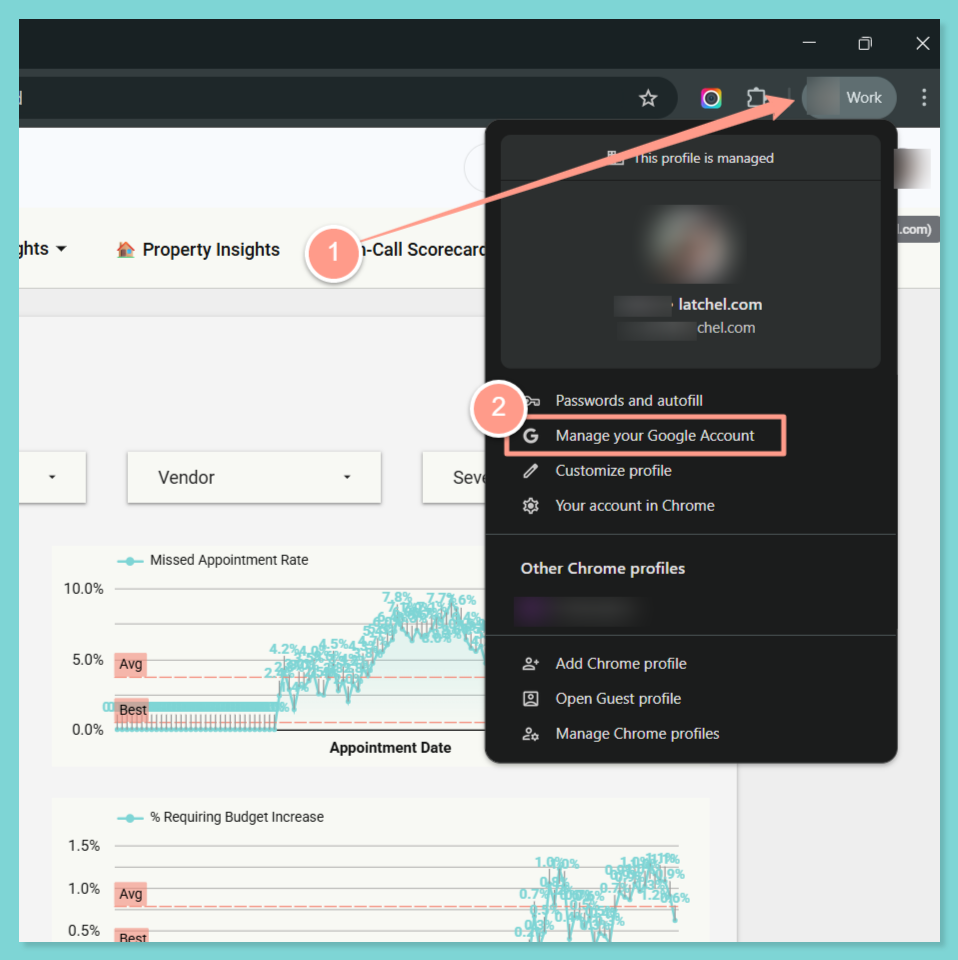
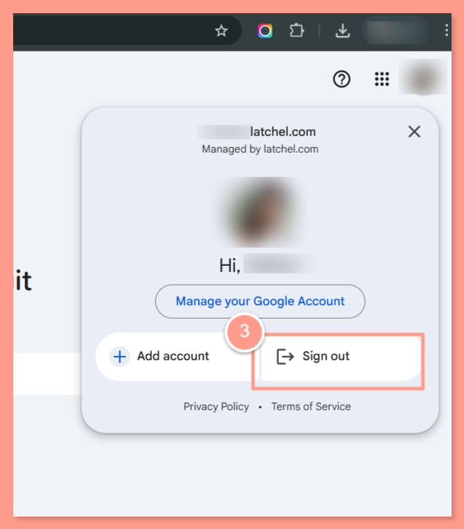

To access Latchel Analytics, your email must be registered with Google (Gmail) using the same email address associated with your Latchel user account. This guide walks you through how to set up your existing email with Google so you can securely log in and access Analytics.

## **Why This Is Required**

Latchel Analytics uses Google authentication to provide a secure and seamless login experience. By registering your existing email with Gmail, you can:

- Access Latchel Analytics without creating a new email address
- Maintain secure login and authentication
- Ensure proper access to your account and data

## **Steps to Register Your Email with Gmail**

<Steps>
  <Step title="**Go to the Google Account Sign In page**" icon="1" iconType="sharp-solid" stepNumber={1} titleSize="p">
    Go to the [Google Account Sign In page](https://accounts.google.com/signin).
  </Step>
  <Step title="**Click Create account**" icon="2" iconType="sharp-solid" stepNumber={2} titleSize="p">
    Click **Create account**. From the drop down, select **For my personal use**.
  </Step>
  <Step title="**Enter your basic info**" icon="3" iconType="sharp-solid" stepNumber={3} titleSize="p">
    Enter your basic info.
  </Step>
  <Step title="**Click Use your existing email**" icon="4" iconType="sharp-solid" stepNumber={4} titleSize="p">
    Click **Use your existing email**.
  </Step>
  <Step title="**Enter your current email address**" icon="5" iconType="sharp-solid" stepNumber={5} titleSize="p">
    Enter your current email address.
  </Step>
  <Step title="**Click Next**" icon="6" iconType="sharp-solid" stepNumber={6} titleSize="p">
    Click **Next**.
  </Step>
  <Step title="**Verify your email address**" icon="7" iconType="sharp-solid" stepNumber={7} titleSize="p">
    Verify your email address with the code sent to your existing email.
  </Step>
  <Step title="**Click Next and finish setup**" icon="8" iconType="sharp-solid" stepNumber={8} titleSize="p">
    Click **Next**. Follow the onscreen instructions to create a password and complete the process.

    Once completed, you can use your registered email to log in to Latchel Analytics through Google authentication.
  </Step>
</Steps>

## **Still Having Trouble Accessing Latchel Analytics After Signing Up?**

If you’re still unable to access Latchel Analytics after registering your email with Google, try the following steps:

<Steps>
  <Step title="**Open Manage Your Google Account**" icon="1" iconType="sharp-solid" stepNumber={1} titleSize="p">
    Log out of your Google account in Chrome. Click your **profile icon** in the top-right corner of Chrome, then click **Manage Your Google Account**.

    <Frame>
      
    </Frame>
  </Step>
  <Step title="**Select Sign Out**" icon="2" iconType="sharp-solid" stepNumber={2} titleSize="p">
    Click your account icon again, then select **Sign Out**.

    <Frame>
      
    </Frame>
  </Step>
  <Step title="**Close your browser**" icon="3" iconType="sharp-solid" stepNumber={3} titleSize="p">
    **Close** your browser completely.
       - Make sure all Chrome windows are fully closed.
  </Step>
  <Step title="**Reopen Google Chrome**" icon="4" iconType="sharp-solid" stepNumber={4} titleSize="p">
    **Reopen** Google Chrome.
  </Step>
  <Step title="**Log back into your Google account**" icon="5" iconType="sharp-solid" stepNumber={5} titleSize="p">
    **Log back** into your Google account.
       - Use the same email you registered for Latchel Analytics.
  </Step>
  <Step title="**Open your Latchel Analytics URL**" icon="6" iconType="sharp-solid" stepNumber={6} titleSize="p">
    **Access your Latchel Analytics** URL again.
       - Try opening your company-specific Analytics link.
  </Step>
</Steps>