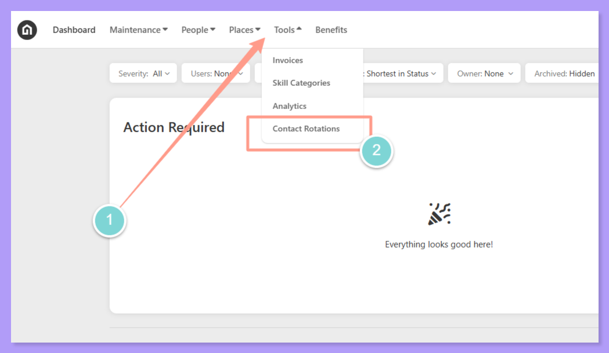
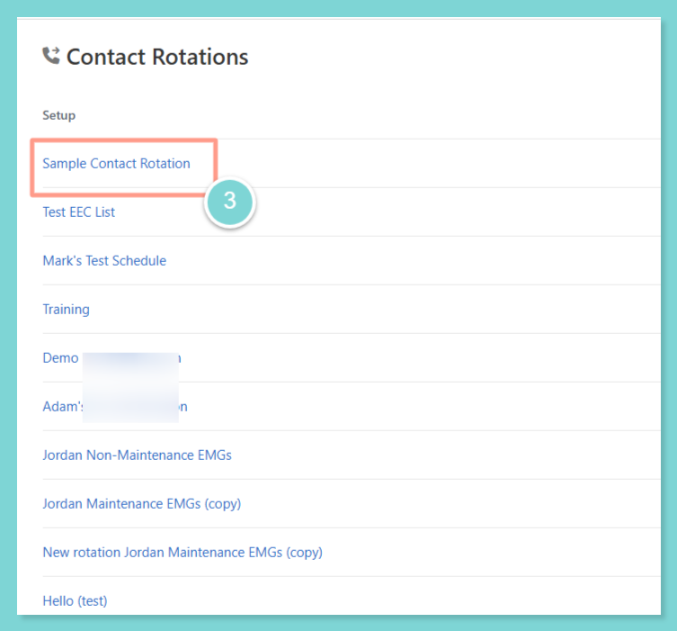
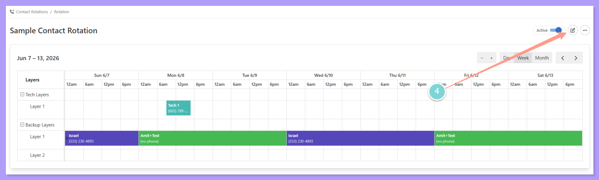
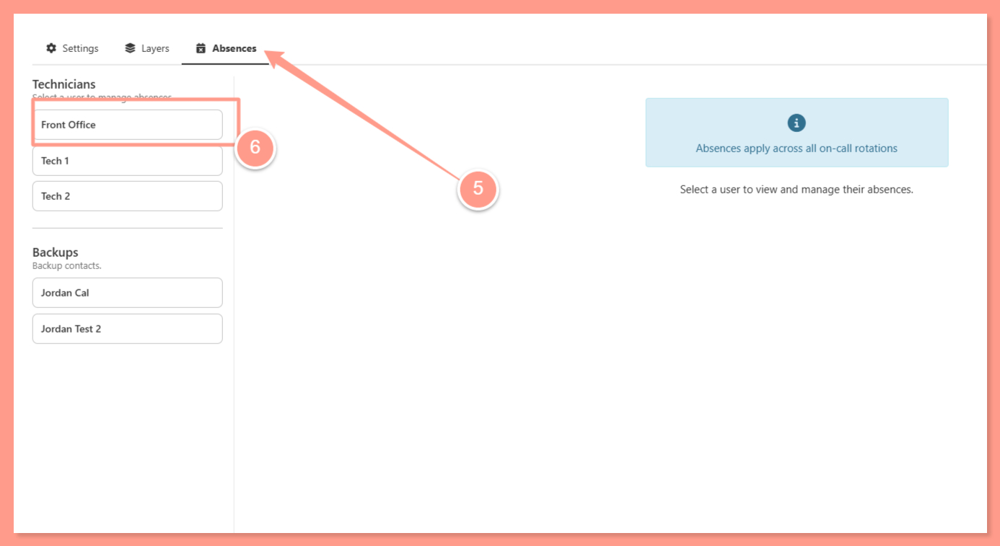
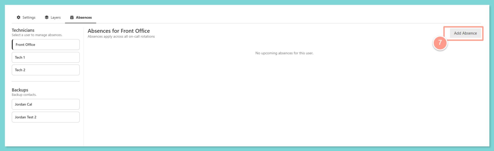
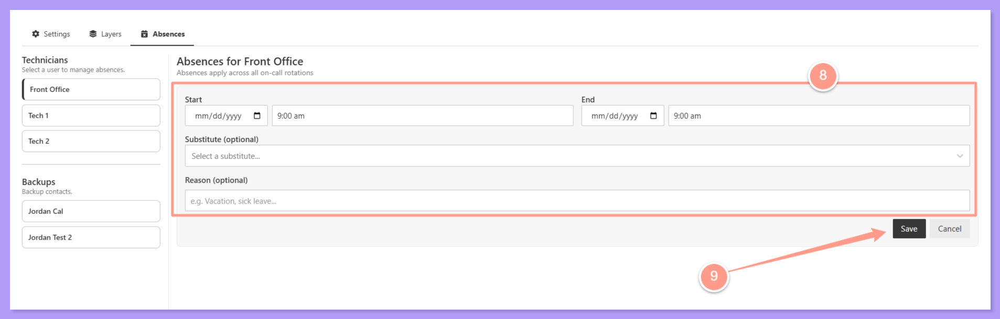

When a technician in an contact rotation is unavailable, an absence should be recorded to keep the rotation running smoothly and avoid missed alerts. Absences can be scheduled in advance or logged as needed, and property managers can manage them anytime.

<Tip>
  **When to scheduled absences?**

  Use for planned time off such as vacations, appointments, or leave. Set this up ahead of time with a known start and end date.
</Tip>

## **Logging a Technician Absence**

Follow the steps below to record an absence for a technician in an contact rotation.

<Steps>
  <Step title="**Open the rotation and click Edit**" icon="1" iconType="sharp-solid" stepNumber={1} titleSize="p">
    Go to the **Contact Rotations** page and **open the rotation** that includes the technician who will be absent. Click **Edit** to access the scheduled rotation.

    <Frame>
      
    </Frame>

    <Frame>
      
    </Frame>

    <Frame>
      
    </Frame>
  </Step>
  <Step title="**Click the technician's name**" icon="2" iconType="sharp-solid" stepNumber={2} titleSize="p">
    **Locate the layer that contains the technician.** Each layer lists the technicians assigned to that escalation tier. Click on the **technician's name** or profile to access their absence settings.

    <Frame>
      
    </Frame>
  </Step>
  <Step title="**Click Add Absence**" icon="3" iconType="sharp-solid" stepNumber={3} titleSize="p">
    Within the technician's profile or layer settings, locate the **Absences** section and click **Add Absence** to open the absence form.

    <Frame>
      
    </Frame>
  </Step>
  <Step title="**Enter the start and end dates**" icon="4" iconType="sharp-solid" stepNumber={4} titleSize="p">
    Enter the **start date and end date** of the absence. Both dates are required — if the end date is unknown for an unplanned absence, enter an estimated date and update it later.

    <Frame>
      
    </Frame>

    <Note>
      Both a start and end date are always required. The system will not save an absence without both fields filled in.
    </Note>
  </Step>
  <Step title="**Select a substitute technician**" icon="5" iconType="sharp-solid" stepNumber={5} titleSize="p">
    Optionally, select a **substitute technician** who will cover the absent technician's spot during the absence period. You can search by name or phone number, and filter the results to service providers only or property managers only, just like when you add someone to a rotation. If no substitute is selected, the rotation will skip this technician and escalate normally to the next layer.

    <Warning>
      The substitute must also be an **in-house technician** for the PM company to appear in the selection list.

      **Leaving this blank is acceptable** — the contact rotation will continue escalating through the remaining layers.
    </Warning>
  </Step>
  <Step title="**Click Save**" icon="6" iconType="sharp-solid" stepNumber={6} titleSize="p">
    Click **Save** to confirm the absence. The technician will be automatically skipped during the absence period, and the substitute (if assigned) will receive alerts in their place.
  </Step>
</Steps>

## **Things to Keep In Mind**

<Columns cols={2}>
  <Column>
    <Card title="Start and end date are always required" color="#b19cf8" icon="1" iconType="duotone">
      Even for unexpected sick days, an end date must be entered. Estimate if needed — it can be updated later.
    </Card>
  </Column>
  <Column>
    <Card title="Substitute is optional" color="#7ed5d5" icon="2" iconType="duotone">
      If left blank, the rotation escalates normally through the remaining layers without the absent technician.
    </Card>
  </Column>
</Columns>

<Columns cols={2}>
  <Column>
    <Card title="Substitutes must be in-house" color="#ff9b8a" icon="3" iconType="duotone">
      Only technicians with the in-house toggle enabled will appear in the substitute selection list.
    </Card>
  </Column>
  <Column>
    <Card title="Property managers manage absences" color="#373737" icon="4" iconType="duotone">
      PMs have full control to add, edit, or remove any technician's absence from the rotation at any time.
    </Card>
  </Column>
</Columns>
