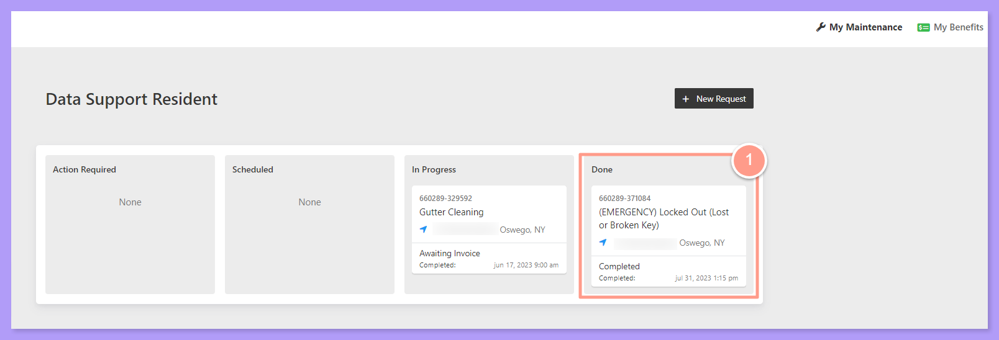
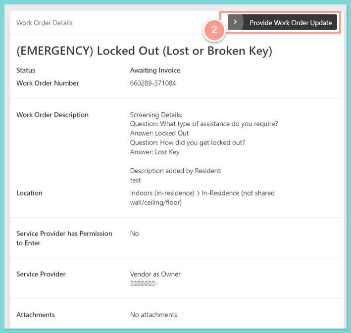
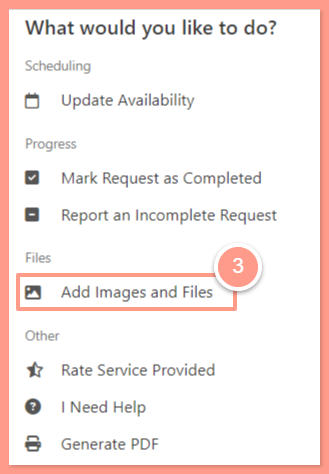
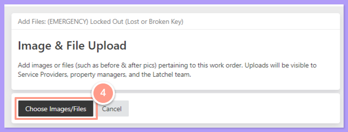
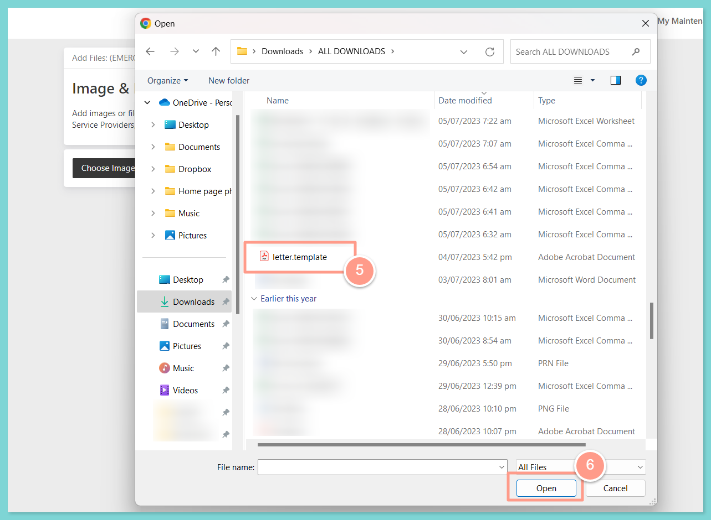
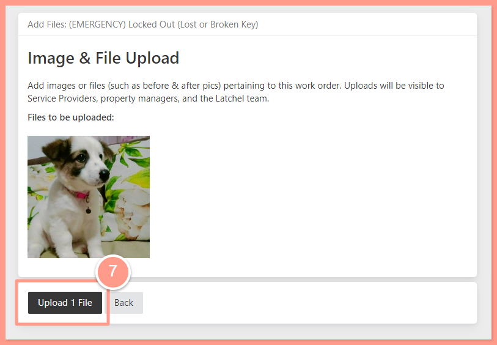
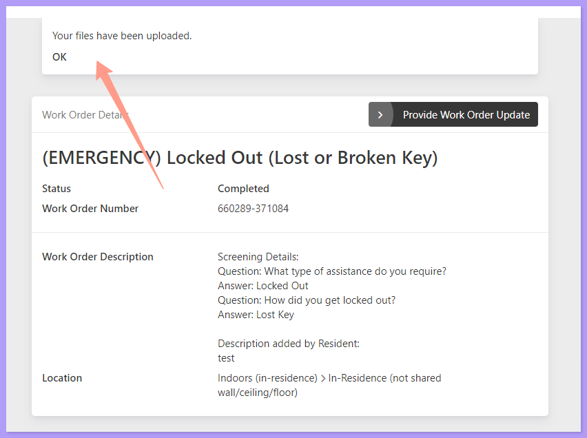

## **How to Add Images and Files to a Work Order**

<Steps>
  <Step title="**Go to your resident dashboard**" icon="1" iconType="sharp-solid" stepNumber={1} titleSize="p">
    First, navigate to your **resident dashboard** by following the steps in the help guide:

    <Card title="Resident Dashboard Overview" icon="chalkboard-user" iconType="duotone" href="/s/topic/0TO5e000000h9wrGAA/Resident-Dashboard-Overview">
      Learn how to access and navigate your Resident Dashboard for the first time with ease.
    </Card>
  </Step>
  <Step title="**Select the work order**" icon="2" iconType="sharp-solid" stepNumber={2} titleSize="p">
    From your dashboard, **select the work order** where you need to add a file.

    <Frame>
      
    </Frame>
  </Step>
  <Step title="**Click Provide Work Order Update**" icon="3" iconType="sharp-solid" stepNumber={3} titleSize="p">
    On the **Work Order Details** page, click **Provide Work Order Update**.

    <Frame>
      
    </Frame>
  </Step>
  <Step title="**Select Add Images and Files**" icon="4" iconType="sharp-solid" stepNumber={4} titleSize="p">
    Then select **Add Images and Files**.

    <Frame>
      
    </Frame>
  </Step>
  <Step title="**Click Choose Images/Files**" icon="5" iconType="sharp-solid" stepNumber={5} titleSize="p">
    Next, click **Choose Images/Files.** Depending on your computer's settings, your drive folders will pop up on your screen.

    <Frame>
      
    </Frame>
  </Step>
  <Step title="**Select the file and click Open**" icon="6" iconType="sharp-solid" stepNumber={6} titleSize="p">
    Afterward, select the **file or image** that you want to upload from your computer to the work order. Click **Open** to upload the file.

    <Frame>
      
    </Frame>
  </Step>
  <Step title="**Click Upload File**" icon="7" iconType="sharp-solid" stepNumber={7} titleSize="p">
    Finally, click **Upload File** to upload the images or files you've selected. A confirmation message at the top of the next page will show that the image/file is uploaded. 

    <Tip>
      You can also add **videos** to a work order at any time except when the work order is completed/cancelled.
    </Tip>

    <Frame>
      
    </Frame>

    <Frame>
      
    </Frame>
  </Step>
</Steps>

And that's it\! Congratulations on uploading your images or files for your work order\!