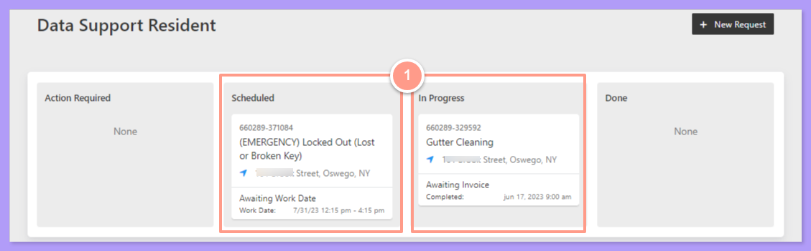
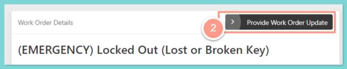
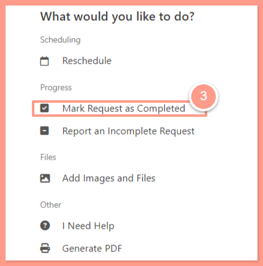
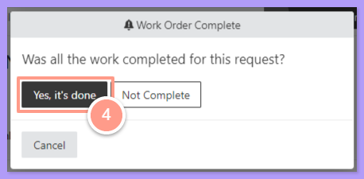
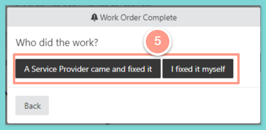
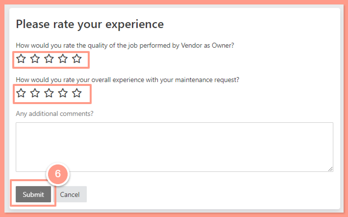

## **How to Confirm a Work Order Is Complete**

<Steps>
  <Step title="**Go to your resident dashboard**" icon="1" iconType="sharp-solid" stepNumber={1} titleSize="p">
    First, navigate to your **resident dashboard** by following the steps in the help guide:

    <Card title="Resident Dashboard Overview" icon="chalkboard-user" iconType="duotone" href="/s/topic/0TO5e000000h9wrGAA/Resident-Dashboard-Overview">
      Learn how to access and navigate your Resident Dashboard for the first time with ease.
    </Card>
  </Step>
  <Step title="**Select the work order**" icon="2" iconType="sharp-solid" stepNumber={2} titleSize="p">
    From your dashboard, **select the work order** you want to complete.

    <Frame>
      
    </Frame>
  </Step>
  <Step title="**Click Provide Work Order Update**" icon="3" iconType="sharp-solid" stepNumber={3} titleSize="p">
    In the work order details page, click **Provide Work Order Update**.

    <Frame>
      
    </Frame>
  </Step>
  <Step title="**Select Mark Request as Completed**" icon="4" iconType="sharp-solid" stepNumber={4} titleSize="p">
    Then select **Mark Request as Completed**.

    <Frame>
      
    </Frame>
  </Step>
  <Step title="**Choose Yes, it's done**" icon="5" iconType="sharp-solid" stepNumber={5} titleSize="p">
    Next, choose **Yes, it's done** if your maintenance request is well taken care of.

    <Frame>
      
    </Frame>
  </Step>
  <Step title="**Confirm who fixed the issue**" icon="6" iconType="sharp-solid" stepNumber={6} titleSize="p">
    Afterwards, confirm if the issue was fixed by a service provider, or by yourself.

    <Frame>
      
    </Frame>
  </Step>
  <Step title="**Rate your experience and submit**" icon="7" iconType="sharp-solid" stepNumber={7} titleSize="p">
    Once confirmed, please rate your experience, or leave any additional comments. Finally, click **Submit**.

    <Frame>
      
    </Frame>
  </Step>
</Steps>