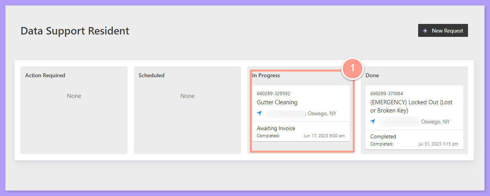
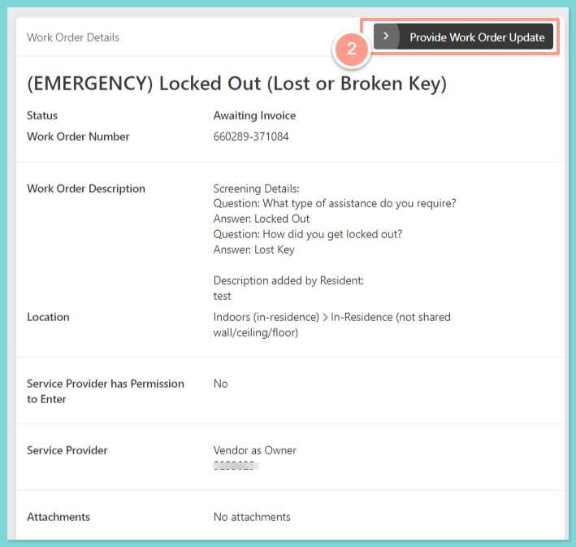
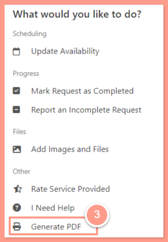

## **How to Generate Work Order Details**

<Steps>
  <Step title="**Go to your resident dashboard**" icon="1" iconType="sharp-solid" stepNumber={1} titleSize="p">
    First, navigate to your **resident dashboard** by following the steps in the help guide:

    <Card title="Resident Dashboard Overview" icon="chalkboard-user" iconType="duotone" href="/s/topic/0TO5e000000h9wrGAA/Resident-Dashboard-Overview">
      Learn how to access and navigate your Resident Dashboard for the first time with ease.
    </Card>
  </Step>
  <Step title="**Select the work order**" icon="2" iconType="sharp-solid" stepNumber={2} titleSize="p">
    From your dashboard, **select the work order** you’d like to generate details for.

    <Frame>
      
    </Frame>
  </Step>
  <Step title="**Click Provide Work Order Update**" icon="3" iconType="sharp-solid" stepNumber={3} titleSize="p">
    Then, on the Work Order Details page, click **Provide Work Order Update**.

    <Frame>
      
    </Frame>
  </Step>
  <Step title="**Select Generate PDF**" icon="4" iconType="sharp-solid" stepNumber={4} titleSize="p">
    Lastly, select **Generate PDF**. Depending on your computer settings, it will either download automatically or ask you to save it on your computer. 

    <Frame>
      
    </Frame>
  </Step>
</Steps>

And there you have it\! You have successfully generated your work order details in pdf\!