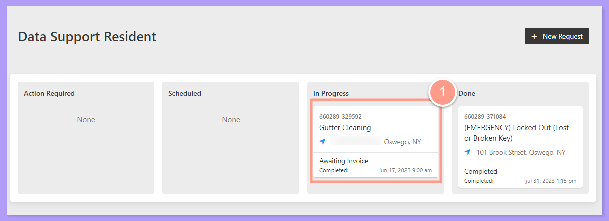
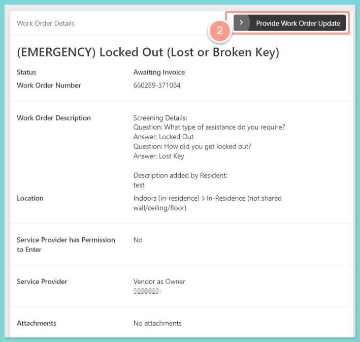
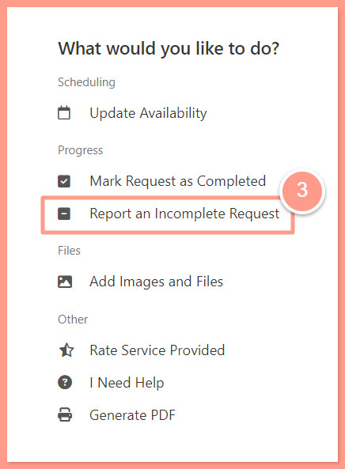
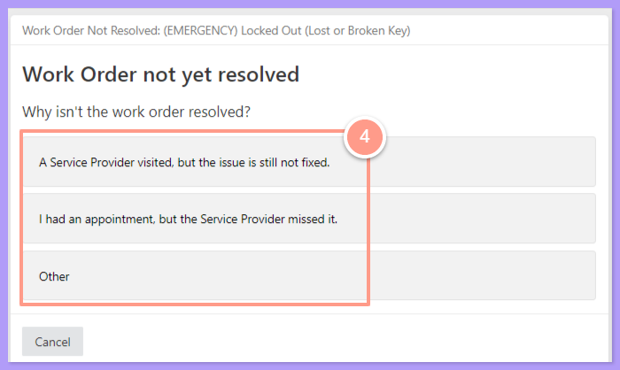
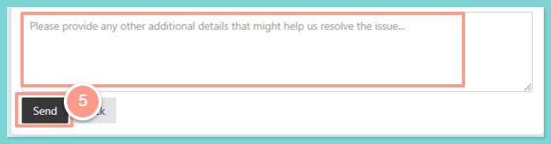

## **How to Report an Incomplete Maintenance Request**

<Steps>
  <Step title="**Go to your resident dashboard**" icon="1" iconType="sharp-solid" stepNumber={1} titleSize="p">
    First, navigate to your **resident dashboard** by following the steps in the help guide:

    <Card title="Resident Dashboard Overview" icon="chalkboard-user" iconType="duotone" href="/s/topic/0TO5e000000h9wrGAA/Resident-Dashboard-Overview">
      Learn how to access and navigate your Resident Dashboard for the first time with ease.
    </Card>
  </Step>
  <Step title="**Select the work order**" icon="2" iconType="sharp-solid" stepNumber={2} titleSize="p">
    From your dashboard, **select the work order** you need to report. 

    <Frame>
      
    </Frame>
  </Step>
  <Step title="**Click Provide Work Order Update**" icon="3" iconType="sharp-solid" stepNumber={3} titleSize="p">
    On the **Work Order Details** page, click **Provide Work Order Update**.

    <Frame>
      
    </Frame>
  </Step>
  <Step title="**Select Report an Incomplete Request**" icon="4" iconType="sharp-solid" stepNumber={4} titleSize="p">
    Next, select **Report an Incomplete Request**.

    <Frame>
      
    </Frame>
  </Step>
  <Step title="**Choose the reason**" icon="5" iconType="sharp-solid" stepNumber={5} titleSize="p">
    Chose the reason why your work order is unresolved.

    <Frame>
      
    </Frame>
  </Step>
  <Step title="**Add details and click Send**" icon="6" iconType="sharp-solid" stepNumber={6} titleSize="p">
    Then provide additional details in line with your concern. Finally, click **Send**.

    <Frame>
      
    </Frame>

    <Note>
      Based on our volume of assistance requests, a Latchel Associate will reach out to you during business hours. In situations like emergencies, our specialized team will reach out to you to confirm your submitted report.
    </Note>
  </Step>
</Steps>