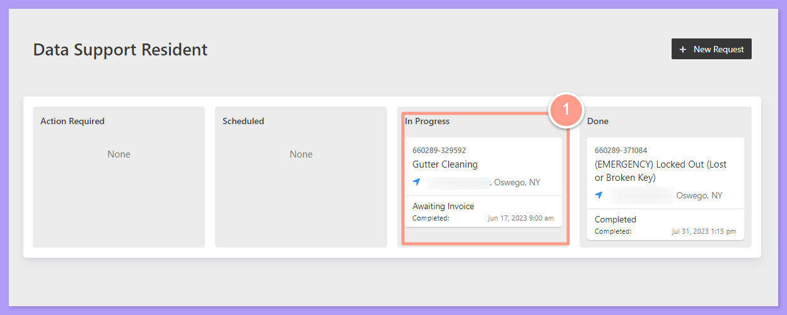
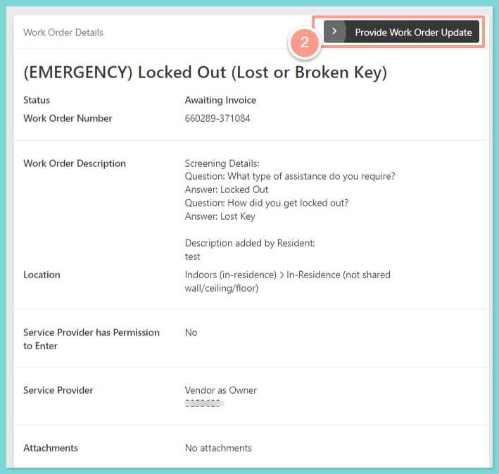
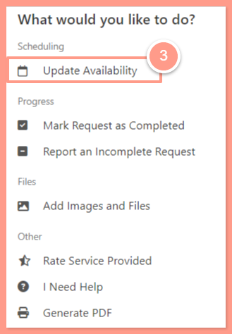
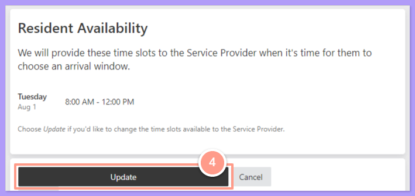
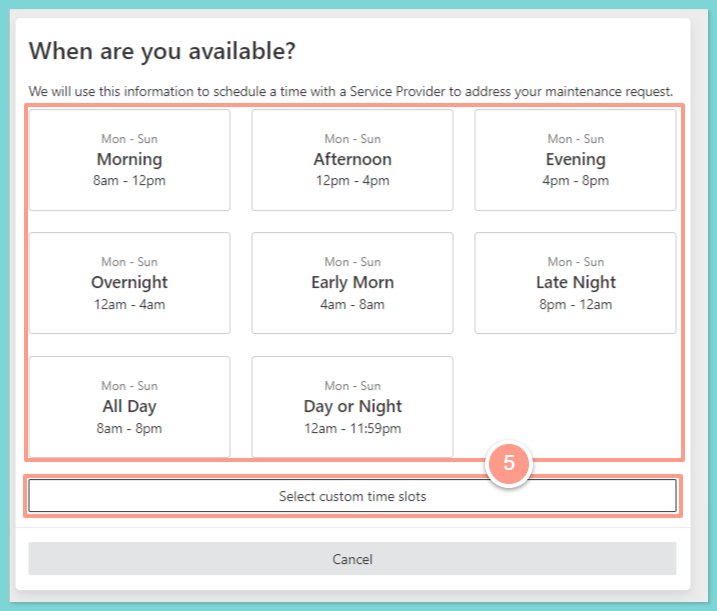
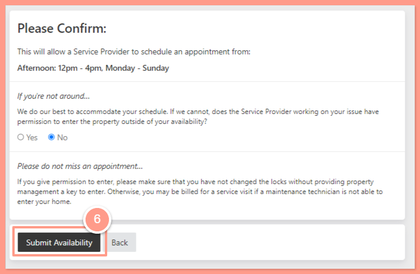

## **How to Update Your Availability**

<Steps>
  <Step title="**Go to your resident dashboard**" icon="1" iconType="sharp-solid" stepNumber={1} titleSize="p">
    First, navigate to your **resident dashboard** by following the steps in the help guide:

    <Card title="Resident Dashboard Overview" icon="chalkboard-user" iconType="duotone" href="/s/topic/0TO5e000000h9wrGAA/Resident-Dashboard-Overview">
      Learn how to access and navigate your Resident Dashboard for the first time with ease.
    </Card>
  </Step>
  <Step title="**Select the work order**" icon="2" iconType="sharp-solid" stepNumber={2} titleSize="p">
    Once logged in, select the **work order** you need to update your availability.

    <Frame>
      
    </Frame>
  </Step>
  <Step title="**Click Provide Work Order Update**" icon="3" iconType="sharp-solid" stepNumber={3} titleSize="p">
    On the **Work Order Details** page, click **Provide Work Order Update**.

    <Frame>
      
    </Frame>
  </Step>
  <Step title="**Select Update Availability**" icon="4" iconType="sharp-solid" stepNumber={4} titleSize="p">
    Then select **Update Availability**.

    <Frame>
      
    </Frame>
  </Step>
  <Step title="**Click Update**" icon="5" iconType="sharp-solid" stepNumber={5} titleSize="p">
    The current slot availability will now be displayed. If you wish to change the current schedule, simply click the **Update** button.

    <Frame>
      
    </Frame>
  </Step>
  <Step title="**Choose a new schedule**" icon="6" iconType="sharp-solid" stepNumber={6} titleSize="p">
    From here **choose a new schedule** or **customize the time slot** that is convenient for you.

    <Frame>
      
    </Frame>
  </Step>
  <Step title="**Click Submit Availability**" icon="7" iconType="sharp-solid" stepNumber={7} titleSize="p">
    Finally, click **Submit Availability**.

    <Frame>
      
    </Frame>

    <Warning>
      The availability you set helps the service provider schedule an arrival time, **but it doesn’t mean the repair will only occur during that exact timeframe.**

      For example, if you list 10:00 AM–2:00 PM as your available time, the service provider may arrive at any point within that window and could continue working past 2:00 PM if the job requires more time.
    </Warning>
  </Step>
</Steps>

And that's it! You've successfully updated your availability in your maintenance request.