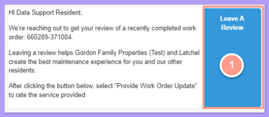
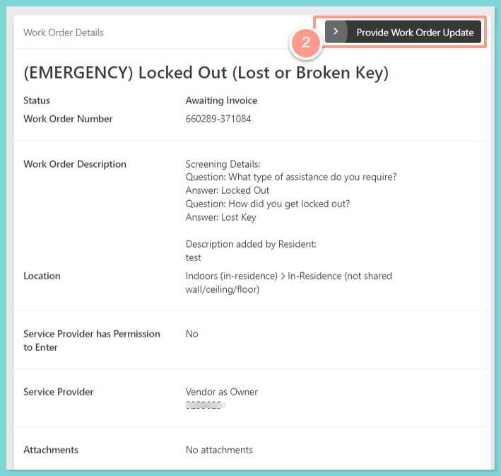
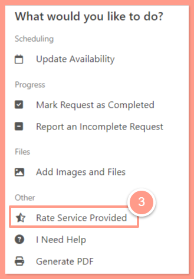
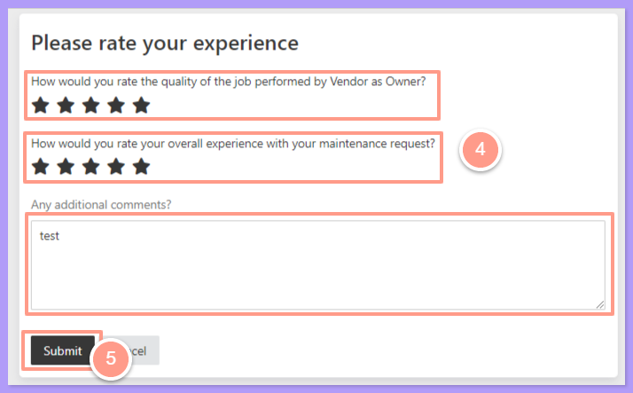

For each completed maintenance request, you'll receive a notification to review your experience. In the email, click **Leave a Review** to be directed to the work order detail page.

## **How to Rate the Service Provided**

<Frame>
  
</Frame>

<Steps>
  <Step title="**Click Provide Work Order Update**" icon="1" iconType="sharp-solid" stepNumber={1} titleSize="p">
    On the work order details page, click **Provide Work Order Update** button.

    <Frame>
      
    </Frame>
  </Step>
  <Step title="**Select Rate Service Provided**" icon="2" iconType="sharp-solid" stepNumber={2} titleSize="p">
    Then select **Rate Service Provided**.

    <Frame>
      
    </Frame>
  </Step>
  <Step title="**Rate and submit**" icon="3" iconType="sharp-solid" stepNumber={3} titleSize="p">
    From here, rate your experience, leave any additional comments based on the work of the service provider, and then hit **Submit**.

    <Frame>
      
    </Frame>
  </Step>
</Steps>

And that's all there is to it\! Your property manager and Latchel greatly appreciate the ratings you've provided.