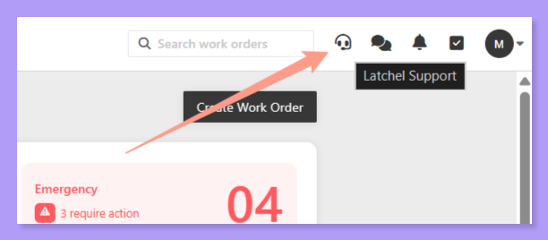
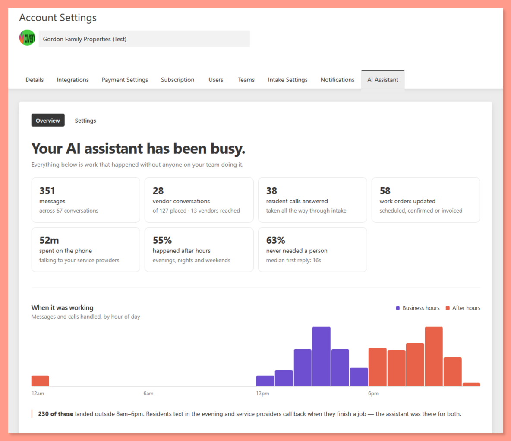
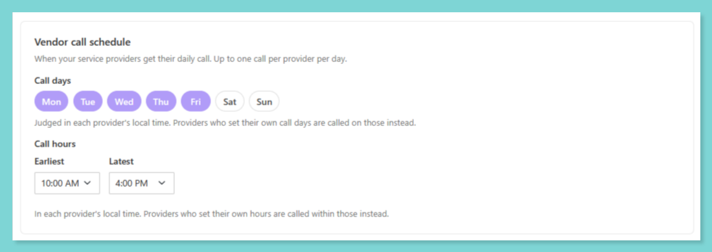
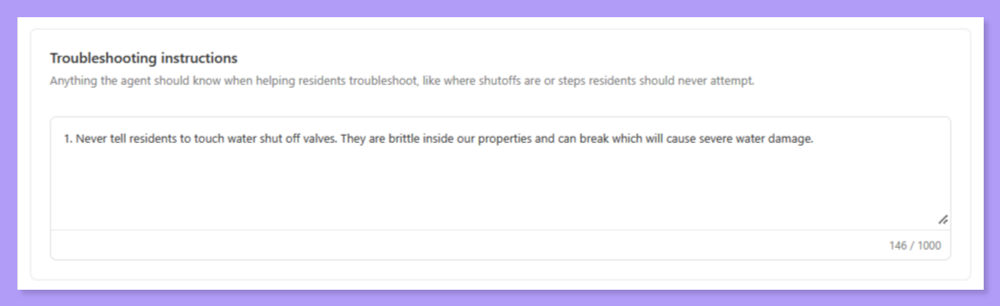

The following are the Latchel updates for the week of November 2, 2026.

<Callout icon="megaphone" iconType="duotone" color="#ff9b8a">
  **Next Live Webinar: From Answering Everything to Working Everywhere**

  Join us **Tuesday, November 10, 2026 at 10:00 am PT / 1:00 pm ET** for our next live webinar session.

  <Columns cols={2}>
    <Column>
      <Card title="Save your seat!" color="#ff9b8a" icon="pen-field" iconType="duotone" horizontal href="https://latchel.com/latchel-everywhere-product-launch/">
      </Card>
    </Column>
    <Column>
    </Column>
  </Columns>
</Callout>

### **New Features**

1. **Conversations Is Live for All Customers — Plus a New AI Assistant Tab**

AI Messaging has finished rolling out, and **Conversations** is now live for all customers! Here's what's new:

- **A new home for your messages:** Next to the bell in the top-right nav you'll find the **Conversations** icon, where every resident and vendor conversation now lives. The old SMS icon is now a **chat-with-support** icon that goes straight to our team.

<Frame>
  
</Frame>

- **The AI Assistant tab:** Want to see what your AI assistant has been doing for you? Go to **Account Settings → AI Assistant**, or click **See everything** from your feed. You'll see messages handled, vendor conversations, time on the phone, and how much happened **after hours vs. business hours**, so you can see what you didn't have to be bothered with.

<Frame>
  
</Frame>

- **Your vendor call schedule:** Also in the **AI Assistant tab → Settings**, choose which days your vendors get automated calls (Tuesdays and Thursdays only, for example) and narrow the call hours (say 10–4 instead of 10–7). Vendors still set their own time windows, and you can see which ones have.

<Frame>
  
</Frame>

<Note>
  AI features are on by default for Autopilot customers as we roll out [Autopilot AI](https://latchel.com/latchel-autopilot-ai-product-launch/). If you'd rather opt out, reach out to [success@latchel.com](mailto:success@latchel.com).
</Note>

<Columns cols={2}>
  <Column>
    <Card title="AI Messaging: How Conversations Work" color="#ff9b8a" icon="messages" iconType="duotone" href="/s/topic/0TO5e000000h9wqGAA/ai-messaging">
      Learn how Latchel's AI handles resident and service provider messages.
    </Card>
  </Column>
  <Column>
    <Card title="AI Assistant Tab" color="#ff9b8a" icon="robot" iconType="duotone" href="/s/topic/0TO5e000000h9wqGAA/ai-assistant-tab">
      See what your AI assistant handled and set your vendor call schedule.
    </Card>
  </Column>
</Columns>

2. **Tell Our AI How You Want Troubleshooting Done (Beta)**

Have a preferred way your residents should troubleshoot a leak, a breaker or a thermostat before a vendor goes out? You can now tell us. The new **Troubleshooting Instructions** field lets you write your company's own guidance in plain language. Our AI then works it naturally into troubleshooting during intake, whether the resident calls in or submits through the web portal.

<Frame>
  
</Frame>

Find it under **Intake Settings → Conversation Settings → Troubleshooting Instructions**. For now it applies across your whole company; portfolio- and property-level instructions are coming soon.

<Card title="Intake Conversation Settings" color="#ff9b8a" icon="sliders" iconType="duotone" href="/s/topic/0TO5e000000h9wqGAA/intake-conversation-settings">
  Customize how Latchel's AI talks with residents during intake.
</Card>

3. **Meet Latchel for Slack**

Does your team talk maintenance in Slack? Now Latchel can join the conversation. With **Latchel for Slack**, you can:

- **Ask about a work order in the thread:** tag @Latchel and get the status, vendor, appointment and resident without repeating the address
- **Turn a conversation into a work order:** "@Latchel create a work order for this" fills in the property, resident and issue from the thread
- **Approve estimates, schedule work and message residents or vendors** without leaving Slack
- **See what needs you:** `/latchel agenda` privately lists the approvals, conversations and tasks waiting on you

Latchel acts with your own login and permissions, and it shows you every change before making it. Nothing happens until you click **Confirm**. Setup takes about two minutes.

<Note>
  Slack commands are included with all Latchel subscriptions. Conversational AI features are available exclusively for Autopilot AI customers.
</Note>

<Columns cols={2}>
  <Column>
    <Card title="Add Latchel to Slack" color="#ff9b8a" icon="slack" iconType="brands" horizontal href="https://bot.latchel.com/slack/install">
    </Card>
  </Column>
  <Column>
  </Column>
</Columns>

<Tip>
  **Use Google Chat or Microsoft Teams instead?** We're looking for beta testers! Reach out to [success@latchel.com](mailto:success@latchel.com) if you'd like early access.
</Tip>

4. **Techs Can Now Call Residents Without Sharing Their Number**

Once a technician accepts an on-call alert or work order, they'll see a new **Call Resident** button. Tap it, confirm, and Latchel calls the tech first, then connects them straight to the resident.

- **Numbers stay private:** the resident sees your Latchel-assigned number, the same one they already use for maintenance. The tech's own phone number is no longer shown to the resident.
- **Two-party consent:** all parties are aware calls are being recorded at all times.
- **Everything is documented:** each call is logged and all calls are recorded. Transcriptions and automatic work order updates based on the call are coming soon.

<Note>
  The button stays available for 72 hours after the alert is accepted.
</Note>

5. **White Label by Community**

Do you manage communities with their own brand? You can now turn on **White Label** for a portfolio. Residents will then see the community's name, logo and colors instead of your company's or Latchel's on their dashboard, maintenance request forms, on-call screens and on-call notifications.

Check more about this cool feature by visiting the help article below:

<Card title="How to White Label Your Resident Experience by Portfolio" color="#ff9b8a" icon="palette" iconType="duotone" href="/s/topic/0TO5e000000h9wqGAA/how-to-white-label-your-resident-experience-by-portfolio">
  Show residents your community’s name instead of your company or Latchel branding, one portfolio at a time.
</Card>

<Tip>
  Questions about setup? Reach out to [success@latchel.com](mailto:success@latchel.com).
</Tip>

6. **Your Call History, Now in the Public API**

You can now pull the calls received on your Latchel-assigned phone number through the **Public API**, up to a month at a time. For each call you'll see when it came in, how long it lasted, whether it connected, the caller's number, and the matching resident when there is one. It's handy for reporting on how many calls Latchel handled for you, and when.

<Card title="API Docs" color="#ff9b8a" icon="code" iconType="duotone" href="/s/topic/0TO5e000000h9wqGAA/API-Docs">
  Explore the Latchel Public API.
</Card>

7. **Now Live: Get Bids From New Service Providers With Thumbtack**

Remember our Thumbtack announcement from September? It took a little longer than planned to launch, but it's **officially live**! When you're short on service providers in an area, you can now find local pros on **Thumbtack** without leaving Latchel:

- **Suggested when you need it:** if your auto-queue comes up empty, we'll suggest looking for a pro on Thumbtack. You can also start a search any time from **Other Actions** on a work order that doesn't have a service provider assigned yet.
- **Real quotes, not just names:** answer a few quick questions about the job (we'll pre-fill what we can), then message one or more nearby pros for quotes from the new **Thumbtack** tab on the work order.
- **Grow your network as you go:** liked how a pro handled the job? Add them as a preferred service provider so they're easy to bring back next time.

<Card title="How to Get Bids From New Service Providers with Thumbtack" color="#FF9B8A" icon="handshake" iconType="duotone" href="/s/topic/0TO5e000000h9wqGAA/how-to-get-bids-from-new-service-providers-with-thumbtack">
  Find new local pros on Thumbtack and get qoutes right from a work order.
</Card>

### **Resolved Bugs**

1. **Fewer Unnecessary Escalations From AI Messaging**

<Warning>
  **What was happening:**

  In the first days of Conversations, some resident messages escalated to property managers when they didn't need to be. Behind the scenes, an extra safety check was flagging far more messages than it should have.
</Warning>

<Check>
  **What's fixed:**

  AI Messaging now only escalates to you when a request is outside its scope, or when someone asks for a person on a work order you manage. Messages that were escalated by mistake have been de-escalated.
</Check>

<Accordion title="Shoutout!" defaultOpen iconType="duotone">
  <Icon icon="party-horn" iconType="sharp-duotone-solid" color="#ff9b8a" size={35} /> Shoutout to **Real Property Management Colorado** for flagging it!
</Accordion>

2. **Attach Photos and Files Anytime in Conversations**

<Warning>
  **What was happening:**

  Residents could only attach photos when the chat asked for them. Property managers couldn't attach files in the new messaging view at all.
</Warning>

<Check>
  **What's fixed:**

  Look for the paperclip. Residents, property managers and our team can now attach photos and files at any point in a conversation.
</Check>

<Accordion title="Shoutout!" defaultOpen iconType="duotone">
  <Icon icon="party-horn" iconType="sharp-duotone-solid" color="#ff9b8a" size={35} /> Shoutout to **Rental Zebra** for the request!
</Accordion>

3. **Non-Emergency Work Orders Route Correctly for Emergency-Only Plans**

<Warning>
  **What was happening:**

  For some customers on emergency-only coverage, non-emergency work orders were landing in **Needs PM Approval** instead of being forwarded to you. That also meant some expected new work order emails didn't arrive.
</Warning>

<Check>
  **What's fixed:**

  Non-emergency work orders are forwarded to you again, as they should be, and any changes you make to a work order right after creating it are still respected.
</Check>

4. **Automated Calls Now Reach Vendors With U.S. Territory Phone Numbers**

<Warning>
  **What was happening:**

  Vendors whose phone numbers are in Puerto Rico, the U.S. Virgin Islands, Guam, the Northern Mariana Islands or American Samoa weren't getting automated vendor calls.
</Warning>

<Check>
  **What's fixed:**

  These numbers are now handled correctly, so these vendors get automated calls just like everyone else.
</Check>

5. **Daily Vendor Reminders Now Focus on Current Work**

<Warning>
  **What was happening:**

  With AI Messaging, vendors get a daily text asking about their most pressing work order. For vendors with older jobs that were never closed out, that text could point to a work order from months, or even a year, ago. If the vendor replied, our AI sometimes couldn't find the job it had just asked about.
</Warning>

<Check>
  **What's fixed:**

  Daily reminders, text replies and AI chats now all work from the same list: open work orders with activity in the last 30 days. Vendors hear about the jobs that matter now, and the AI always knows which job they mean.
</Check>

<Tip>
  Have older work orders that never got closed out? Now's a good time to complete or cancel them so your open list stays accurate. Connect Claude or ChatGPT to your Latchel account with the Latchel MCP to bulk update old work orders.

  Follow help guide below to learn how you can setup the Latchel MCP!

  <Card title="Latchel MCP for AI Assistants" color="#FF9B8A" icon="bahai" iconType="duotone" href="/s/topic/0TO5e000000h9wqGAA/latchel-mcp-ai-assistants">
    Learn how to connect and use Latchel's Model Context Protocol (MCP) to enable AI assistants to interact with your Latchel account.
  </Card>
</Tip>

### **Key Ops Process Changes**

1. **Finding the Source of Leaks From Neighboring Units**

When water comes from the unit above, below or next door, the fastest fix is reaching whoever can shut it off.

**What's changing:**

- When a resident reports a leak from a neighboring unit, our team now asks which unit it's coming from
- If that unit is in your portfolio, we call that resident once and ask them to check for a leak and turn off the water, then continue troubleshooting or dispatching
- If we can't identify or reach the neighboring unit, we escalate to you with a clear request for the information we need

<Check>
  **What this means for you:**

  - Fewer leak escalations that you have to sort out yourself
  - No added action required from you

  **Why this matters:**

  - Stopping the water sooner means less damage
  - Neither resident's details are ever shared with the other
</Check>

2. **A Clear Plan When Flooding Can't Be Stopped**

**What's changing:** If water can't be stopped (for example, the shutoff valve is broken) and no plumber is available, our team will advise the resident to call 911 so emergency services can help stop the water.

<Check>
  **What this means for you:**

  We'll escalate to you right away, as we do with every 911 situation, so you know what's happening and what to do next.

  **Why this matters:**

  Uncontrolled water is one of the fastest ways a maintenance issue becomes major property damage. This makes sure the water gets stopped even when no plumber can respond.
</Check>

### **Special Announcements**

1. **Live Webinar: From Answering Everything to Working Everywhere**

Latchel already answers every resident call, text and message. Now we’re bringing Latchel to wherever you work. Join co-founders **Will Gordon** and **Ethan Lieber** on **Tuesday, November 10 at 10:00 am PT / 1:00 pm ET** for a live look at what’s new:

- **The new Latchel App** for iOS and Android
- **Latchel for Slack and Microsoft Teams**
- **The upgraded Latchel MCP**, which connects your AI tools to Latchel and your other systems
- **A first look at private conversations** that update work orders for you
- Live Q&A, plus how to get early access

<Callout icon="gift" iconType="duotone" color="#ff9b8a">
  **Bonus!**

  Register for a chance to win a **free month of Autopilot AI**! You’ll get extra entries for attending live and for every colleague you refer, and two winners will be picked. Can’t make it? Register anyway, and we’ll email you the recording.

  <Columns cols={2}>
    <Column>
      <Card title="Save Your Seat!" color="#ff9b8a" icon="file-signature" iconType="duotone" horizontal href="https://latchel.com/latchel-everywhere-product-launch/">
      </Card>
    </Column>
    <Column>
    </Column>
  </Columns>
</Callout>

2. **Save These Numbers So Your Team Never Misses an Emergency**

When a technician or vendor misses an emergency alert, the cause is almost always their phone. Blocked numbers, spam filters, Do Not Disturb, and apps like Google Voice can quietly filter out automated calls and texts.

Make sure your team and your vendors save these numbers as contacts:

- Your Latchel-assigned number: work order updates, messages and replies. It’s the same number your residents call for maintenance.
- 206-900-9466: emergency job offers
- 978-848-4371: Latchel On-Call alerts, if your team uses On-Call

Check the article below to learn more about your Latchel-assigned number!

<Card title="How to View Your Latchel-Assigned Phone Number" color="#ff9b8a" icon="headphones" iconType="duotone" href="/s/topic/0TO5e000000h9wqGAA/How-to-view-your-Latchel-Assigned-Phone-Number">
  Learn where to find the phone number assigned to your Latchel Account.
</Card>

### **What Should Latchel Build Next? You Decide.**

We're locking our **2027 priorities** soon, and this is your chance to influence what we build next. It takes less than **60 seconds** — and every response goes straight to the product and leadership teams.

<Columns cols={2}>
  <Column>
    <Card title="Submit your feedback here!" color="#ff9b8a" icon="message-pen" iconType="duotone" horizontal href="https://forms.gle/AbUoieefga3azLmH7">
    </Card>
  </Column>
  <Column>
  </Column>
</Columns>

Your input directly shapes which features ship, improve, or get deprioritized — this is where ideas turn into action.

### **Interested in learning more about Latchel's products? Book a meeting with us.**

<Columns cols={2}>
  <Column>
    <Card title="Get a Demo" color="#ff9b8a" icon="comments-question-check" iconType="duotone" horizontal href="https://latchel.com/demo-request-releases/">
    </Card>
  </Column>
</Columns>
